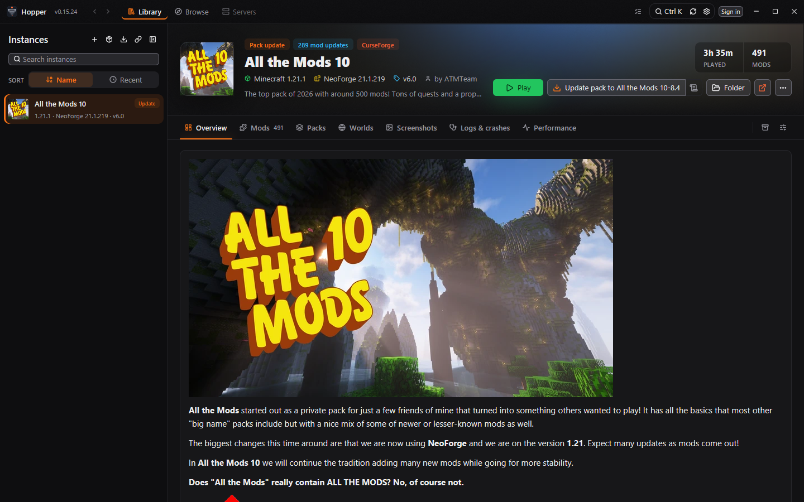
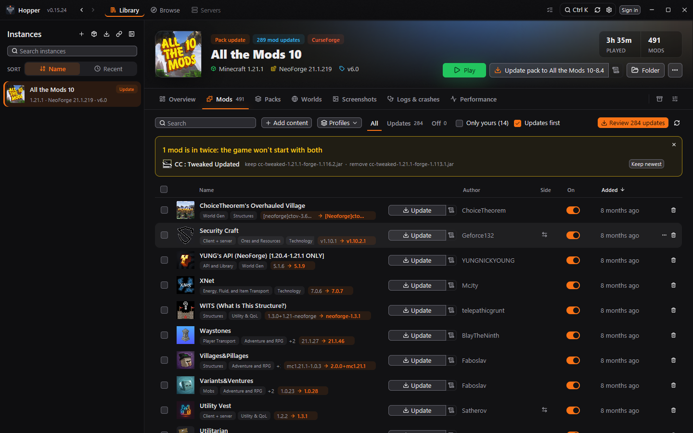
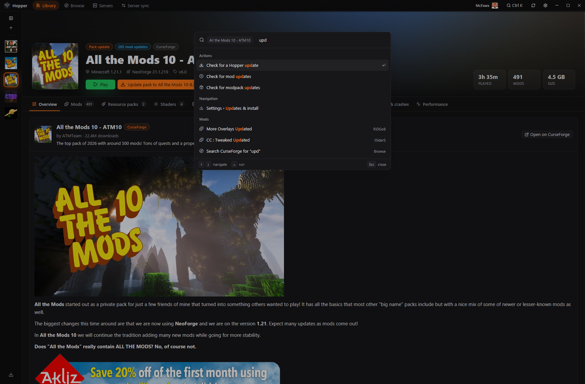
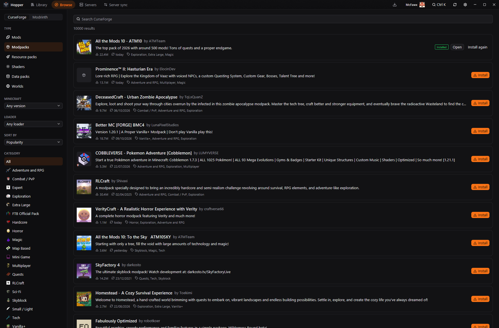
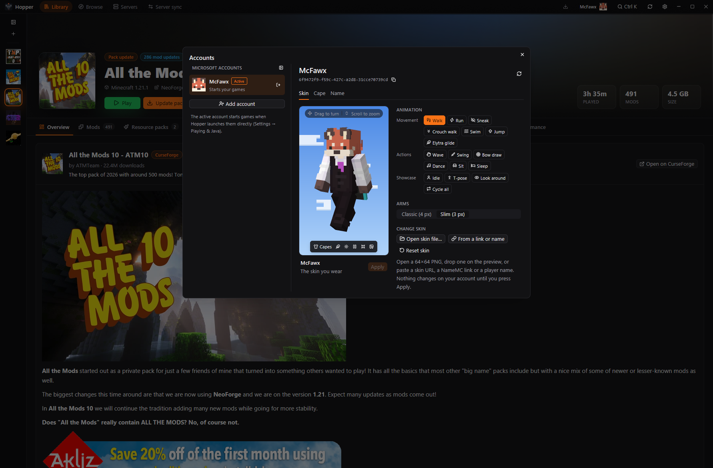
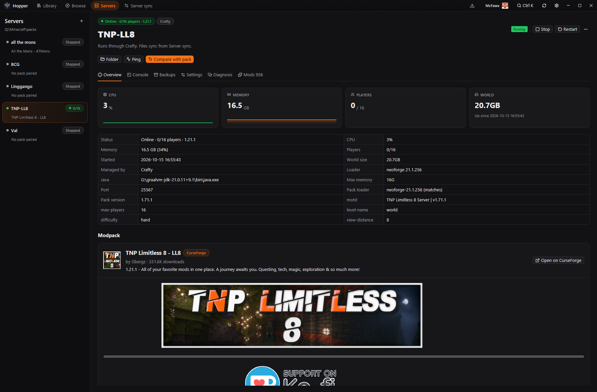
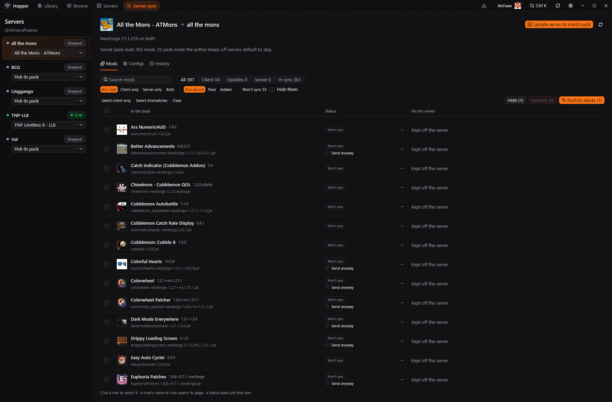
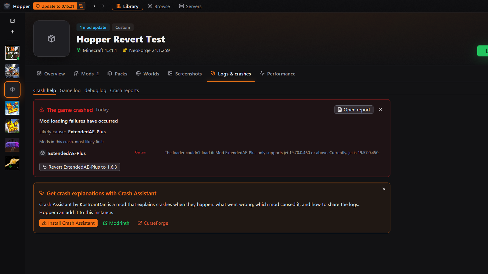

# Hopper

A fast, native Minecraft modpack and server manager for Windows, in Rust on
[GPUI](https://www.gpui.rs/). It replaces the CurseForge app for playing
packs, and keeps your Minecraft servers in step with them.

**[Website](https://watdafawx.github.io/hopper/)** · **[Download hopper.exe](https://github.com/watdafawx/hopper/releases/latest/download/hopper.exe)** · [All releases](https://github.com/watdafawx/hopper/releases)



## Why Hopper

Hopper started as a tool just for me. The CurseForge app was painfully slow, and everyday things took far too many clicks. To see what a mod update changes, you open the mod's page, go to Files, find the newest version and click its changelog icon, one mod at a time. A pack you've added your own mods to won't update until you turn off "Allow content management". And nothing kept my server's mods in line with the pack. So I wrote my own: in Hopper, every changelog since your version is one click from the mod list, and packs update with your own mods kept. Every feature since came from something I needed while playing and running servers, and it grew from there.

### Built with AI help

In the open: most of Hopper's code is written with help from AI, Anthropic's Claude through [Claude Code](https://claude.com/claude-code). I decide what goes in, review the changes and test them in the app before each release. From v0.8.0 on, commits Claude helped with carry a `Co-Authored-By: Claude` line, so the [history](https://github.com/watdafawx/hopper/commits/main) shows which ones (earlier history was folded into one fresh start).

## What it does

- **Library**: your instances, with a pack-art header and an Overview of playtime, mods, worlds and recent screenshots. Play, update packs (with a preview that merges your config changes into the new version), manage mods, resource packs, shaders, worlds and screenshots, read logs and crashes.
- **Performance**: each run is recorded (FPS, 1% lows and frame times from Windows' present events, CPU, RAM, GPU, GC pauses and peak heap from Java's GC log, load time), and runs are compared side by side per Java argument preset. Nothing is injected into the game. FPS needs admin or the Performance Log Users group.
- **Other launchers**: manage Modrinth App, Prism / MultiMC, ATLauncher, GDLauncher and FTB App instances where they are, without copying them. CurseForge's folder is read in place too.
- **Browse**: CurseForge and Modrinth: install mods and modpacks, with dependencies.
- **Servers**: each server's loader, Java and mods, plus a diagnosis. With a server panel (Crafty Controller 4, MCSS, Pterodactyl / Pelican) you can start, stop, restart or kill it, see CPU, memory and players, use its console and its backups, through the panel's API. See [Server panels](#server-panels) for what each one supports.
- **Hosting**: run servers on your own PC: from a pack's official server pack or the instance's mods, with Java picked or downloaded for you, a server.properties editor, JVM presets, daily restarts with warnings and crash recovery. A backup mod's backups (SimpleBackups, FTB Backups, Advanced Backups…) are listed and restorable.
- **Server sync**: compare a server with its pack and push or pull mods and configs, with backups and undo.
- **Logs & crashes**: the game's live log, debug.log and crash reports, with search, an errors-only filter and mclo.gs sharing. Crash help checks the pack for [Crash Assistant](https://modrinth.com/mod/crash-assistant), KostromDan's mod that explains crashes in game, and installs it in one click.
- **Accounts**: several Microsoft accounts; change your skin (upload, URL, recent skins), cape and name.
- **Ctrl+K**: jump to any instance, tab, server or mod, or run an action.
- **Ctrl+,**: Settings, with a search over every setting (Ctrl+F there too).
- **Peers**: sync an instance with a friend's PC on your network.
- **Themes**: 19 themes, dark and light, plus your own theme files.

## Screenshots

| | |
|---|---|
|  |  |
| Mods, with updates shown old → new | Ctrl+K: jump anywhere or run an action |
|  |  |
| Browse CurseForge and Modrinth | Accounts: skin, cape and name |
|  |  |
| A running server through its panel | Server sync: a server against its pack |
|  | |
| Logs & crashes, with Crash help | |

## Install

Download `hopper.exe` from the [latest release](https://github.com/watdafawx/hopper/releases/latest).

Run `hopper.exe`, then use **Settings → Updates & install → Install**. That copies Hopper
into your apps with Start menu and desktop shortcuts, with no admin rights
needed. Uninstall it from Windows Settings → Apps.

**Update source** in Settings → Updates & install takes a GitHub repository (`owner/name`).
Hopper checks its latest release at start and updates itself from it.

## Setup

- **CurseForge API key**: see [Why you need a CurseForge key](#why-you-need-a-curseforge-key). The setup wizard on first start walks you through it.
- **Folders**: Settings → Library & folders points at your instances (CurseForge's `Instances` folder works) and Mojang's launcher; Settings → Servers at the folder your servers live in (see [Your servers](#your-servers)). Folders save as you leave the field, and the library refreshes.
- **Other launchers**: Settings → Other launchers lists the ones found on this PC; switch each on to see its instances in your Library. "Add a launcher folder…" covers a portable MultiMC or a moved instances folder.
- **Server panel** (optional): Settings → Servers takes the panel's address (e.g. `https://myserver:8443`) and an API key. For Crafty: your user → API Keys, with the Commands permission. Servers match by folder name, game port or name.
- **Playing without the launcher** (optional): needs `MS_CLIENT_ID` in `.env`, an Azure app id approved for the Minecraft API.

## Why you need a CurseForge key

CurseForge requires every app to use an API key for searching, installing and checking for updates (the files themselves come from CurseForge's download servers). Launchers like Prism ship one key for all their users; Hopper doesn't, so each person uses their own:

1. Sign in at [console.curseforge.com](https://console.curseforge.com/) (free).
2. Open **API keys** and copy yours.
3. Paste it in Hopper's setup wizard, or Settings → CurseForge & Modrinth, and press Test.

The key stays on your PC, in Windows Credential Manager, and only your copy of Hopper uses it. Without one, Modrinth still works: browse and install from there with no key at all.

### Files you download in your browser

Some mod authors only allow downloads from the CurseForge website, for every app. When a pack or a mod needs one of those, Hopper shows **N files to download in your browser** with **Open pages**. Download them as usual: Hopper watches your Downloads folder, checks each file against CurseForge's checksum, puts it in the instance (even when the browser renamed it to `name (1).jar`), and deletes it from Downloads.

## Your servers

Hopper works with servers wherever their files can be reached as a folder:

- **On this PC**: use **Host a server on this PC…** on an instance (or **+** on the Servers page). Hopper downloads the pack's server files and runs them itself, with start/stop, console, scheduled restarts and backups. Nothing else to set up.
- **On another PC in your home**: share the folder that holds your server folders (right-click → Properties → Sharing), then on this PC either map it to a drive letter or use the `\\PC-NAME\share` path. Put that path in Settings → Servers → Server packs, and the PC's name in Server host (for status pings). Server sync then compares and copies files directly. If a panel such as Crafty, MCSS or Pterodactyl runs the servers, add it in Settings → Servers for start/stop, console and backups.
- **At a host or on a VPS** (no shared folder): Hopper can't copy files there yet. Get the server files with the instance's **⋯ → Download server pack…** (when the pack publishes one), upload them with your host's file manager or SFTP, and if the host runs Pterodactyl, add it as the Server panel to control the server from Hopper.

## Server panels

Hopper drives servers through their panel's own API, with an API key you make in the panel. The panel keeps running the servers; Hopper is the remote control. Set it up in Settings → Servers.

| | Crafty Controller 4 | MCSS | Pterodactyl / Pelican | Hosted by Hopper |
|---|---|---|---|---|
| Start, stop, restart, kill | Yes | Yes | Yes | Yes |
| CPU and memory | Yes | Yes | Yes | Yes |
| Players online | Names and count | Count | No | Names and count |
| World size | Yes | No | No | No |
| Read the console | Yes | Yes | No (open it in the panel) | Yes |
| Send console commands | Yes | Yes | Yes | Yes |
| Backups: list, run, restore | Yes | No (use MCSS) | No (use the panel) | A backup mod's backups |
| Launch command follows NeoForge updates | Yes | No | No | Yes (Hopper runs it) |
| Server sync (copy mods and configs) | If the folder is shared | If the folder is shared | No (files live in its volumes) | Yes |

Limits:
- One panel at a time: Settings → Servers takes one address and key.
- Crafty: the API key needs the Commands permission (your user → API Keys). Tick "self-signed" for Crafty's own certificate.
- MCSS: doesn't report ports, so servers pair by folder or name. Key from Web Panel → API keys.
- Pterodactyl: needs a client key (`ptlc_…`, Account → API Credentials). Its console is a websocket Hopper doesn't read yet; commands still work.
- Server sync needs the server's files as a folder: this PC, or a share on another PC at home. No SFTP or FTP yet.
- Servers hosted by Hopper run while Hopper does. Quitting stops them, saving the world first.

## Build

Rust 1.98 (see `rust-toolchain.toml`).

```powershell
cargo run --bin hopper                # debug build
.\scripts\release.ps1                 # dist\hopper.exe and a zip for a GitHub release
.\scripts\release.ps1 -EmbedKey       # same, with CF_API_KEY from .env built in
cargo test                            # library tests
```

Dev builds optimize dependencies, so GPUI runs at full speed. Only Hopper's
own code stays unoptimized.

### Layout

- `src/*.rs` is the library: CurseForge and Modrinth, instances, other launchers, installs, pack diffs, servers, hosting, server sync, peers, server panels, logs, accounts and self-update.
- `src/gpui/` is the app.
- `docs/` is the website ([watdafawx.github.io/hopper](https://watdafawx.github.io/hopper/)), served by GitHub Pages from `main`. Screenshots live in `docs/screenshots/`; retake them with `hopper --mcp` (see below).

## Hack on it

Hopper is plain Rust (no web stack), MIT licensed, and meant to be changed. Forks and pull requests are welcome: fix a bug, add a server panel or a launcher, or take it somewhere new.

- `cargo run --bin hopper` builds and runs it. Dependencies are optimized even in dev builds, so it runs at full speed while you work.
- A new server panel is one file implementing the `ServerPanel` trait (see `src/panel/mcss.rs` for a small one).
- Themes are JSON files: Settings → Appearance opens the folder, the refresh button loads them. No rebuild needed.
- `hopper --mcp` lets scripts and AI agents screenshot and drive the app, which helps when testing a change.
- Run `cargo test --lib` before sending a PR.

## Scripting and testing

`hopper --mcp` serves [MCP](https://modelcontextprotocol.io/) on
`http://127.0.0.1:47801/mcp`. An agent can screenshot the window, read its
state, navigate, click, hover, scroll and type, all without desktop control.

Dev arguments for scripted runs:
- `--page browse|servers|sync|settings`
- `--instance <name>` and `--tab <tab>`
- `--search <text>`
- `--server <name>`
- `--theme "<name>"`, which applies for that run only
- `--dialog new|export|versions|update|side`

## Releasing

Bump `version` in Cargo.toml, commit, then tag and push:

```powershell
git tag v0.4.0
git push origin v0.4.0
```

The Release workflow builds `hopper.exe` and a zip and attaches them to the
GitHub release; installed copies offer the update at their next start.
Public builds never include a CurseForge key.
