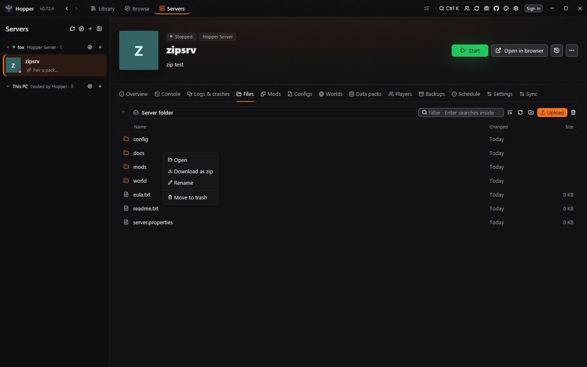
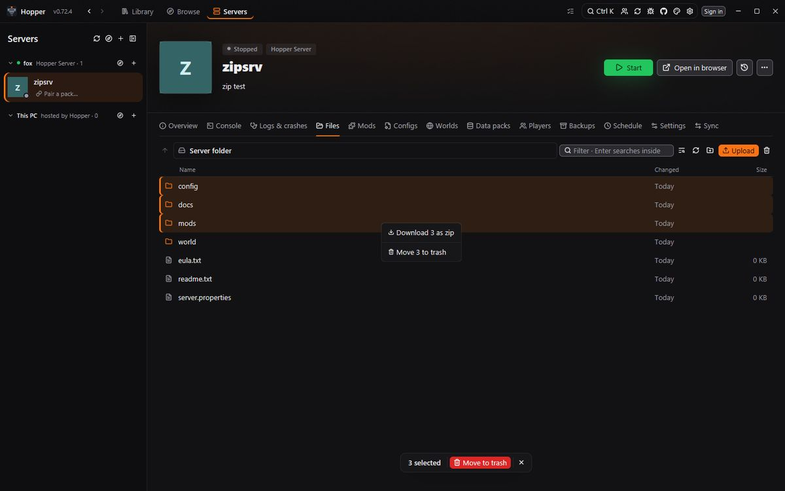
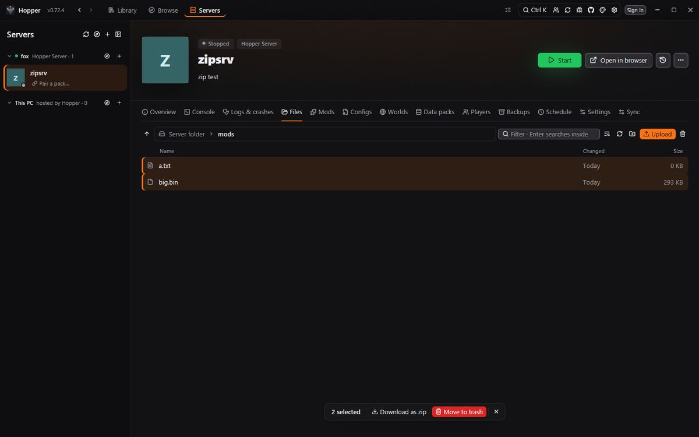

# Server Files tab: download a folder or several files as one zip

**Branch:** t3/0022a3cf   **Commit:** 33e3880   **Size:** S/M
**Apps:** desktop only. Hopper Server's web UI already had "Download as zip"; this brings the desktop Files tab level with it.

## From -> to
- Before: in the desktop Files tab, "Download" was greyed out on a folder, and picking several rows only offered "Move N to trash".
- After: a folder row has "Download as zip" (save dialog suggests `<folder>.zip`). Several picked rows get "Download N as zip" in their right-click menu (separator before the trash item) and "Download as zip" in the floating "N selected" bar. A file row still says "Download".
- Suggested name for a selection: the open folder's name, or the server's name at the top of the server (the web UI's default too).
- Shows as a job in Tasks ("Downloading <name>"), then the note "Saved <name> to <path>", like a file download.

## Screenshots (no "before": the old build was not to hand)
| State | Before | After |
|---|---|---|
| Folder row menu | no before | after-menu-folder.png |
| Multi-select menu (3 rows) | no before | after-menu-multi.png (zoom: zoom-menu-multi.png) |
| Bulk bar, 2 files picked in a subfolder | no before | after-bar-multi.png (zoom: zoom-bar.png) |

The native Save As dialog is not in the card: it shows the maintainer's Downloads folder.

## Measurements
| Claim | State measured (Hopper Dark, 1440x900, 100%) | Numbers | Result |
|---|---|---|---|
| Folder menu text not clipped / balanced | folder row menu, "Download as zip" widest item | content gaps L 13 / R 14 px, T 12 / B 14 | ok (<= 1 px horizontal) |
| Multi-select menu fits its text | "Download 3 as zip" | menu content gaps L 1 / R 1 px (fills the box edge to edge) | ok, no clipping |
| Bulk bar centred under the list | list 292..1418 px, bar with the new button | bar gaps L 391 / R 391 px | ok (0 px) |
| Bar width with the new button | 2 selected | bar 344 px wide, one row, text on one line | ok |
NOT measured: light theme, other zoom levels, narrow window, long folder names in the bar. The bulk bar's vertical gap and the menu's vertical content fit were not claimed (the measure box was not tight).

## Files
- `src/gpui/panel_tabs/files.rs`: folder/group menu items, bar button, `download_zip`, `start_zip`, `zip_name`.

## How tested
- Tests: `cargo-test-changed.ps1`: hopper bin 87 passed; hopperd 314 passed, 1 failed = `ui::tests::built_page_has_no_inline_script_or_style` (expected: no `ui/dist` in the worktree). No new unit test: the zip route and the on-PC zip (`LocalApi::save`) already have tests (`local_api.rs` zip tests); this change is wiring.
- On screen: test build (`--mcp`, scratch data, loopback) paired to a scratch Hopper Server (portable, scratch `--data`, `HOPPERD_SERVICE=hopperd-test`) with a throwaway server `zipsrv` (config/, docs/sub/, mods/, world/region, a few files incl. 300 KB random). Saved through the real Save As dialog:
  - folder `docs` -> `docs.zip` (name suggested by the dialog): entries `docs/sub/deep.txt`, `docs/top.txt`: same list, same bytes as the source.
  - 3 rows (config, docs, mods) at the top -> dialog suggested `zipsrv.zip`: 6 files, same list and bytes as the source (compared with a script, incl. the random 300 KB file).
  - 2 files in `mods/` via the bulk bar -> dialog suggested `mods.zip`: `a.txt`, `big.bin`, same list and bytes.
  - a stray `world` zip and a `config` zip also saved while I was learning to drive the dialog; they came out right (world: level.dat + region file).
- NOT checked: a server "on this PC" (the on-PC path is `LocalApi::save`, covered by its unit tests, but I did not click it); nodes behind a panel (same HTTP route as a panel server, not clicked); cancelling the dialog; a failing download (note shows the error through the same `note` path as file download); very large folders.
- Test data: scratch only. Test zips were saved into the Windows Downloads folder (the dialog's start folder), then moved to the scratch folder. The test pairing's token was removed from Credential Manager. Test exes stopped.

## Notes for the maintainer
- Target kinds: the Files tab's target is a `PanelApi`: a Hopper Server over HTTP (covers panel servers and nodes reached through a panel) or a server folder on this PC (`LocalApi`). Both answer `/fs/{id}/zip?path=..`; `PanelApi::save` handles both, so one call covers both. The Files tab exists for three kinds (`servers.rs` `tabs_for`): a Hopper Server's server (remote), a server hosted by Hopper on this PC, and a plain server folder on this PC. SFTP/FTP "server files" sites have no Files tab, so they are out of scope. Crafty/MCSS servers are listed as plain folders or by their panel; I did not check those by hand.
- The on-PC zip keeps `session.lock` out and does not apply the secret-file hiding that Hopper Server does for non-admin roles (it's the user's own PC).
- Files keep their old "Download" wording and flow.

## Images on the changelog page
- 
- 
- 
