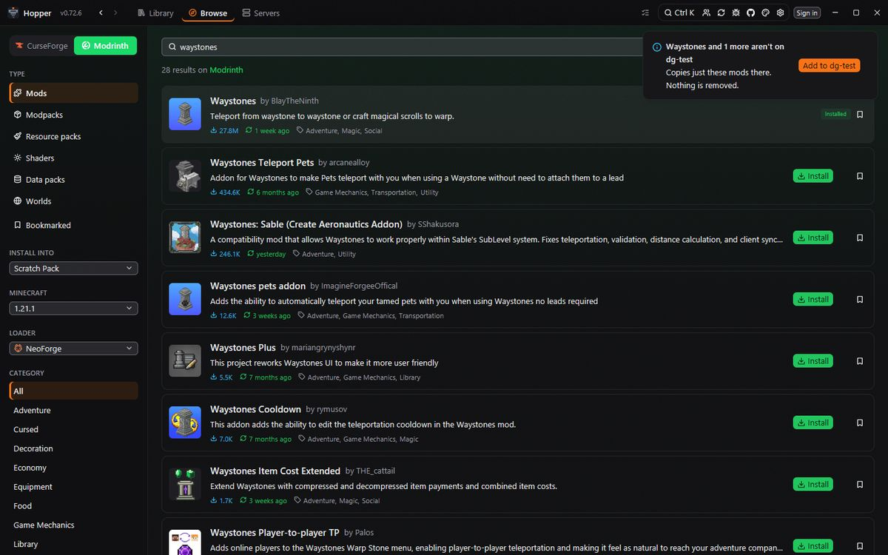
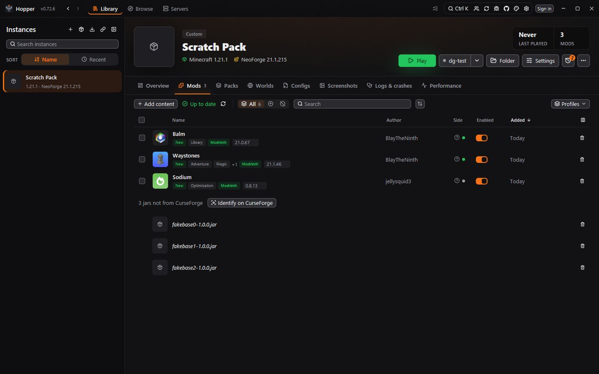

# Adding a mod to a paired instance offers to put it on the server too

**Branch:** t3/28441e5a   **Commit:** e24153d   **Size:** M
**Apps:** desktop only. Hopper Server's web UI adds mods straight to a server and has no instance <-> server pairing (its "paired" means paired desktops), so the gap doesn't exist there.

## From -> to
- Before: adding a mod (and its dependencies) to an instance paired with a server only wrote into the instance; the server got it on "Update server", Server sync or an auto pack update. The only hints were the instance page's banner ("dg has other mods than this pack") and an orange dot in the Mods tab's Side column, so a mod could stay missing for days.
- After: right after the install, each paired server that lacks any just-added mod a sync would copy gets a notice that stays until answered: "Waystones and 1 more aren't on dg-test" with **Add to dg-test**. It copies just those mods (no removals) as a task, recorded in the server's History. Client-only, flagged, turned-off and Never-sync mods give no notice.

Mock (3 options, picked A): https://claude.ai/artifact/92EP4N8dhKWrTe9JNCPxdo and `design/mocks/add-to-server.html`.

## Screenshots (every state)
| State | After |
|---|---|
| Client-only mod (Sodium) installed: no notice | after-client-only.png |
| Waystones (+ required Balm) installed: offer, Waystones named first | after-offer.png |
| Mods tab meanwhile: existing banner + orange Side dots | after-mods-tab.png |
| Side card (unchanged, already says "Not on the server · on dg-test") | after-side-card.png |
| After "Add to dg-test": banner gone, dots green, History badge 2 | after-added.png |
No "before" shot: before, the same screens just had no notice (after-mods-tab.png minus the top-right card).

## Measurements (Hopper Dark, 1440x900, longest case "Waystones and 1 more aren't on dg-test")
| Claim | State | Numbers | Result |
|---|---|---|---|
| Notice fits the window | after-offer.png | card x 1043..1422 of 1440 (18 px to the edge), y 51..160 | ok |
| Text doesn't run under the button | after-offer.png | text right edge 1270, button left 1295: 24 px gap | ok |
| Body text readable | sampled | rgb(237,237,239) on rgb(23,23,26): 15.3:1 | ok (>= 4.5) |
| Button label readable | sampled | rgb(28,13,2) on rgb(249,115,22): 6.76:1 | ok |
| Button label centred | zoom-button.png | L 4 / R 4 px; T 3 / B 1 px (the "g" descender sits low; stock gpui-kit button, unchanged) | horizontal ok |
Not measured: light theme, a running server's wording ("dg is running: restart it after adding to load them"), more than one paired server.

## Files
- `crates/hopper-core/src/rigsync.rs`: `to_offer` + test
- `src/gpui/store/server_offer.rs`: new; Before snapshot, compare, add job
- `src/gpui/store.rs`: Msg::Added / ServerOffer, event, field
- `src/gpui/app.rs`: the notice with "Add to <server>"
- `browse.rs`, `addons_extra.rs`, `crash_help.rs`, `logs.rs`, `mcp_data.rs`, `source_dialog.rs`: installs report new jars

## How tested
- Tests: `rigsync::tests::to_offer_keeps_just_added_mods_the_server_needs` pass; hopper-core 1366 pass, hopper 87 pass, hopperd 314 pass + 1 expected fail (`built_page_has_no_inline_script_or_style`, no ui/dist in the worktree).
- On screen (test build, port 47836, scratch HOPPER_DATA_DIR, loopback): Browse (Modrinth) → Sodium into "Scratch Pack": no notice. Waystones: Balm came along, notice appeared; Mods tab showed both "Not on the server"; clicked Add to dg-test → both jars in the scratch server's mods folder, Sodium not; History has 2 "Copied" entries (side server).
- NOT checked: a server on a Hopper Server (remote path goes through `run_on_report`, same as Server sync; the scratch server was a local folder under `servers_root`, not a scratch hopperd), a running server, two paired servers, the "offer not taken folds into the next" path, light theme.
- Test data: scratch root in the session scratchpad (fake jars + throwaway server folder); test exe killed.

## Notes for the maintainer
- Installs that don't go through these paths (dropping jar files into the folder, pack updates, group sync) don't offer; pack updates already have `auto_update_servers`.
- The existing pre-join banner and Side dots already showed the gap on the instance page; the notice is the part that reaches the player where they add the mod.

## Images on the changelog page
- 
- 
