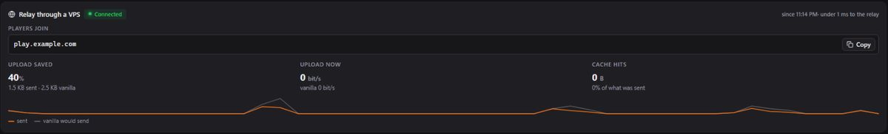
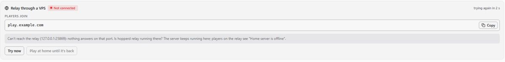

# Relay through a VPS: the tunnel works, and the server's Overview shows it

**Branch:** t3/vps-relay-b2-tunnel   **Commit:** fa7968f   **Size:** L (phase B2 of design/vps-relay.md)
**Apps:** Hopper Server only. Desktop shows a remote server's Overview too (`src/gpui/server_control.rs`); the same card there is B8.

## From -> to
- Before: no relay; a server at home without an open port couldn't be joined from outside.
- After: `hopperd relay` on a VPS takes players and carries them over one compressed TLS connection that the home panel dials out; the home router answers for the server (wake-on-join intact). The server's Overview shows a "Relay through a VPS" card.

## Screenshots (every state, both themes; scratch panel, real browser)
| State | After |
|---|---|
| Connected, Hopper Dark | up-dark.png |
| Connected, Hopper Light | up-light.png |
| Not connected (relay killed), Hopper Dark | down-dark.png |
| Not connected, Hopper Light | down-light.png |
| Whole Overview page, dark | overview-dark.jpg |
| Copy button crop | copy-btn-zoom.png |
No before: the card is new.

## Measurements
| Claim | State measured | Numbers | Result |
|---|---|---|---|
| Card content even on all sides | dark, up, 1732 px wide main column | gaps L 15 / R 15 / B 15 px (14 padding + 1 border) | ok |
| Three stats same width, no wrapping | dark, up | 561 / 561 / 561 px, gap 10; every line scrollWidth <= clientWidth | ok |
| Address on one line | dark | text box 18.8 px tall (one line) | ok |
| Copy button label centred | up-dark.png, measure_shot.py | L 8 / R 8 / T 5 / B 5 px | ok |
| Muted text readable | dark / light | 5.89:1 / 5.74:1 | ok (>= 4.5) |
| Values readable | light | 16.1:1 | ok |
| Down note readable | dark / light | 5.94:1 / 5.03:1 | ok |
| Legend readable | light | was 3.24:1 (orange text) -> now muted text + colour swatch, 5.74:1 | fixed |
| Status pill | dark / light | green 3.96 (dark, down: red) / 2.4 (light, green), 3.51 (light, red) | FAILS 4.5; shared `.pill.running` / `.pill.crashed` in app.css, same as the header status pill; not changed here |
Not measured: narrow window (< 520 px, stats go to 2 columns by CSS), other themes than Hopper Dark/Light.

## Files
- `crates/hopperd/src/vps/relay_end.rs`: `hopperd relay` VPS end
- `crates/hopperd/src/vps/home.rs`: home client, counters, API routes
- `crates/hopperd/src/vps/link.rs`: key check + codec agreement
- `crates/hopperd/src/vps/wire.rs`: mux frames through codec + TLS
- `crates/hopperd/src/vps/mod.rs`, `tests.rs`: heads, pipe, 14 tests
- `crates/hopperd/src/router.rs`, `limbo.rs`: router entry for tagged streams, generic socket
- `crates/hopperd/src/tunnel/dial.rs`: pinned TLS config with own ALPN
- `crates/hopperd/src/main.rs`, `api.rs`: subcommand, App field, routes
- `crates/hopperd/ui/src/RelayCard.svelte`, `ServerPage.svelte`: the card
- `design/vps-relay.md`: "B2 as built", deviations, manual pairing

## How tested
- Tests: `cargo test -p hopperd` 329 passed, 0 failed (14 new in `vps::tests`: half-close, 100 streams echo, backpressure, dead connection, wrong key, nothing read before key, rate limit, fingerprint pin, relay offline answers, router tagging, whole path + reconnect).
- On screen: two scratch hopperds on loopback (relay 25869/25870, home 8797), throwaway vanilla 1.20.4 server. Real server list ping through 25870: version 1.20.4, motd "B2 relay test server", pong ok, 1.0-1.5 ms. Offline-mode login through the relay reached the server (its log shows the bot's connection). Killed the relay: card went red "Not connected", the error in plain words; restarted it: home reconnected by itself within ~1 s.
- NOT checked: a real Minecraft client joining (scripted login only), Try now click (the reconnect came first), real recordings for codec defaults, any VPS.
- Test data: scratch folder in the session scratchpad; real `%APPDATA%\hopperd` untouched (last write 2026-10-30).

## Notes for the maintainer
- No Velocity yet: raw TCP to the router; the server sees relayed players as 127.0.0.1 until PROXY v2 (B4/B5).
- "Play at home until it's back" is a disabled stub until B4.
- Status pill contrast below 4.5:1 app-wide (shared style); worth its own fix.
- Desktop card: B8.

## Images on the changelog page
- 
- 
