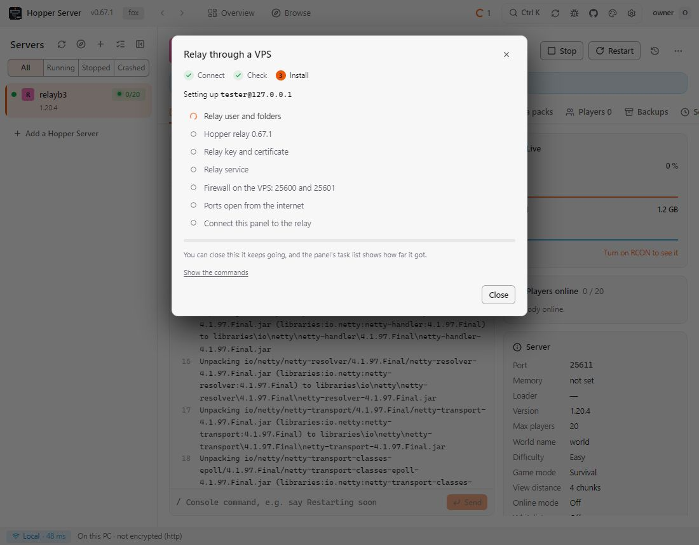
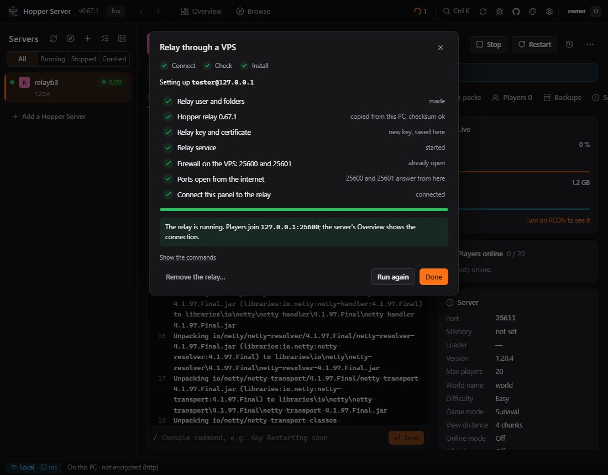
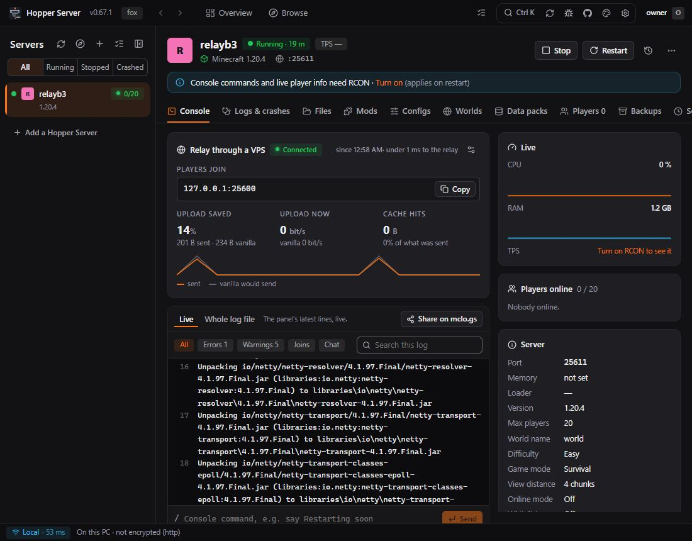

# Relay through a VPS: set up the VPS from the panel

**Branch:** t3/vps-relay-b3-setup   **Commit:** bd2bb52   **Size:** L (phase B3)
**Apps:** Hopper Server only. Desktop is B8 (see design/vps-relay.md "B3 as built", Desktop parity).

## From -> to
- Before: pairing a VPS relay meant running `hopperd relay init` on the VPS and pasting its key into an API call.
- After: the server page's More menu (or the relay card's setup button) opens "Relay through a VPS": connect over ssh, check the VPS, install, and the card shows Connected. Running it again repairs; Remove takes everything out.

## Screenshots (every state, light + dark unless noted)
No "before": the dialog is new.

| State | Files |
|---|---|
| Connect (saved key / key file) | after-1-connect-dark/light |
| Connect with password | after-1b-connect-password-dark/light |
| Connect: VPS not reachable / login refused | after-1c-connect-refused-dark, after-1d-connect-refused-login-dark |
| Connect: new key to paste | after-1e-connect-newkey-dark/light |
| Check with a failing check (port busy) | after-2b-check-fail-dark/light |
| Check ok | after-2-check-ok-dark/light (dark one shows "Remove the relay…" at Check) |
| Install in progress | after-3-install-progress-dark/light |
| Done / done with a warning (iptables not saved) | after-4-done-dark/light, after-4-done-warn-dark/light |
| Relay card Connected | after-5-card-connected-dark/light |
| Repair (Run again, nothing changed) | after-6-repair-done-dark/light, after-6-repair-progress-light (finished too fast, shows done), after-7-repair-ufw-dark |
| Remove confirm / progress / done | after-8-remove-confirm-dark/light, after-9-remove-progress-dark, after-9-remove-done-dark/light, after-9-remove-from-check-dark |
| Measuring shots | meas-*.png |

## Measurements
| Claim | State measured | Numbers | Result |
|---|---|---|---|
| Dialog width / top same as other dialogs | dark, 1100x860 | 560 px wide, top 56 px (= `--dialog-top`) | ok |
| Status marks centred in their circle | 18 px circles, dark and light | gaps L/R 4/3, T/B 6/5 (dark); 4/3, 5/5 (light) | ok (<= 1 px) |
| Stepper numbers centred | 16 px circles, incl. "on" in light | 4/4, 5/5; meas-zoom-stepper-on-light | ok |
| Seg at field height | connect form | inputs 34.84 px, seg 34.00 px | ok (< 1 px) |
| Labels line up | connect form | all labels x = 289 | ok |
| Text readable | sampled pixels, WCAG | detail text 6.41 dark / 5.89 light; warn detail 7.58 / 5.89; good note 13.03 / 14.80; fail row 15.30 / 16.55; wait row light 5.89 | ok (>= 4.5) |
| Check tick icon | green on its tint | 6.69 dark / **2.75 light** | below 3:1 in light; same colours as AddPanel's ticks; text beside it carries the meaning. Not changed here. |
| Nothing clipped | every step row; 420 px wide window | detail overflow 0 on every row; no horizontal scroll at 420 px; "Host key" label 15.94 px tall = one line | ok |
| Card header on one line | relay card with setup button | h3 26 px tall | ok |

Not measured: zoom levels other than 100 %, Windows high contrast.

## Files
- `crates/hopperd/src/vps/setup/mod.rs`: steps, jobs, routes, login file
- `crates/hopperd/src/vps/setup/plan.rs`: fixed commands, pure checks, unit
- `crates/hopperd/src/vps/setup/ssh.rs`: russh client, host key pin
- `crates/hopperd/src/vps/setup/tests.rs`: 14 unit tests
- `crates/hopperd/src/vps/relay_end.rs`: `relay init --key-stdin`, `relay status`
- `crates/hopper-core/src/applog.rs`: redact `hrt_` keys and private keys
- `crates/hopperd/ui/src/VpsRelaySetup.svelte`: the dialog
- `RelayCard.svelte`, `ServerPage.svelte`: entry points
- `main.rs`, `api.rs`, `vps/mod.rs`, `cross_origin_tests.rs`: wiring
- `design/vps-relay.md`: "B3 as built"

## How tested
- Tests: `cargo test -p hopperd` 343 passed, 3 ignored (vps:: 28); `cargo test -p hopper-core --lib` 1382 passed, 60 ignored.
- On screen (scratch panel, Playwright Chromium, WSL test VPS `hopper-vps-test` from clean.tar, everything bound to 127.0.0.1):
  - Fresh install: all steps ok; `hopper-relay` user; service active + enabled, runs as hopper-relay; listens 127.0.0.1:25600/25601 only; /opt/hopper-relay root 755, installed.json 600; /var/lib/hopper-relay 700, files 600.
  - Card Connected; server list ping through the relay 127.0.0.1:25600 returns the scratch server's MOTD (125 ms; 10 ms direct).
  - Run again: "Nothing changed" (0 changes).
  - ufw: allowed ssh first, enabled ufw, ssh still answered; repair added 2 rules commented hopper-relay; Remove took those 2 out, ssh rule kept.
  - iptables: box's own REJECT for the ports; install put ACCEPTs above it and warned they're not saved; ping ok; Remove took the ACCEPTs out, kept the REJECT, removed the key it had added with the password.
  - Remove (from done and from Check): no user, unit, files, rules or listeners left.
- NOT checked: the release download path (no release has `relay init --key-stdin` yet); Ubuntu 22.04 / Debian (only Ubuntu 24.04); aarch64; a real cloud firewall; nftables-only boxes.
- Test data: scratch panel and server in the session scratchpad; test box reset from clean.tar at the end.

## Notes for the maintainer
- The release Linux binary (built on Ubuntu 24.04) may need a newer glibc than 22.04 / Debian 12 have. The install step fails with a clear message. A musl build would fix it.
- iptables rules aren't kept over a reboot without netfilter-persistent (warned in the dialog).
- Light theme green tick 2.75:1 is shared with AddPanel; worth one fix in app.css for both.
- B4: Velocity + Java + PCF + server-side changes with History; B6 voice port.

## Images on the changelog page
- 
- 
- 
