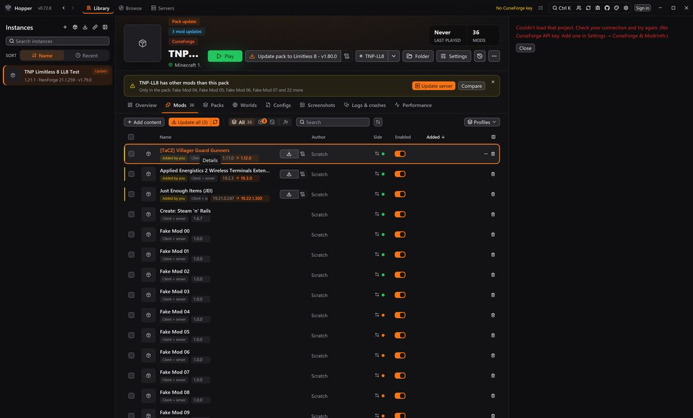
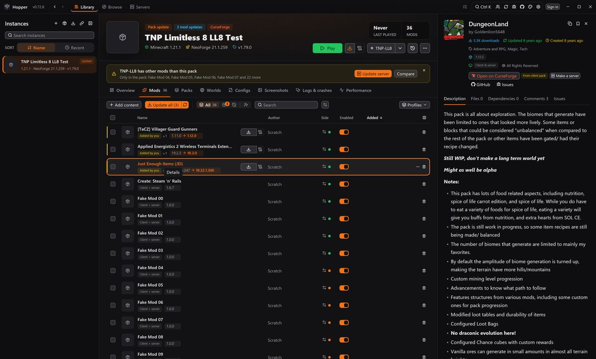

# Pages fit beside open side panels (headers, tabs, Mods toolbar, mod tags)

**Branch:** t3/fit-pages-when-side-panels-open   **Commit:** 592be92 (+ 9ca9d46, test-only seed hook)   **Size:** L (stopped at the 3 h budget, partly done)
**Apps:** both (desktop: header, tabs, toolbar, mod rows; Hopper Server: relay card header only)

## From -> to
- Before: with the mod peek open, the instance header lost its title ("TNP…"), pills stacked in three rows, facts were clipped ("Minecraft 1."), and mod chips were cut mid-word ("Client + se").
- After: the header keeps the whole name, the pills on one row and every fact; the actions give way instead (Update pack → icon, Folder/Settings into ⋯). Chips that don't fit fold into "+n" with a tooltip. Tabs and the Mods toolbar stay on one line.

## Screenshots
| State | Before | After |
|---|---|---|
| Mods, peek open (window 1817, default peek) | before-mods-peek.png | after-mods-peek.png |
| Mods, no panel (nothing should collapse) | (same as main) | after-mods-no-panel.png |

## Measurements
| Claim | State | Numbers | Result |
|---|---|---|---|
| Pills on one row | dark, 1817, peek default | before: 3 rows (2nd and 3rd at y 155-176 and 208-228 phys px); after: 1 row (read off the screenshot, not measured) | ok |
| Relay card header one line | Chromium, card 640/460/340/300 px | before: h3 height 21.7 / 47.6 / 47.6 / 47.6 px, settings icon 26 px below the top from 460 px down; after: 21.7 px at every width, icon right gap 0 px, status ellipsized from 460 px | ok |
- NOT measured with pixel numbers (seen on screenshots only): header actions' right edge against the content edge, no overlap between the facts and the actions, toolbar on one line, tabs not clipped. The band script couldn't separate ink from the header's backdrop gradient.
- NOT measured: light theme, peek at max width (64 rem), minimum window 960×600, Servers page, Browse, the sync/friends/config panels.

## Files
- `src/gpui/widgets.rs`: `Fit` helper, `fit_key`, `chip_w`; `mod_tags` folds into "+n"
- `src/gpui/hero.rs`: `HeroFit`, pills "+N", `name_room`, soft facts ellipsize
- `src/gpui/library.rs`: header levels, ⋯ menu gets folded actions, tabs measured
- `src/gpui/servers.rs`: header levels, tabs icon→menu, room minus peek
- `src/gpui/server_control.rs`: icon-only controls variant
- `src/gpui/addons.rs`, `addons_extra.rs`: toolbar levels, tag room per row
- `crates/hopperd/ui/src/RelayCard.svelte`: header nowrap + ellipsis
- `src/gpui/store.rs` (separate commit): HOPPER_TEST_SEED fake updates, test builds only

## How tested
- Tests: none run (no logic tests added; `cargo-test-changed.ps1` not run).
- On screen: fast build on rig (MCP port 47833, scratch data, HOPPER_TEST_WINDOW=1); Library › TNP Test › Mods, opened the mod peek on JEI. Hopper Server web UI: `pnpm build` passes; relay header checked in a stand-alone page with the card's CSS (no scratch hopperd with a live relay).
- NOT checked: everything in "NOT measured" above; the Servers page after the change; the server tabs menu; the ⋯ menu's folded items (clicking them).
- Test data: throwaway instance "TNP Limitless 8 LL8 Test" + fake server "TNP-LL8" in E:\rig-test\hv-a5ad-data on rig (fake ids; the peek looked up a real CurseForge project by that id, read only).

## Notes for the maintainer
- Still to do: Sync tab header, sync/friends/config panels, Browse, other Library tabs' toolbars, Hopper Server pages besides the relay card, and the max-peek / 960-px / light-theme checks.
- gpui-kit has no responsive toolbar; `TabBar::menu(true)` is used for the server tabs' last level.
- Stray folder `C:\Rig` on FOX (a script copied scratch data there by mistake); a guard blocked deleting it. Please delete it by hand.
- Fast builds on FOX took 6-20 min this session; build on rig next time.

## Images on the changelog page
- 
- 
