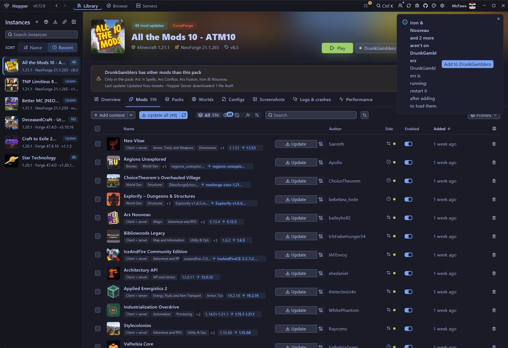
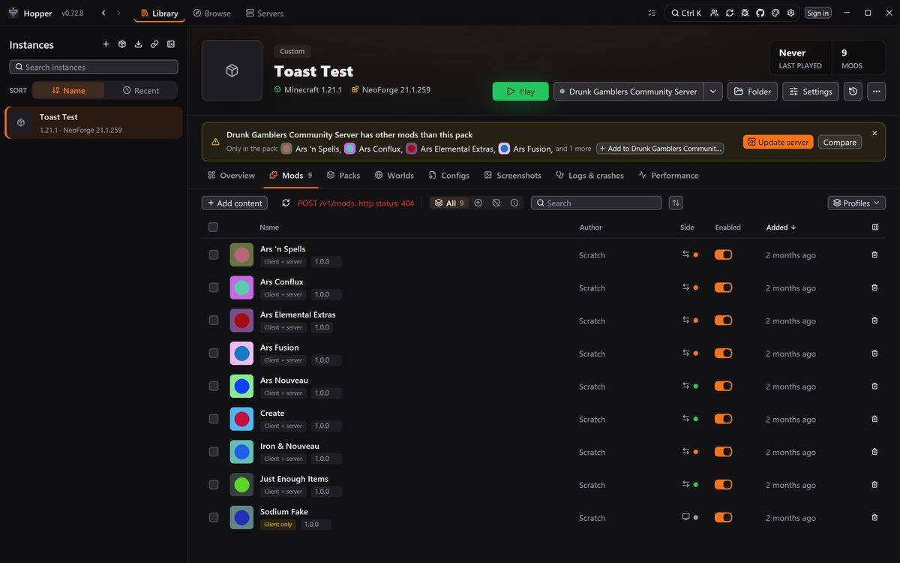
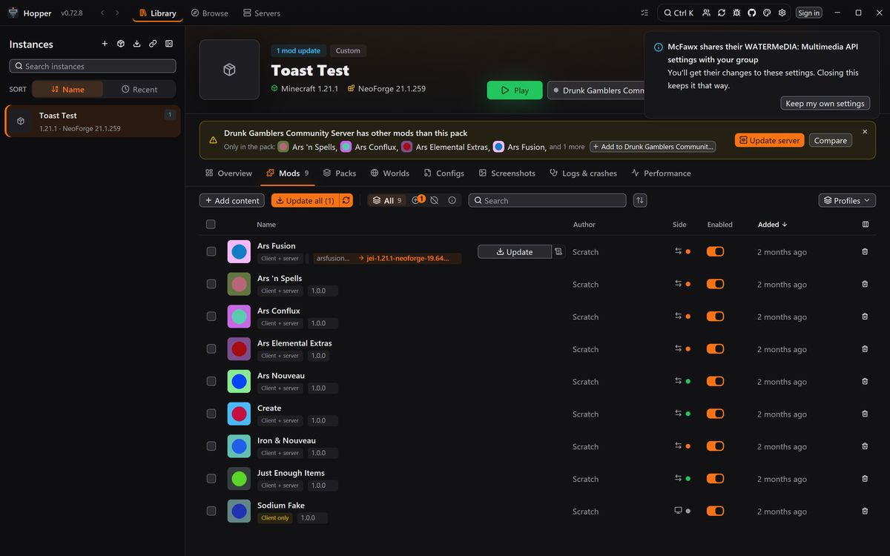
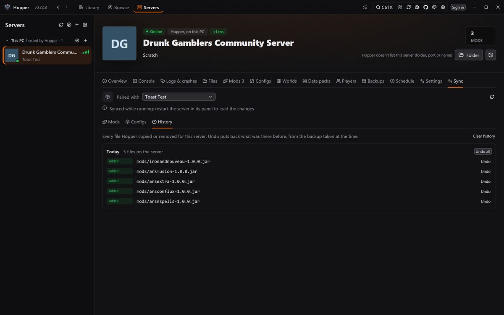

# Mods missing on the server: "Add to <server>" sits in the notice, no extra toast; toast buttons go under the words

**Branch:** t3/server-offer-notice-not-toast (worktree t3-b59af471)   **Commit:** e7208f6   **Size:** M
**Apps:** desktop only. Hopper Server's web UI has no offer toast, no pre-join notice, no group sync, and its toasts (`lib/toast.svelte.js`) are text only with no buttons, so nothing there to change.

## From -> to
- Before: after installing a mod, a toast "Iron & Nouveau and 2 more aren't on DrunkGamblers" with "Add to DrunkGamblers" beside the words, squeezing them into a ~100 pt column ("DrunkGambl / ers"), while the instance page's notice said the same. Every toast with a button had the same squeeze. The group settings toast ("McFawx now shares ... / Keep mine for this mod") left a player asking "if I cross it out will I be kept synced up?".
- After: no offer toast. The notice's "Only in the pack:" line shows each mod with its icon (click opens the mod peek beside) and an outlined "+ Add to <server>" button (its tooltip says what it copies, that nothing is removed, and when the server runs: restart it after adding). Every toast with a button puts the words full width and the button below, right-aligned (`widgets::ToastAction::action_below`, 13 toasts). Group toasts reworded: "McFawx shares their WATERMeDIA settings with your group / You'll get their changes to these settings. Closing this keeps it that way. / [Keep my own settings]".

## Screenshots (every state)
| State | Before | After |
|---|---|---|
| Offer toast + notice | before-offer-toast-and-notice.png (user's ATM10 shot) | after-notice-offline-dark.png (no toast; button in the notice) |
| Server running, notice | (same) | after-notice-running-dark.png |
| Add button tooltip (running) | - | after-notice-add-tooltip-dark.png |
| Right after Add | - | after-notice-gone-after-add-dark.png (server now matches, notice gone) |
| Server Sync tab after Add | - | after-server-sync-restart-line-dark.png ("Synced while running: restart...") |
| Server History after Add | - | after-server-history-dark.png (5 "Added" rows with Undo) |
| Notice with mod peek open (light) | - | after-notice-peek-open-light.png |
| Group "shares settings" toast | before-toast-shared-player-report.png (player's Discord shot) | after-toast-shared-dark.png, after-toast-shared-and-notice-light.png |
| Group "changed settings" toast (Undo) | no before | after-toast-arrived-dark.png |
| GitHub limit toast | no before | after-toast-github-dark.png |
"No before" = no old build was run; the two befores are the user's and the player's screenshots.

## Measurements (2880x1800 screenshots, 2 px per point, rig 200 %)
| Claim | State | Numbers | Result |
|---|---|---|---|
| Toast words use the full width | shared toast, dark, "McFawx ... WATERMeDIA: Multimedia API" | toast inner 2086..2846 (760 px); words 2147..2778 = 631 px of ~667 px free (before: ~100 pt = ~200 px column) | ok |
| No mid-word wrap | shared, arrived, GitHub, light | every line breaks at a space (see shots) | ok |
| Button inside the toast, below the words | shared dark | words end y 292, button y 311..356; button right 2816 vs inner 2846 (30 px), bottom 356 vs 382 (26 px) | ok |
| Same padding all toasts | shared / arrived | content gaps L 29 / R 28 / T 35 / B 24 px, identical | ok |
| Add button lines up with the row | notice, dark, running | button centre y 474.5; mod icon 474.5; "Only in the pack:" 475.0 | ok (<= 0.5 px) |
| Add button clear of the button group | notice, dark | Add ends x 2317; "Update server" starts ~2378 (61 px) | ok |
| Long server name truncates | "Drunk Gamblers Community Server" | label "Add to Drunk Gamblers Communit..." (24 chars + ellipsis), one line | ok |
| Notice fits beside the mod peek | light, peek open | notice 645..1875 px, panel edge 1920 (45 px clear); Add button 732..1141 inside; no clip/overlap | ok |
NOT measured: contrast of the new text (kit colours unchanged); tooltip of "Keep my own settings" (MCP hover didn't open it; the notice's Add tooltip did show); 1080p / narrow window other than the peek case; light theme for arrived/GitHub toasts.

## Files
- `crates/hopper-core/src/rigsync.rs`: `to_offer` -> `to_add` (all server-needed pack mods), test.
- `src/gpui/join_help.rs`: notice row with mod links + Add button; add job state lines.
- `src/gpui/store/server_offer.rs`, `store.rs`: offer toast plumbing removed; `add_to_server` kept.
- `src/gpui/widgets.rs`: `ToastAction::action_below`, `short_label` (+ test). New items at the end only.
- `src/gpui/app.rs`: offer toast removed; group/GitHub toasts reworded + below; dev `--dialog toast-*`.
- `addons.rs`, `config_pushes.rs`, `config_view.rs`, `datapacks.rs`, `friends.rs`, `perf_view.rs`: `.action` -> `.action_below`.

## How tested
- Tests (cargo-test-changed, base main): hopper-core 1386 passed (incl. `to_add_keeps_just_the_mods_the_server_needs`); hopper 88 passed (incl. `short_label_tests`); hopperd 342 passed, 1 failed: `ui::tests::built_page_has_no_inline_script_or_style` panics "UI built" because `crates/hopperd/ui/dist` isn't built in this worktree (hopperd untouched by this change).
- On screen (rig, scratch data root, HOPPER_LOOPBACK, MCP 47841): notice offline + running (fake status responder on 127.0.0.1:25611), Add clicked: 5 jars copied to the scratch server, client-only jar not, History has 5 rows, Sync tab shows the restart line. Mod name in the notice opens the peek. Toasts via `--dialog toast-shared|toast-arrived|toast-github`, dark + light.
- Test data: throwaway "Toast Test" instance + scratch server folder under E:\rig-test\hopper-toast\scratch; one addon given JEI's project id so the peek has a real page. No real instance/server touched.

## Notes for the maintainer
- After Add, the instance page's notice goes away once the server matches, so the "restart it to load them" line only shows on the server's Sync tab (and in the button's tooltip before). If wanted, a small info line on the instance page could carry it.
- Instance header beside the peek: the "1 mod update / Custom" chips overlap the Play row (see after-notice-peek-open-light.png). Not this change (header layout agent).
- Short "Undo" toasts are one line taller now (button under the words) for consistency.
- `to_add` offers every pack mod the server lacks, not just ones installed this session (the notice lists all of them anyway).

## Images on the changelog page
- 
- 
- 
- 
