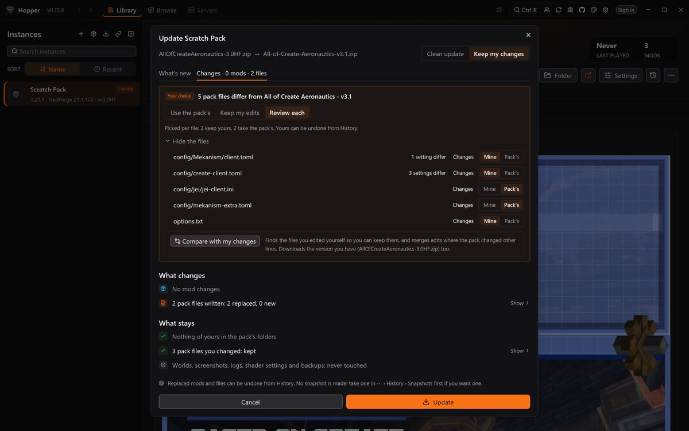
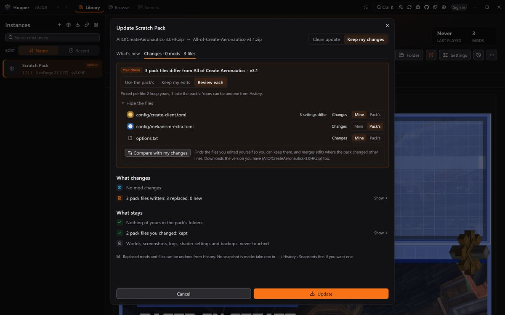
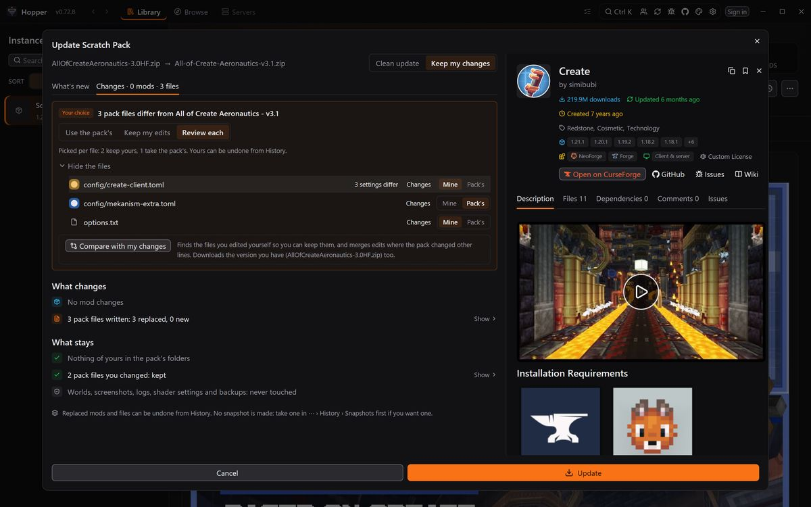
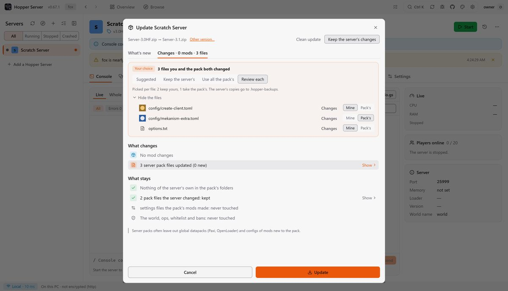

# Pack update: mod icons on files to review; files you never edited take the pack's

**Branch:** t3/pack-update-config-owner-icons   **Commit:** 875bbc1   **Size:** M
**Apps:** both (desktop update window + Hopper Server's pack update dialog)

## From -> to
- Before: "Your choice: 5 pack files differ" listed every file that differed from the new pack, including files only the pack changed (you never touched them) and files only spacing apart, each with Mine / Pack's and no hint which mod owns it.
- After: files you never edited (same as the old pack's copy, or only spacing / comments / key order apart from the new one) take the pack's copy silently and leave the list and its count; each remaining row shows the owning mod's icon before the path (click: the mod's page opens beside the dialog, which stays open); a file no mod owns gets a plain file icon so paths line up.

## Screenshots (every state, both apps)
| State | Before | After |
|---|---|---|
| Desktop, Review each (dark) | before-desktop-dark.png (5 rows, no icons) | after-desktop-dark.png (3 rows, icons) |
| Desktop, Review each (light) | no before | after-desktop-light.png |
| Desktop, icon clicked | - | after-desktop-peek.png (Create page beside dialog) |
| Desktop, History after Update | - | after-desktop-history.png ("Changed 3 files", Undo all) |
| Web UI, Review each (dark / light) | no before (stubbed plan, see Test data) | after-web-dark.png / after-web-light.png |
| Web UI, icon clicked | - | after-web-peek.png (Create page beside dialog) |

## Measurements
Desktop: 2880x1800 MCP screenshot, 2 px per point, zoom 100. Web: headless Edge, 2x device scale.

| Claim | State measured | Numbers | Result |
|---|---|---|---|
| Icon size | desktop dark + light | box 40x40 px (rems 1.25 = 20 pt); ink 37x37 (rounded corners) | ok |
| Icon size | web dark + light | 40x40 px ink (20x20 CSS px, getBoundingClientRect) | ok |
| Paths line up, with and without an owner | desktop dark + light | path text starts x = 778 on all 3 rows | ok (0 px) |
| Paths line up | web dark + light | path text starts x = 884 px (442 CSS) on all 3 rows | ok (0 px) |
| Icon vertically centred on the path text | desktop dark + light | icon centre minus text visual centre (ascender top to baseline): -1.0 / -1.0 / -1.5 px (no-owner row) | ok for owner rows; file glyph row 1.5 device px = 0.75 pt |
| Icon vertically centred | web dark + light | -1.0 / -1.0 / -0.5 px; DOM box centres equal within 0.004 CSS px | ok |
| No-owner file glyph readable | desktop | contrast 6.42:1 dark (154,154,163 on 27,22,20), 5.78:1 light | ok (>= 3:1 icon) |
| Count right | desktop | title "3 pack files differ", tab "Changes · 0 mods · 3 files", "3 pack files written: 3 replaced", "2 pack files you changed: kept" | consistent |

Not measured: other zoom levels; narrow windows with very long paths (the path still truncates as before; icon is flex-none); web UI file-glyph contrast.

## Files
- `crates/hopper-core/src/packdiff.rs`: `same_content`, `edited`, `settle_unedited`; plan reads cached old zip; `quiet` backed up; owners
- `crates/hopper-core/src/modpack.rs`: `cached_pack_zip`
- `crates/hopper-core/src/configowner.rs`: `FileOwner`, `file_owners`, `folder_file_owners`
- `crates/hopper-core/src/server_pack_update.rs`: same settle for servers (old server pack's file list), owners
- `crates/hopperd/src/pack_api.rs`: `owners` in the plan summary
- `crates/hopperd/ui/src/PackUpdate.svelte`: icon button / placeholder before the path
- `src/gpui/pack_update.rs`: `owner_icon` (thumb + tooltip + `open_peek`), icons preloaded

## How tested
- Tests (cargo-test-changed): hopper-core 1390 passed (new: files_you_never_edited_are_the_packs, spacing_and_comments_are_no_difference, real_edits_stay_a_choice, unedited_conflicts_update_and_are_backed_up); hopperd 343 passed; hopper 87 passed.
- On screen, desktop (rig, port 47845/47846, scratch data): before = release 0.72.8, after = this branch. Update pack > Keep my changes > Changes > Review each. Saw 3 rows with icons; clicked the Create icon: page opened beside, dialog stayed. Clicked Update on the scratch instance: Mekanism client.toml took the pack's (0.5), jei-client.ini took the pack's, Create and options.txt kept; History "Changed 3 files"; Undo all put all three back byte-exact (incl. the CRLF/space-padded jei copy).
- On screen, web UI: this branch's UI (Vite dev) against a scratch hopperd (127.0.0.1, --data/--home scratch); clicked Pack update > Keep the server's changes > Changes > Review each; icon click opens Create's page beside.
- NOT checked: the server-side plan live (needs a real CurseForge server pack download); web UI rows came from a stubbed plan shaped like `pack_api::summary`, so the web check proves the rendering, not hopperd's settle logic (that is covered by the core tests only). Modrinth packs.
- Test data: fake "Scratch Pack" instance (5 config cases, 3 fake jars with real project ids), fake pack zips in the scratch cache; scratch hopperd server folder. All under scratch / rig `E:\rig-test\hopper-fac4` (removed after).

## Notes for the maintainer
- Quick update reads the installed pack's zip only when it's already in Hopper's cache (no download). Modrinth packs get no cached base, so their untouched files still ask unless only spacing apart.
- Server quick update compares the server's file to the old server pack's crc/size; it can't tell "same settings, different spacing" from the old pack (only from the new one).
- The desktop "Clean update" tab count showed 4 files with 5 differing in this build; I didn't check why (likely options.txt left out of clean_take) or whether the before build did the same. Not changed here.
- The web UI dark screenshot has a browser-extension popup (Edge profile) top right; it does not cover the dialog rows.

## Images on the changelog page
- 
- 
- 
- 
