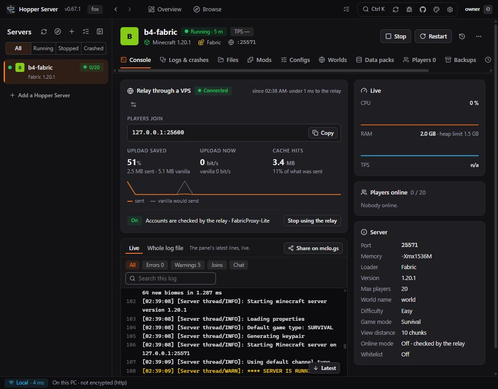
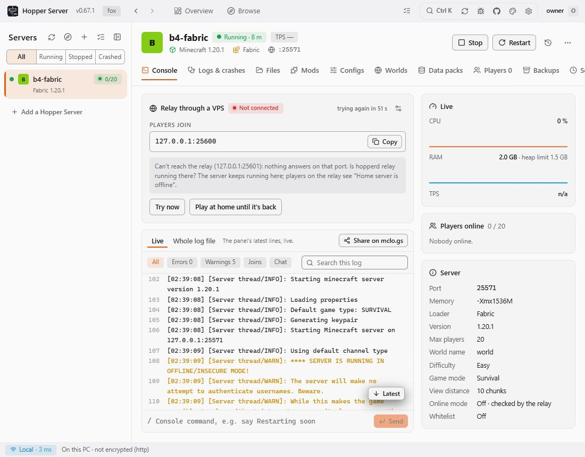
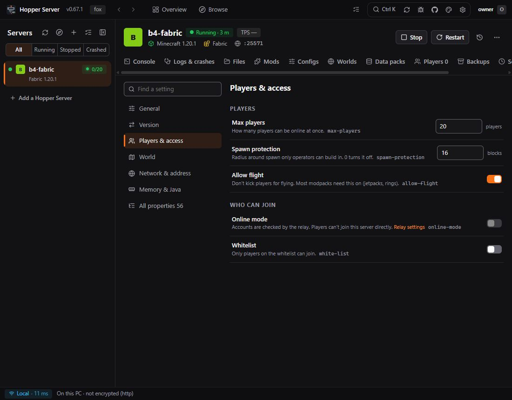

# Relay through a VPS: the relay checks accounts (Velocity), Play at home, settings lock

**Branch:** t3/vps-relay-b4-velocity   **Commit:** 56b4be4   **Size:** L (phase B4)
**Apps:** Hopper Server only. Desktop parity is B8 (see design/vps-relay.md).

## From -> to
- Before: the relay passed players straight to the server at home; the server checked accounts itself and saw every player as coming from 127.0.0.1.
- After: the relay setup also installs Velocity on the VPS (pinned Java + jar, own user and service). On a server, "Use the relay" adds FabricProxy-Lite (with Fabric API when missing) or PCF, writes its config, sets four server settings, records each in History and restarts only after asking. Velocity checks accounts and passes the real player address. "Stop using the relay" undoes all of it byte for byte. When the relay is down the red card offers "Play at home until it's back", and offers "Go back to the relay" once it's up. The four settings are locked in Settings while on the relay.

## Screenshots (every state, Hopper Server web UI, 1100x860)
| State | Dark | Light |
|---|---|---|
| Card, relay on (On · Accounts are checked by the relay · FabricProxy-Lite; Overview "Off · checked by the relay") | after-1-relay-on-dark.png | after-1-relay-on-light.png |
| Settings: Online mode locked with reason + "Relay settings" link | after-2-settings-locked-dark.png | after-2-settings-locked-light.png |
| Red card: relay down, "Play at home until it's back" | after-3-red-card-dark.png | after-3-red-card-light.png |
| Play at home confirm (restart said plainly) | after-4-play-at-home-confirm-dark.png | after-4-play-at-home-confirm-light.png |
| Playing at home, relay down (relay address hidden; Online mode On) | after-5-playing-at-home-dark.png | after-5-playing-at-home-light.png |
| Relay back: green note + "Go back to the relay" | after-6-back-on-relay-offer-dark.png | after-6-back-on-relay-offer-light.png |
| Go back confirm | — | after-7-back-to-relay-confirm-light.png |
| Direct mode: "Use the relay" offer (header on one line) | after-8-direct-use-offer-dark.png | — |
| Use the relay confirm | after-9-use-relay-confirm-dark.png | after-9-use-relay-confirm-light.png |
No "before" shots: these states are new in B4.
after-2 (settings) was taken before the link colour fix below; the fix is measured separately.

## Measurements
| Claim | State measured | Numbers | Result |
|---|---|---|---|
| Card header items on one line, centred on one axis | Connected, direct mode, dark, card 502 px | vertical centres: globe 203.9, pill 203.9, status 203.9, setup button 203.9 px; status text ellipsized (scrollWidth > clientWidth) | ok |
| Relay-on row centred | dark, relay on | centres: pill 488, text 487.5, button 487.5 px | ok (<= 0.5 px) |
| Go back / Stop buttons aligned | light, relay back | both top 287.7 px, height 30.1 px, no overflow | ok |
| Confirm dialog padding | Play at home, dark | L 18 / R 18 px; T 23 / B 18 px (title line height, shared confirm dialog) | sides ok; top/bottom 5 px apart, pre-existing dialog |
| Confirm body text readable | dark / light | 7.58:1 / 5.89:1 | ok |
| Confirm orange button text | dark / light | 6.76:1 / 5.33:1 | ok |
| Green "relay is back" note | dark / light | 11.87:1 / 14.40:1 | ok |
| Red-card and at-home notes | dark / light | 5.97:1 / 5.11:1 | ok |
| Relay-on row text | dark / light | 14.05:1 / 16.12:1 | ok |
| "On" pill | dark / light | 6.09:1 / 2.68:1 | light FAILS: shared `.pill.running` (same as the header's "Running"), not changed here |
| Settings lock reason text | dark / light | 6.70:1 / 6.05:1 | ok |
| "Relay settings" link (before fix) | dark / light | 8.27:1 / 2.17:1 | light failed -> fixed |
| "Relay settings" link (after fix) | dark / light | 9.25:1 / 6.72:1 (light rgb(150,62,18) on rgb(250,250,250); computed colour of the served `.relay-link` rule against the page background) | ok |
| Disabled switch | dark / light | 3.18:1 / 2.15:1 | disabled control, exempt; reason text carries the meaning |
NOT measured: narrow window (< 900 px) layouts, the Settings tab's "All properties" lock rows, the card at 125 % zoom.

## Files
- `crates/hopper-core/src/hosting/proxy_forward.rs`: new: mod choice, config, keys, plans
- `crates/hopper-core/src/hosting/properties.rs`: keep CRLF line endings
- `crates/hopper-core/src/backups.rs`: History rows show the reason
- `crates/hopperd/src/vps/forward.rs`: new: record, jobs, route, lock
- `crates/hopperd/src/vps/setup/{mod,plan}.rs`: Velocity + Java step, bStats off, port check
- `crates/hopperd/src/vps/{home,relay_end,mod}.rs`: Velocity route, PROXY v2 header
- `crates/hopperd/src/{manage_api,router,secrets,main,api}.rs`: lock on PUT, routes, wiring
- `crates/hopperd/ui/src/{RelayCard,Settings,ServerPage}.svelte`: card states, confirms, lock

## How tested
- Tests: `cargo test -p hopperd` 350 pass / 3 ignored; `cargo test -p hopper-core --lib` 1391 pass / 60 ignored (new: proxy_forward 8, forward 5 incl. CRLF byte-for-byte, properties CRLF, proxy header layout).
- On screen (scratch panel 127.0.0.1:8817, WSL test VPS): install, repair, Use (UI and API), offline-mode login through the relay (Login Success, UUID = offline UUID, real client port in Velocity's log), direct join refused ("This server requires you to connect with Velocity."), relay stopped -> red card -> Play at home (mod `.disabled`, online-mode=true, unlocked) -> relay started -> Go back -> login again ok -> Stop -> every file byte-identical to before (History folder aside) -> Remove (no units, users, folders, listeners left).
- NOT checked: a real Mojang (online) login (the test VPS runs Velocity offline), PCF on a real Forge/NeoForge 1.20.2+ server (unit-tested only), a public VPS, desktop.
- Test data: throwaway Fabric 1.20.1 server in the scratchpad; test VPS reset from clean.tar and stopped; real panel data untouched.

## Notes for the maintainer
- Velocity 3.5.1 is deprecated (ends 2026-09-30); Velocity 4 needs Java 25 -> new pins (B5+).
- The light theme's global link orange (`a { color: #fb923c }`) and `.pill.running` green are below 4.5:1 everywhere; fixed only for the new link here.
- History is folder-per-second (shared); the relay job now waits for a fresh second so Use and Stop never share a folder. Other features with quick back-to-back changes can still merge.
- The web History list doesn't show settings notes (`.settings.json`); desktop does.
- A Minecraft server made by `/servers/create` binds RCON and the game port on all interfaces when server-ip is empty (seen during the test); unrelated to B4.

## Images on the changelog page
- 
- 
- 
