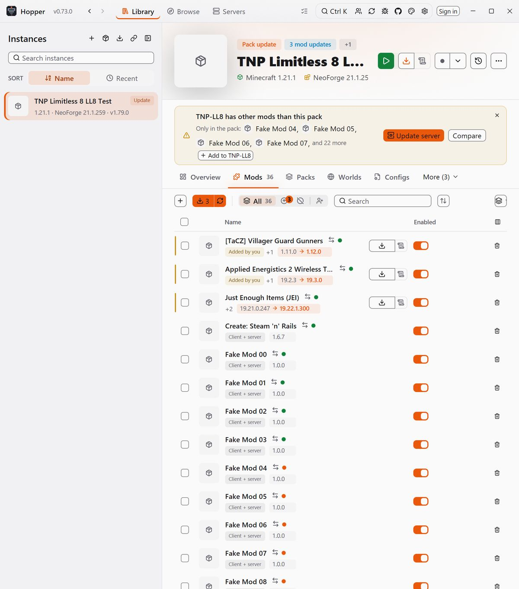
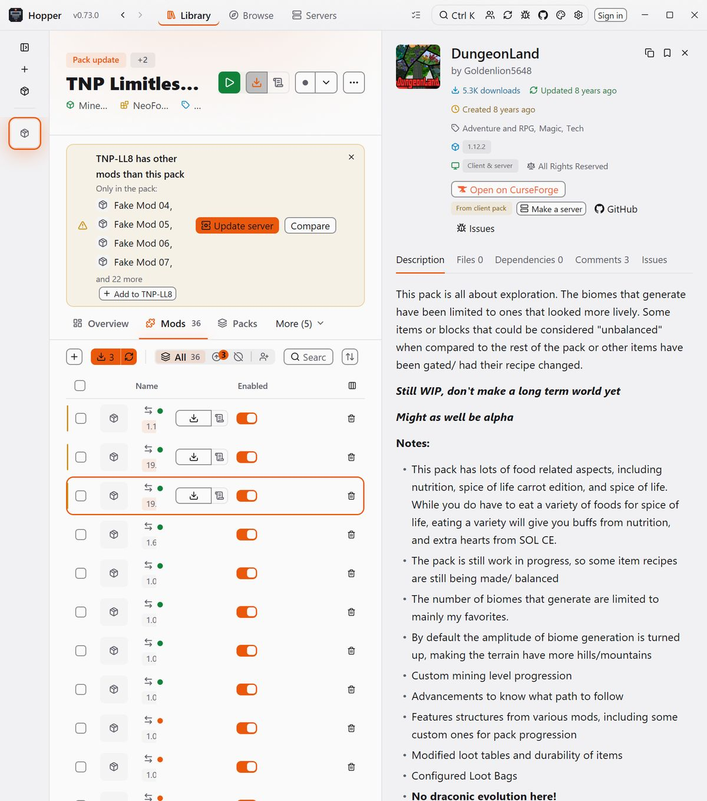
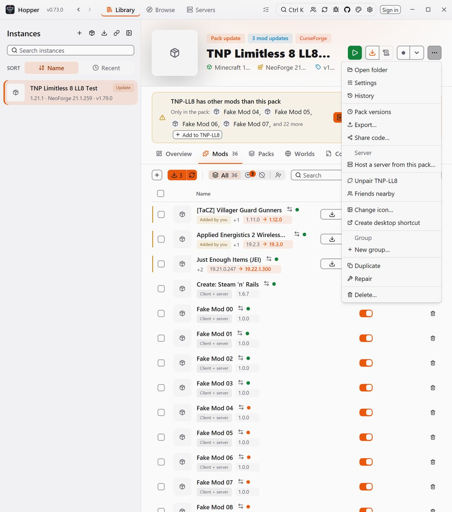

# Pages fit beside open side panels, parts 2 and 3

**Branch:** t3/fit-remaining-screens-side-panels (worktree t3-e99ed502)   **Size:** L, over budget (stopped; list of what's left below)

## What collapses, per screen (desktop, `widgets::Fit`)
| Screen | Fit id | Levels (in order) |
|---|---|---|
| Instance/server header | hero-actions | part 1 levels, then the name squeezes; new: when the actions are still short (`Fit::short_by`), the art drops |
| Servers > Sync header | sync-head (2) | pair picker 14 → 10 rem; "Update from server pack" → "Server pack" → icon |
| Servers > Sync filter row | sync-bar (4) | search 12 / 9 / 6.5 rem; Sync tabs count-only; Side/Source → one picker. Row now keeps its own height (was clipped to 14 px) |
| Resource packs / Shaders / Data packs | content-bar (6) | same as Mods (shared addons toolbar) |
| Worlds | worlds-bar (2) | labels → icons |
| Configs | configs-bar (5) | search 16 rem; short labels; filter tabs → picker; icon toggles; search 10 rem |
| Logs / server logs | log-bar (3) | shared `LogBar` (crash_list.rs) for both |
| Screenshots / Performance | — | caption ellipsizes |

## Hopper Server web UI (container queries, same steps as desktop)
- Header: one line; power buttons go icon-only at ≤620 px.
- Tabs: unselected tabs icon-only at ≤1080 px (selected keeps its label).
- Mods: Profiles label hides at ≤900; search min 64 px at ≤560.
- Configs: filter tabs → one select (same choices as desktop) at ≤700; search min 72 at ≤560.
- Files: secondary buttons (group, tree, preview, refresh, new file/folder, upload folder) fold into a ⋯ menu at ≤900; Upload label hides at ≤560. Before: toolbar wrapped to 2 lines at 674 px.

## Measurements
Desktop, rig, from MCP state `fits` (element bounds), window 960, dark:
| View | Fit | Level | One line | Right gap ≥ 0 |
|---|---|---|---|---|
| Instance header | hero-actions | 7/7 | yes | yes (row 699–937.5, page edge 960 − padding) |
| Instance tabs | inst-tabs | 3/7 | yes (h 43) | yes |
| Mods / packs | content-bar | 4/6 | yes (h 22.5) | yes |
| Worlds | worlds-bar | 0/2 | yes | yes |
| Configs | configs-bar | 4/5 | yes | yes |
| Logs | log-bar | 1/3 | yes | yes |
| Server header | hero-actions | 4/4, art hidden | yes (row 604.5–937.5) | yes |
| Server tabs | server-tabs | 1/2 | yes | yes |
| Sync header | sync-head | 0/2 | yes (h 30) | yes |
| Sync filter row | sync-bar | 2/4 | yes, box 32 = row 32 (before: box 14, clipped) | yes |
| Server Mods / Configs / Worlds | content / configs / worlds | 2/6, 4/5, 0/2 | yes | yes |
Wide (1787, no panel): every fit at level 0.
Peek at max (OLD build, before the art fix): inst-tabs 4/7, content-bar 5/6; hero actions were short (History cut, ⋯ hidden) → fixed with `short_by` + art drop, **not re-measured**.

Web UI, Chromium preview, `getBoundingClientRect` (rightGap px / rows' top spread px / overlaps):
| Main width | Theme | Header | Tabs | Mods | Configs | Files |
|---|---|---|---|---|---|---|
| 552 | light | 18 / 0 / 0 | 127 / 0 / 0 | 0.0 / 0 / 0 | 6.8 / 0 / 0 | 10 / 0 / 0 |
| 712 | dark | 18 | 287 | 10.5 | 12 | 10 |
| 736 | light | 18 | 311 | 36.7 | 12 | 10 |
| 896 | dark | 18 | 471 | 194 | 12 | 10 |
| 1032 | dark | 18 | 607 | 85 | 12 | 10 |
| 1216 | dark | 18 | 242 | 269 | 12 | 10 |
All spreads 0 (one line), all overlaps 0. Files ⋯ menu: "Hide folder tree" hid the tree, menu closed after the pick, toggling back restored it; menu 180×200 inside the Files box.

## Screenshots (shots2/)
- Desktop before (960, dark): `b960-*.png` (no panel), after: `C-dark-*.png` (instance views) and `C-dark-srv-*.png` (server views); bounds in `C-dark.json`, `C-dark-srv.json`.
- Web: `web-files-wide-after.png` (Files, wide, dark), `web-files-960-menu-broken-midfix.png` (mid-fix state, menu class clash, since fixed), `web-0629.png` (earlier web state).

## How tested
- Tests: `cargo-test-changed.ps1`: 6 binaries; hopperd 349 pass, 1 fail (`hold::tests::client_leaves`, broken pipe, untouched code); rerun of `hold::tests` 9/9 pass: flaky.
- On screen: fast build on rig (`hv-e99e.exe`, MCP 47834, scratch data, HOPPER_TEST_WINDOW=1, loopback). Web UI: Vite dev server against a scratch hopperd (`--data` + `--home` in scratchpad, HOPPERD_SERVICE=hopperd-test, loopback, port 8817); real `%APPDATA%\hopperd\data` untouched (mtime 2026-10-30).

## Not done
- Desktop light theme pass (960 + peek max).
- Peek at max width re-measure with the new build (hero art drop).
- Browse, friends/group, config and sync side panels; dialogs with a side panel: not checked or changed.
- Desktop ⋯ / More folded items: clicking them not re-checked in part 2.
- Web: no after screenshots per width saved beyond the Files ones (measurements from DOM only); Logs/Worlds toolbars on the web not touched.

# Part 3: light theme, peek at its widest, side panels

## What changed
- **Library: the page keeps 30 rem beside a docked panel** (`library.rs` `PAGE_MIN`). The mod peek and the config panel are capped first (`SidePanel::cap_to`, never below their minimum). Then the instance list folds to its rail for as long as the panel is open; this fold isn't saved. Before: at 960 with the peek at its widest (64 rem saved), the peek took 672 px, the list took 300 and the instance page was **0 px wide**. After: list rail, peek 416 px, page ~450 px.
- **Instance header level 7: History moves into ⋯** (`HEADER_FIT_MAX` 6 → 7, `HeaderFold.history`). The menu item opens the same History window and marks it seen, as the button does.
- **Hero facts ellipsize** (`hero.rs` `fact()`: shrinkable, text truncates). Before, "NeoForge 21.1.25" was cut mid-glyph at the box edge.
- **Notice cards: the text gives way to the button** (`min_w_0` on the text). Before, the Paxi notice's "Find Paxi" button was pushed under the card's X on Data packs, both instance and server. The same pattern was fixed in addons.rs (2), addons_extra.rs (1) and panel_tabs/settings.rs (3).
- **Sync filter bar: two more levels** (`rigsync.rs` `BAR_FIT_MAX` 4 → 6). Level 5 merges Side and Source into one "Filters" menu (the new shared `widgets::filters_menu`: one labelled section per group). The Show picker and search narrow at 5 and 6. Before, on the instance Server tab at 960 the bar was at 4/4 with 353 px of room and still clipped ("So…").
- **Server Settings MOTD**: the preview scrolls sideways inside its box (`motd_editor.rs`) and the field may shrink (`server_settings.rs`). Before, a long MOTD made the whole form wider than the page, which cut the help text and inputs.

## Measured (rig, debug build, MCP `state` fits + screenshots, light theme "Hopper Light")
Window 960, no panel, instance tabs (level/max, one line each):
| Row | lv | Note |
|---|---|---|
| hero-actions | 7/7 | row 699–937.5, inside the hero box |
| inst-tabs | 3/7 | |
| content-bar (Mods, RP, Shaders, DP) | 4/6 | |
| configs | 4/5 | |
| logs | 1/3 | |
| worlds | 0/2 | |

Server tabs at 960: hero-actions 4/4 (row 604.5–937.5), server-tabs 1/2, content 2/6, configs 4/5, worlds 0/2, sync-bar 2/4, sync-head 0/2.

Peek at its widest, 960, instance Mods tab (after the cap and fold):
- Peek 26 rem (416 px). List on its rail. Page about 450 px.
- hero-pills 2/2. Facts ellipsize ("Mine…", "NeoFo…").
- inst-tabs 5/7 (room 405). content-bar 6/6.
- hero-actions before level 7: row 288.5 + 238.5 = 527 against the hero box 67.5–517.5, so about 9.5 px short and ⋯ cut.
- **After level 7 (final build, light and dark the same):** hero-actions 8/8, row 296.6 → 495.5 inside the hero box 67.4 → 517.7, so 22.2 px spare and ⋯ fully shown. hero-pills 2/2, inst-tabs 5/7 (room 405.7), content-bar 6/6. Every row is one line.
- ⋯ click-through (instance header, 960): **History** opened the History window (`P3-history.png`), and **Settings** switched to the Settings tab (`P3-settings.png`). Open folder wasn't clicked (it opens Explorer on rig).

## Screenshots (shots3/)
- `L960-*.png`: instance tabs, light, 960, no panel (before the fixes: datapacks shows the Paxi button clipped, server shows the clipped sync bar).
- `LS960-*.png`: server tabs, light, 960 (settings shows the MOTD overflow, before).
- `pk1.png` / `pk2.png`: peek at max, before (page 0 px) and after the cap and fold.
- `P3-peek-light.png` / `P3-peek-dark.png`: final build, peek at max. `P3-menu.png`: the header ⋯ with Open folder, Settings and History.
- Note: rig's display scale is now 1.75 (it was 2), so the viewport is 960 logical px at 1680 physical.

## Not done (out of the ~2 h budget)
- **Mods table beside the max peek**: with a ~450 px page the name column gets ~0 width. Date, author and side drop and it goes compact, but the Update split, On, ⋯ and Remove alone leave less than `NAME_MIN` (16 rem). This needs a decision about what leaves a mod row next (the Update split into ⋯? Remove into ⋯?). Not changed.
- Re-measure of the sync-bar levels 5–6 and of the Paxi and MOTD fixes on the final build (code compiled and is in the build; not measured on screen). Dark theme: only the peek-at-max case was measured.
- Servers page with its peek open (`servers.rs` list panel): same cap and fold not applied.
- Friends panel: not capped (friends.rs belongs to the group-sync work); it only benefits from the list fold.
- Browse filters and dock, the sync side panel, and dialogs beside a panel: not checked.
- Click-through of every folded ⋯ / More item: not done.
- Web UI Logs and Worlds toolbars at ≤700 px: not done.
- "RefCell already borrowed" was logged twice at one click (08:18:07, while opening the peek): not investigated.

## Tests (part 3)
- `cargo test --bin hopper`: 87 pass, 1 fail: `anim::tests::packed_frames_unpack_to_the_same_pixels` ("attempt to multiply with overflow", anim.rs:440). anim.rs isn't in this change.
- `cargo test -p hopperd`: 351 pass, 1 fail: `ui::tests::built_page_has_no_inline_script_or_style` ("style attribute in index.html"). The web UI isn't in this change, and the worktree has no fresh `ui/dist`.
- Commit `f524699` on `t3/fit-pages-side-panels-part-3` (not pushed).

## Images on the changelog page
- 
- 
- 
