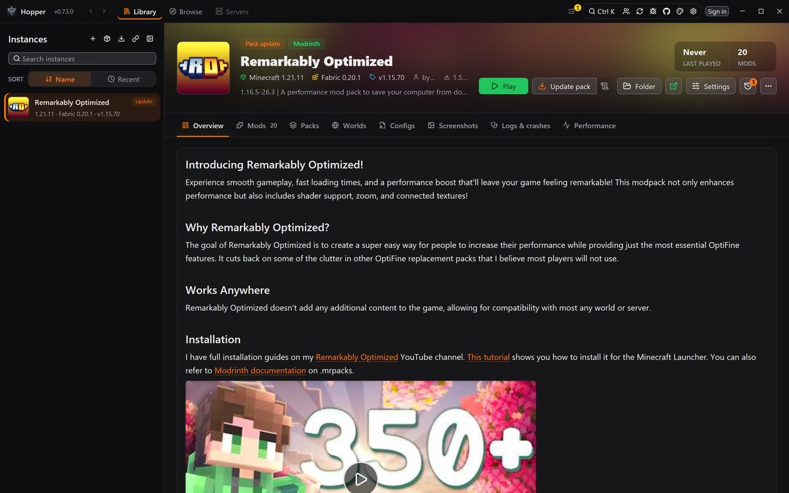
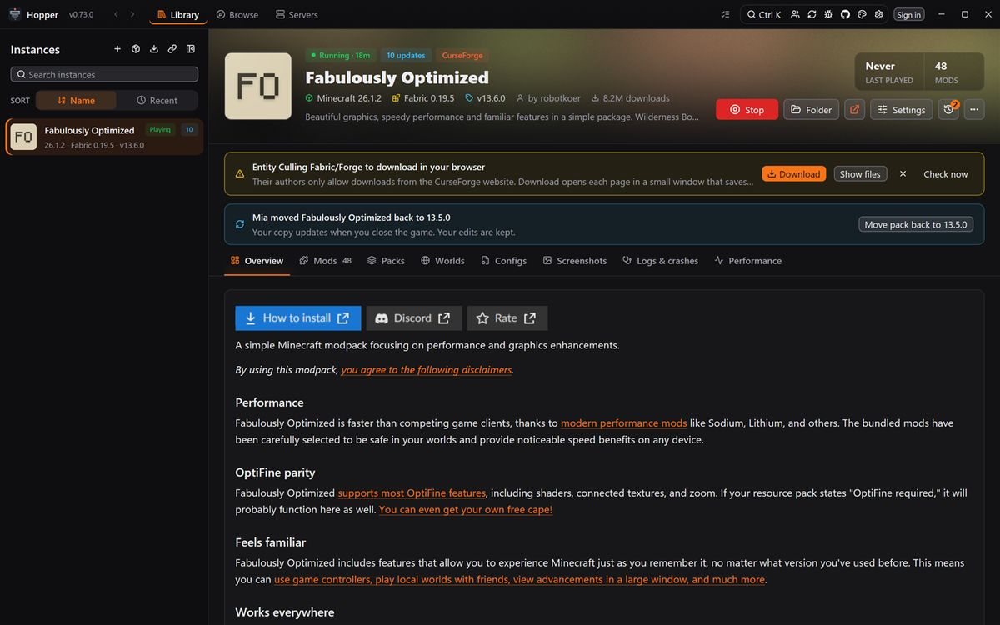
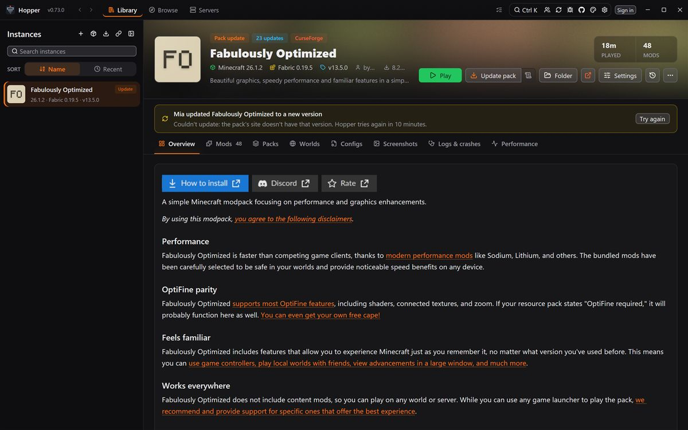

# Group packs: a member's pack update reaches everyone

**Branch:** t3/group-pack-version-sync   **Commit:** (see branch head)   **Size:** L
**Apps:** desktop only (group sync is desktop-only; Hopper Server has no group copies)

## From -> to
- Before: a member updating a group pack (ATM10 8.5 -> 8.6) sent nothing about the version. Others stayed on 8.5, and a mod that member had added themselves that 8.6 now includes was read as "removed", so it was deleted for everyone.
- After: the pack version is part of what a group copy keeps (`~pack`). When a member moves it ahead or back, the others run the full pack update themselves ("Keep my changes", History entry in that member's name), then the mod changes. A notice says "Mia updated Remarkably Optimized to 1.15.70. Your edits were kept."

## Screenshots
| State | After |
|---|---|
| Followed Mia's move 1.15.66 -> 1.15.70 by itself (rig, Hopper Dark) | after-auto-updated.png |
| 1. Game running: "Your copy updates when you close the game. Your edits are kept." + "Move pack back to 13.5.0" | wait-1-game.png |
| 1. Game closed -> update ran; toast "Mia moved Fabulously Optimized back to 13.5.0. Your edits were kept." | wait-1-done-toast.png |
| 1. History: "Mia changed 18 mods" (the pack move) in Mia's name, Everyone / You / Mia filters | wait-1-history.png |
| 2. Needs a pick: "Some of your settings changed in this update too. Pick what to keep, then the group's other changes follow." + "Update pack to 13.6.0" | wait-2-pick.png |
| 2. The button opens the pack update dialog (13.5.0 -> 13.6.0) | wait-2-dialog.png |
| 3. Failed (version 404), dark: "Couldn't update: the pack's site doesn't have that version. Hopper tries again in 10 minutes." + "Try again" | wait-3-failed-dark.png, wait-3-retry-zoom.png |
| 3. Failed, Hopper Light | wait-3-failed-light.png |
| Stale `sent` case (was silently dropped), now shows the notice | wait-stale-sent-fixed.png |
| Friends side panel open: notice fits (title one line, detail ellipsized, button whole) | wait-side-panel.png |

## Measurements (full-res shots, 2517 px wide, scale 1.748)
Button vs the notice bar (bar inner y 384..483):
| Shot | Button y | Top / bottom gap | Button right -> bar border |
|---|---|---|---|
| Failed, dark | 414..452 | 30 / 31 px | 26 px |
| Failed, light | 414..452 | 30 / 31 px | 26 px |
| Pick, dark | 414..452 | 30 / 31 px | 26 px |
| Pick, side panel open | 414..452 | 30 / 31 px | 26 px |
Button centred within 1 px; same right padding with the panel open.

Contrast (sampled text pixel vs bar fill, WCAG):
- Title: dark warning 12.8:1, dark info 14.3:1, light warning 15.7:1.
- Detail: dark warning 5.5:1, dark info 5.95:1, light warning 5.6:1 (all >= 4.5).

One line: the text block is 59 px tall (title + detail) in every shot, so neither line wraps. With the side panel, the text ends 29 px left of the button: no overlap.
Not measured: the "Trying..." label (the retry finished in under 300 ms; a second 404 at 08:58:31 in the log shows it ran).

## Files
- `crates/hopper-core/src/grouppack.rs` (new): pack version as a group key, what a version ships (cached), wording
- `crates/hopper-core/src/groupsync.rs`: `~pack` change, base-change filter, pack update first in `merge`, other-version guard, 10 tests
- `crates/hopper-core/src/modpack.rs`: `curse_ships` / `modrinth_ships`, `update_group_pack` (won't run when it needs a pick)
- `crates/hopper-core/src/configsync.rs`: settings a pack update writes are the pack's (snapshot after the update) + test
- `src/gpui/group_pack.rs` (new) + `store/friends.rs`, `library.rs`: waiting notice and gating (game running, needs a pick, retry after 10 min)
- `design/friends-sync.md`: `~pack` section
- Waiting-path fix (t3/d2c3536d): `crates/hopper-core/src/game.rs` (`runs_in`), `grouppack.rs` (`version_name`, `failed_says`), `groupsync.rs` (game check, stale-sent in `plan`, test), `src/gpui/store/friends.rs` (game recheck, `retry_group_pack`), `src/gpui/group_pack.rs` ("Try again")

## How tested
- Tests: `cargo test -p hopper-core --lib` 1411 passed, 0 failed. `cargo test --bin hopper` 87 passed, 1 failed: `anim::tests::packed_frames_unpack_to_the_same_pixels`, a u8 overflow in a debug test (anim.rs:440). It is in code this change does not touch and anim.rs is the same as on main. Commit 59aa1f9 on t3/d2c3536d.
- On screen: rig, a test build from its own folder, scratch `HOPPER_DATA_DIR`, `HOPPER_LOOPBACK=1`, `HOPPER_TEST_WINDOW=1`, a dead mailbox URL, and a fake member "Mia" seeded in settings (`group_copies` got / waiting codes). Throwaway Fabulously Optimized instance (CurseForge 396246, 13.5.0 = 8872454, 13.6.0 = 9127669).
- Game running: a stand-in `java.exe` (a sleeping Java program) started with `--gameDir "<instance>"`. Hopper showed it as running. Killing it ran the update.
- Pick: a config file that differs between 13.5.0 and 13.6.0 was edited first.
- Failed: a code for file 999999999 (404). "Try again" ran the update again at once.
- Stale `sent`: `sent` = an older-version code, the `~pack` mark by Mia matching the instance, Mia waiting with 13.6.0. The notice showed 35 s after start (past the 10 s hold).
- Not checked on screen: the follow-through after the Pick dialog's Update (the dialog was opened, not run). The 10-minute automatic retry (only the button). The stale-`sent` case on the old build (the unit test covers it).
- Rig scratch, the stand-in and the scheduled task were deleted afterwards.

## Waiting path: why it showed nothing, and the fix
- **Startup with the game running:** the merge runs before the store's game scan reports. The update ran under the game and no Game notice appeared. Fix: `game::runs_in(root)` takes a fresh look in `pack_step`. The store also waits 5 s after a Game wait before trying again.
- **Stale `sent`:** after following a member's move with the mailbox down, `sent` still held the old version. The group's own earlier move then read as an unsent local change: Held, and after 10 s the member's next move was dropped with no notice and no job. Fix: in `plan`, a change matches a mark taken from the group isn't "unsent". Test: `a_pack_version_taken_from_the_group_and_not_sent_yet_holds_nothing_back`.
- **Wording:** the toast said "to 26.1.2" (the Minecraft version). Now it is named by the pack's file (`grouppack::version_name`) and the installed manifest. Failed reads "the pack's site doesn't have that version" for a 404, otherwise `recipe::says`.
- **Retry:** the Failed notice gets "Try again" (`Store::retry_group_pack`).

## Notes for the maintainer
- **Bug that was already there, not fixed here:** a Modrinth pack update drops every mod whose jar name changed between versions. Remarkably Optimized 1.15.66 -> 1.15.70 went from 27 jars to 20: the old jars were removed and the new ones never downloaded. Plain `update_any`, `update_any_synced` and `update_group_pack` all do it (headless repro). The lead is the `leave_out` / `only_here` checks in `apply_mrpack_with` (modpack.rs ~3026). This hits manual updates too, and group follows make it spread.
- Page header (not this change): after the update check, "Update pack to 13.6.0 for 26.1.2" pushes the stats box past the right edge ("MODS" clipped), and with a side panel open the header buttons clip. This belongs to the Fit work.
- The notice's detail line is ellipsized beside a side panel. A tooltip with the full text would help.
- Unrelated: "RefCell already borrowed" ERROR lines show up in test-build logs, from other sessions' builds too.

## Images on the changelog page
- 
- 
- 
