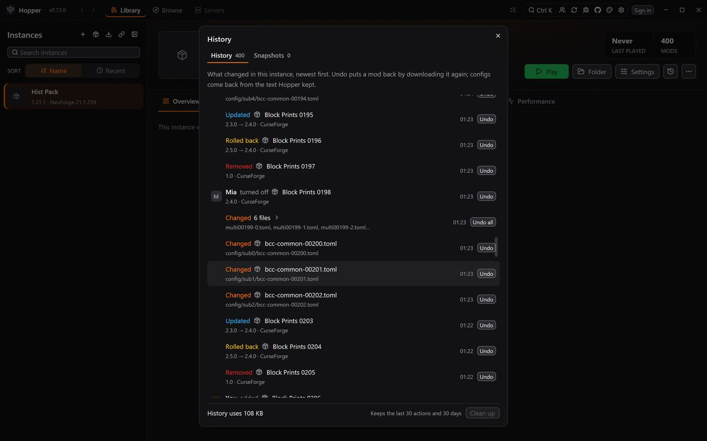
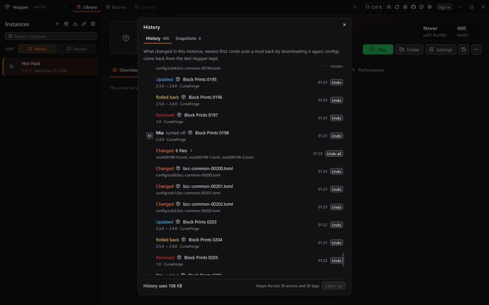
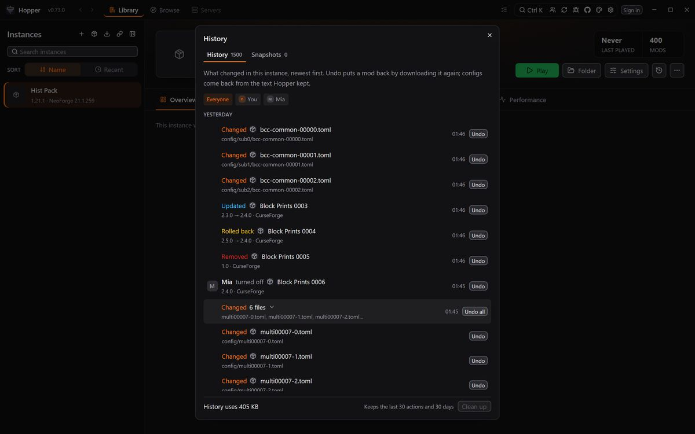

# History scrolls smoothly with thousands of entries

**Branch:** t3/history-scroll-perf   **Commit:** 7f74130   **Size:** M
**Apps:** desktop (instance + server History share one view). Hopper Server web UI measured, no change needed for scrolling (see notes).

## From -> to
- Before: after a big pack update (hundreds of entries) History stuttered: every scroll frame rebuilt and painted every row (772 ms per frame at 1,500 entries).
- After: only the rows in view are built; a scroll frame takes ~4 ms at 400 or 1,500 entries. Rows look the same.

## Screenshots (rig, scratch "Hist Pack", 400 / 1,500 entries)
| State | Before | After |
|---|---|---|
| Top, dark, 400 | before-h400-top.png | after-h400-top.png |
| Scrolled 18,000 px, dark | before-h400-mid.png | after-h400-mid.png |
| Top, light | before-light-top.png | after-light-top.png |
| Scrolled, light | before-light-mid.png | after-light-mid.png |
| "Changed 6 files" fold open (1,500) | - | after-fold.png |
| Filter: Mia only | - | after-mia.png |
| Scrolled to the very end (thumb at bottom) | - | after-end.png |
| Web UI History, 1,500 (unchanged) | web1500-top.png | web1500-end.png |

## Measurements
| Claim | State | Numbers | Result |
|---|---|---|---|
| Scroll smooth, 400 entries | rig, `--profile fast`, 200+ wheel frames | before median 204.6 / p95 235 / max 285 ms, 200/200 over 16 ms; after median 3.76 / p95 5.7 / max 6.75 ms, 0 over 16 ms | ok |
| Scroll smooth, 1,500 entries | same | before median 772 / p95 851 / max 938 ms, all over 16 ms; after median 3.65 / p95 5.67 / max 7.14 ms, 0 over 16 ms | ok |
| Opens faster | fresh launch, click History to first painted rows, 3 runs | 400: 558/474/622 -> 280/363/251 ms; 1,500: 2160/2262/2143 -> 1051/939/951 ms; reopen 1,500: ~2100 -> ~790 ms | ok |
| Rows unchanged | same scroll spot before/after, dark + light, top + mid | best pixel alignment at dx 0 / dy 0 (any 1 px shift is 15x worse); 2.0-3.9k px differ by > 24, all text anti-aliasing (zoomed crop identical) | ok |
| Scrollbar thumb right | 1,500, scrolled to end | thumb at the bottom of the track, last entry (#1499) visible | ok |
| Web UI scroll | headless Chrome, 1536x960, 300 wheel notches, 1,500 entries | median 2.1 / p95 4.2 / max 6.2 ms, 0 over 16 ms; jump to end 4.2 ms; 14.5k DOM nodes | ok, no change |
Not measured: narrow window (row code unchanged, list fills the same box); frame times on FOX.

## Files
- `src/gpui/history_view.rs`: rows as a virtual list, row items, lookup tables
- `src/gpui/backups_view.rs`: list state, load-time lookups, list scrollbar

## How tested
- Tests: `cargo test --bin hopper` 87 pass, 1 fail: `anim::tests::packed_frames_unpack_to_the_same_pixels` (anim.rs:440 `x as u8 * seed` overflows; not touched here, pre-existing).
- On screen (rig, MCP): opened History at 400 and 1,500 entries, wheel-scrolled, opened a 6-file fold, filtered to Mia and back to Everyone, scrolled to the end; dark and light theme.
- NOT checked: narrow window, Undo / Undo all clicks after the change (handlers unchanged), drag-pick across rows in the list, remote Hopper Server History opened from desktop (same code path, panel data).
- Test data: scratch HOPPER_DATA_DIR on rig with a seeded throwaway instance; deleted. Scratch hopperd on FOX (`--data` + `--home`, loopback); stopped, real panel data untouched.

## Notes for the maintainer
- Web UI History opens slowly at 1,500 entries: `/mod-backups` takes 3.3-4.1 s, page render ~1.3 s. The endpoint runs `retention::usage` + `retention::preview` (each walks every entry) in the same request; desktop loads those after the list. Follow-up: split usage into its own request.
- Web UI rows have no mod icon next to the name; desktop does.
- Grouping mock (one row per pack update): https://claude.ai/artifact/LDwBAx4eVa4i6KMw3oX6Gc (pick B). Not built.

## Images on the changelog page
- 
- 
- 
