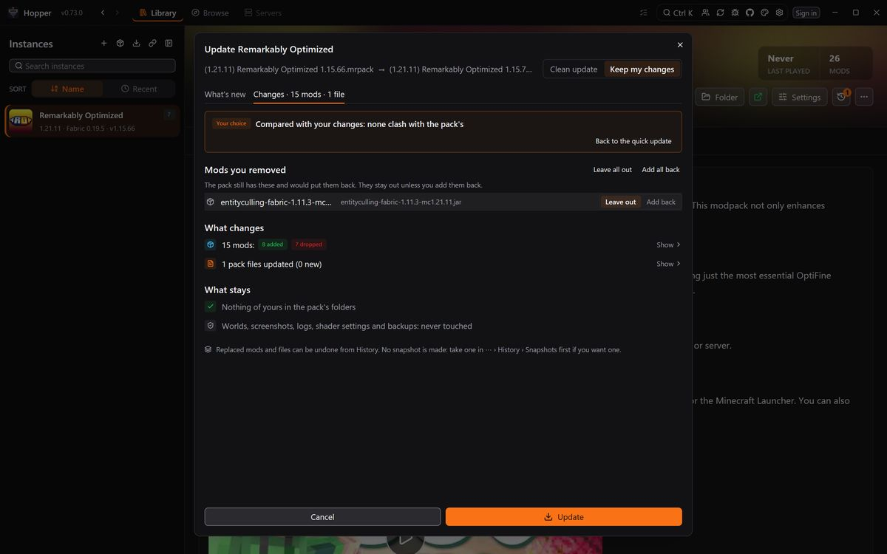

# Modrinth pack updates keep mods whose jar gets a new name

**Branch:** t3/eace0226   **Commit:** d304457   **Size:** S
**Apps:** both (shared core: desktop update dialog, follows/groups, Hopper Server use the same `packdiff::plan`)

## From -> to
- Before: updating a Modrinth pack (compared with the installed version, which every update without hand-picked choices does) listed every mod whose jar name changed as "Mods you removed" and left it out. Remarkably Optimized (1.21.11) 1.15.66 -> 1.15.70: 27 jars -> 20.
- After: only mods with no copy left in the folder (on or off) count as removed. Same update: 28 jars = the pack's 28, minus the one the player removed, plus the player's own mod; a turned-off mod arrives turned off under its new name.

## Screenshots
| State | Before | After |
|---|---|---|
| Mods tab at 1.15.66 (Gnetum off, entityculling removed) | before-mods.png | - |
| Update dialog, Compare with my changes | no before (old build not run on rig; old logic would list all 8 renamed jars) | preview-compare.png: only entityculling under "Mods you removed" |
| After update | - | after-update.png: v1.15.70, Updated |

## Measurements
No visual claims; no UI change. Jar counts from the instance's mods folder, diffed against the 1.15.70 mrpack index:
| Check | Numbers | Result |
|---|---|---|
| jars after update | 28 on disk; pack lists 28 | ok |
| pack mods missing | entityculling only (player removed it) | ok |
| extra on disk | appleskin only (player added it) | ok |
| turned-off renamed mod | Gnetum-4.6.3+1.21.11-fabric.jar.disabled | ok |

## Files
- `crates/hopper-core/src/packdiff.rs`: `mr_removed` checks the folder; `mr_changes` helper
- `crates/hopper-core/src/modpack.rs`: fixture test + network test

## How tested
- Tests: `pack_fix_tests::mrpack_update_keeps_renamed_mods` red on old logic (flagged keep/off renames as removed), green after; `real_mrpack_update_keeps_renamed_mods` (ignored, network) 26.3 1.15.66 -> 1.15.70: 30 -> 30 jars, plan removed = 0. `cargo test -p hopper-core --lib`: 1396 passed. `cargo test -p hopperd`: see report.
- On screen: rig test build, scratch HOPPER_DATA_DIR, installed (1.21.11) 1.15.66 from Browse, removed entityculling, turned Gnetum off, added AppleSkin, Versions -> Compare first -> Keep my changes -> Compare with my changes -> Update.
- NOT checked: Hopper Server web UI update flow on screen; a group/follow sync update on screen (same code path); CurseForge packs (unchanged code).
- Test data: throwaway instance in E:\rig-scratch\mrrename, deleted.

## Notes for the maintainer
- Scratch build logged `RefCell already borrowed` and exited twice during MCP clicks on the Browse page (before any update); not related to this change, worth a look.
- The update dialog says "Nothing of yours in the pack's folders" although AppleSkin (added by hand) sat in mods/ — the kept-mods count may miss jars dropped into the folder. Not changed here.
- CurseForge server pack updates use their own stem matching and were already fine; Modrinth packs have no server packs.

## Images on the changelog page
- 
