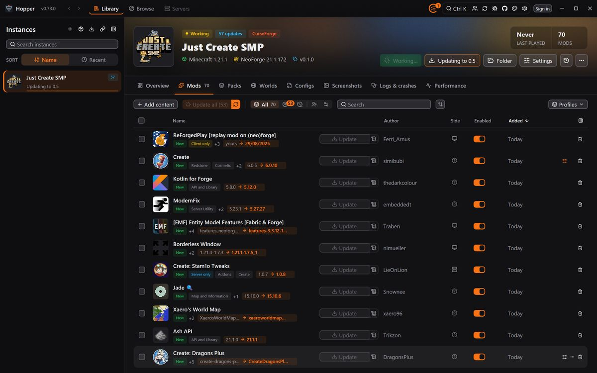
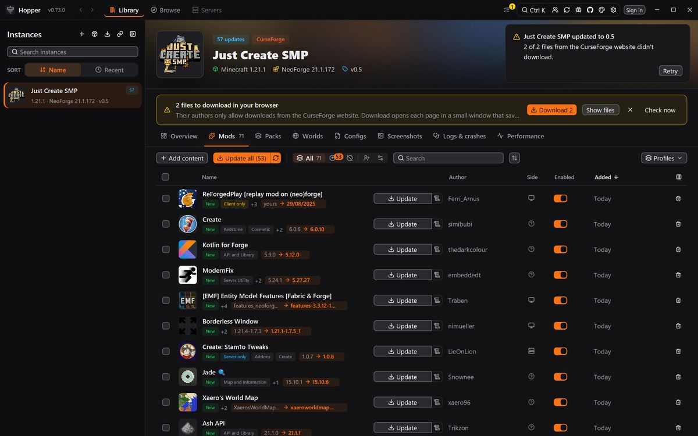

# Pack updates run in the background, with a toast that says how it went

**Branch:** t3/fdf41758   **Commit:** e2605a0   **Size:** M
**Apps:** both (desktop: everything below; Hopper Server web UI: dialog closes on Update, chip on the server page, result toast with the same wording)

## From -> to
- Before: the pack update dialog stayed open with its own progress until the update ended; the CurseForge download window opened white, in front, and took focus; Repair couldn't fetch website-only mods; a paired server was updated before the website-only files arrived, so it missed them.
- After: Update closes the dialog at once. Progress shows on the instance row (caption + bar) and in the header (busy button), and in Tasks. When it ends a toast says how: "Just Create SMP updated to 0.5" / "reinstalled at 0.5" / "rolled back to 0.4", plus "N files came from the CurseForge website" or a warning with **Retry** when some didn't download, or an error toast. The download window opens behind Hopper, never takes focus, in the theme's background. If CurseForge asks the player to tick its bot check, Hopper shows a "… is waiting for you" toast with **Show window**. Repair sends website-only files through the same window. The server update waits for those files first.

## Screenshots (rig, throwaway "Just Create SMP" from CF, scratch HOPPER_DATA_DIR)
| State | File |
|---|---|
| Dialog closed, update running (dark) | shots/22-closed-running.png, shots/15-run-1.png (row "Updating to 0.4 · 43%" + header busy button) |
| Getting files from the website (window behind Hopper) | shots/16-fetch.png |
| Done toast with website files | shots/18-done.png (old wording, see note) |
| Missing toast with Retry (fetch window killed) | shots/24-missing.png |
| After Retry: both files in place | shots/26-retry-done.png |
| Reinstall: title-only toast | shots/32-reinstalled.png |
| Light theme, narrow (986 pt) | shots/39-light-narrow.png, shots/42-narrow-running.png |
| Light, narrow, side panel open, running | shots/43-narrow-panel-running.png |
| Light, narrow, side panel, done | shots/46-narrow-panel-done.png |
| Download window, light theme | shots/44-fetchwin-light.png |
No "before" shots (old build not to hand; Phase 1 mock has the old look).

## Measurements
| Claim | State | Numbers | Result |
|---|---|---|---|
| Download window uses theme background | Hopper Light | window body (250,250,250) = Hopper main bg (250,250,250) | ok |
| Same, dark | Hopper Dark | launched with `--bg=121214`; Hopper bg hsl(240°,5%,7.5%) = #121214. Window pixels NOT sampled in dark (capture missed) | arg ok, pixels not measured |
| Window opens behind Hopper, no focus | 3 runs | z-order: Hopper 53 / window 56; 47 / 50; foreground window same before, during (polled each 1 s) and after | ok (see note on run 2) |
| Row caption on one line, bar inside the row | light, 986 pt, side panel open | caption x 113–246, y 357–376; bar 4 px below; track x 112–498 inside card 18–511 (L aligned with text, R 13 px like the badge) | ok |
| Toast with no body has no blank line | dark, reinstall | single line toast, title only | ok (visual) |

## Files
- `crates/hopper-core/src/jobs.rs`: job toast (done/failed/missing), waits
- `crates/hopper-core/src/modpack.rs`: `place_fetched` wait helper + test
- `crates/hopper-core/src/instance_ops.rs`: repair queues website-only files
- `src/gpui/job_toast.rs` (new): toasts, Retry, waiting-for-you
- `src/gpui/app.rs`: shows toasts when jobs end
- `src/gpui/store.rs`: background update, toast text, server waits for files
- `src/gpui/pack_update.rs`: dialog closes on Update
- `src/gpui/library.rs`, `rigsync.rs`: row/header/server busy states
- `src/gpui/fetch_window.rs`, `fetch_progress.rs`, `main.rs`, `video.rs`: window behind, no focus, theme bg
- `crates/hopperd/ui/src/PackUpdate.svelte`, `ServerPage.svelte`, `lib/packs.svelte.js`: same for the web UI

## How tested
- Tests (on rig, debug): hopper-core lib 1409 ok; hopperd 352 ok; hopper bin 87 ok, 1 fail `anim::tests::packed_frames_unpack_to_the_same_pixels` (pre-existing u8 overflow in debug, anim.rs untouched).
- On screen (rig, MCP): reinstall 0.5, roll back 0.4, update 0.5 (dark + light, wide + narrow + mod side panel), kill the download window mid-way → Missing toast → Retry → files placed.
- NOT checked: the "waiting for you" toast (CurseForge never showed its bot check); the failed toast on screen (offline the versions dialog can't load and Repair has nothing to fetch; covered by the jobs test only); the done toast with the side panel open (missed by screenshot timing; toasts are top-right overlays); server ordering with a real paired server (covered by `waits_for_fetched_files_then_goes_on`); Hopper Server web UI not run in a browser (built only).
- Test data: throwaway instance in rig scratch; moved one jar out and back; scratch deleted afterwards.

## Notes for the maintainer
- Follow-up (not built): B2/B3 side-panel version of the download window.
- Run 2 focus: once the download window was the foreground window; the window that had focus before (another session's test app) had closed just before. Three later runs with a live foreground window never changed it. Worth a look on FOX in normal use.
- Pack's own version can be stale: Just Create SMP 0.4.zip calls itself 0.1.0, so toast now names the file the player picked.
- Pre-existing, not touched: the CurseForge banner on the Mods tab gets squashed (buttons clipped) at 986 pt with the side panel open (46-narrow-panel-done.png); the header hides Update pack at narrow widths, so only the row shows progress there.
- Server-panel toasts still always say "updated to" (no reinstall/rollback wording) in both apps.

## Images on the changelog page
- 
- 
