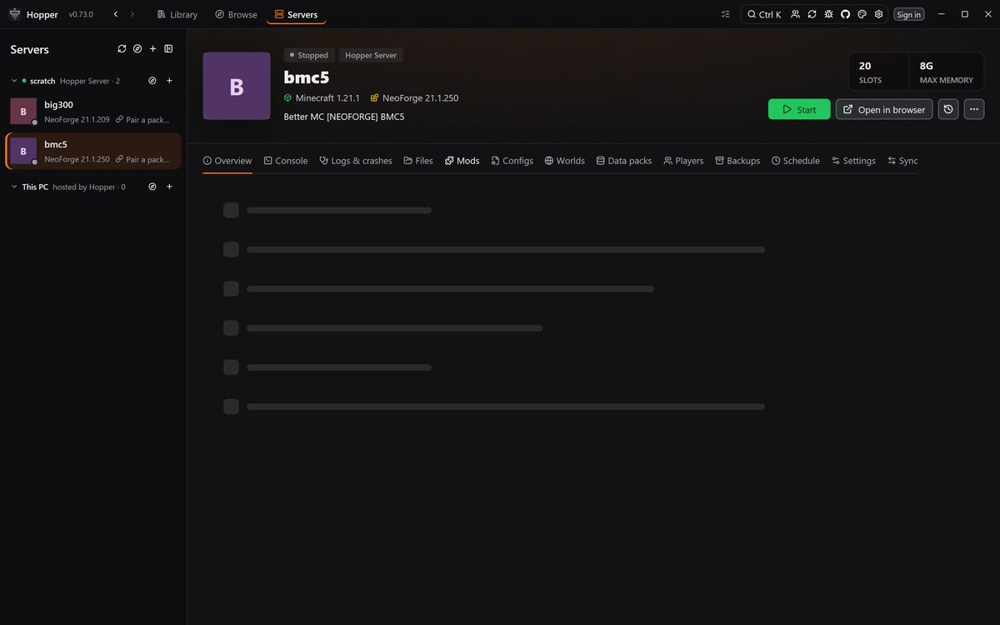

# Server Mods tab: shows the last list at once, one update check instead of two

**Branch:** t3/10078619 (worktree t3-10078619)   **Commit:** 6bfb73f   **Size:** M
**Apps:** desktop only. Hopper Server's web UI has its own list route (`/mods`, ~15 ms) and doesn't have these problems.

## From -> to
- Before: after a restart, opening a Hopper Server server's Mods tab showed a blank area until the panel answered. It then asked the panel for updates twice at the same time. On a panel whose update check was stale, that ran two full CurseForge/Modrinth checks.
- After: the last list (kept on disk per server) shows at once and is swapped for the panel's answer when it comes. With no kept list (first time ever), skeleton rows show instead of a blank area. One update request per open.

## Where the time goes (measured, scratch hopperd 0.68.0 with a copy of BMC5's 291 jars / 350 entries, plus a fake 300-mod server)
Server side, curl, 3 runs each (run 1 = right after the panel starts):
| Endpoint | bmc5 run 1 | bmc5 runs 2-3 | big300 |
|---|---|---|---|
| `/mods/instance` (190 KB) | 130 ms | 69 ms | 51-75 ms |
| `/mods/problems` | 988 ms | 127-149 ms | 140-185 ms |
| `/mods/updates` | 3.2 s (CF/Modrinth check) | 11 ms (6 h cache) | 354 ms / 11 ms |
TLS handshake ~12 ms. A new `Client` per call costs 0.1-0.5 ms; reusing one changed nothing (74-79 ms vs 48-130 ms).

Desktop requests on opening Mods: `/mods/instance`, `/mods/updates` **x2** (one from the tab's own stale check, one because the first list counted as "jars changed" against the empty placeholder), `/mods/problems`, `/configs/index`. All parallel.

Other findings:
- Icons and categories on a **cold desktop cache** take up to 24 s (351 icons from forgecdn at ~14/s in a debug build; categories from `modmeta::fetch`). It's a one-time cost: both are disk-cached afterwards (warm: 335 of 351 icons from disk within ~0.15 s).
- An earlier ~440 ms "gap" between the reply and the table turned out to be my own MCP screenshots: `screenshot` does PrintWindow plus a PNG encode on the UI thread (~0.9 s each in a debug build). Timings below use no screenshots.
- The maintainer's own LAN panel resolves in 22 ms (IPv4 only), so DNS and IPv6 aren't the cause there. Side note: a panel paired by a hostname that resolves to an IPv6 link-local address first can wait ~5 s per new connection, because the panel listens on IPv4 only. Not changed.

## Numbers before / after (rig, debug build, loopback panel; "first rows" = MCP navigate to the table's first rebuild)
| Run | Before | After |
|---|---|---|
| Warm panel, x3 | 116 / 119 / 127 ms; 2 update calls | no kept list: 114 / 153 / 118 ms, 1 call. Kept list: **74 / 37 / 68 ms**, 1 call |
| Cold panel (restarted, update cache dropped), x3 | 144 / 139 / 156 ms; 2 concurrent full checks: 3479+3818, 2856+2871, 2604+3724 ms | **103 / 49 / 72 ms**; 1 check: 3131, 2749, 2706 ms |
| Blank area before rows | blank (before-first-load-blank.png) | skeleton (after-first-load-skeleton.png) |
On loopback the panel answers in ~50-90 ms, so the kept list saves ~50-80 ms here. On a slower link or a bigger pack it saves the whole wait for `/mods/instance`.

## Screenshots
| State | Before | After |
|---|---|---|
| First open, nothing loaded yet | before-first-load-blank.png | after-first-load-skeleton.png |
| List shown | before-cold-no-icons.png (cold desktop cache) / before-cold-filled.png | after-list.png |

## Measurements
| Claim | State | Numbers | Result |
|---|---|---|---|
| Skeleton lines up with the table | Hopper Dark, 200 % scale, bmc5 | skeleton block starts x=563 px; row tick box x=572 px (9 px = ~4.5 logical) | close; same padding as the existing remote Data packs skeleton (`px_6 pt_4`) |
Not measured: light theme, narrow window.

## Files
- `src/gpui/store/server_mods.rs`: keeps the last list on disk (`save_last_in` / `load_last_in`, FNV-hashed file per server under `cache\server-mods`), shows it at once, and drops it when the panel turns out unreachable. "Jars changed" is now worked out before the placeholder is added, and is skipped while a check runs. New test.
- `src/gpui/store.rs`: `Msg::ServerModsKept` plus its handler line.
- `src/gpui/addons.rs`: skeleton rows while a Hopper Server list loads for the first time.
- `crates/hopper-core/src/hopperd.rs`: `Client::get` logs each call and its time at debug level (`RUST_LOG=hopper_core::hopperd=debug`).

## How tested
- Tests: `store::server_mods` tests (new one included) pass. Full hopper-core --lib, --bin hopper and hopperd suites NOT run (stopped by master while the build slots moved).
- On screen: rig, scratch hopperd plus a scratch desktop data dir (`HOPPER_DATA_DIR`, loopback, test window). I navigated to bmc5 > Mods by MCP and read the debug log for timings.
- NOT checked: real LAN panel, release build, a 1,000-mod pack, light theme, Resource packs / Shaders tabs on a remote (they use the same list, so the same cache applies, but I didn't open them), and the panel going offline with a kept list shown (code drops the kept list and shows the error; not seen on screen).
- Test data: scratch only (copy of BMC5's mods folder in a scratch servers-root). Deleted afterwards.

## Notes for the maintainer
- The big remaining wait is server-side: a stale `/mods/updates` takes about 3 s (291 mods) while the panel asks the sites. Possible follow-up: hopperd answers with the stale offers at once and refreshes in the background.
- `/mods/problems` takes ~1 s right after a panel start.
- `/configs/index` took 612 ms once, cold.
- The kept files are never pruned when a server is removed. Each is ~200 KB.
- Hopper Server web UI: no change needed. It lists through `/mods`, which answers in ~15 ms.

## Images on the changelog page
- 
- 
