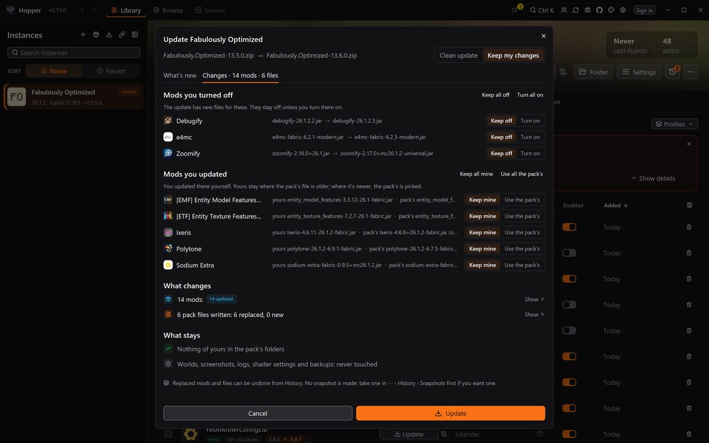

# Pack updates keep the mods you updated and the pack's own override jars

**Branch:** t3/5c18e031   **Commit:** 5730d0f   **Size:** M
**Apps:** desktop + group follow (both run `packdiff::plan` + `modpack::update_any`). Hopper Server's server pack update already keeps the instance's versions (`server_pack_update::split_versions`), so it was left alone.

## From -> to
- Before: a normal ("Keep my changes") pack update put every pack mod you had updated back to the pack's older file with no question. It also removed a jar the pack ships in its zip's overrides/mods (a mod no longer on CurseForge, like CC Tweaked Compat in TNP Limitless 8) whenever your copy was already the same file.
- After: when no older pack version is known, a mod file newer than the pack's counts as yours. It shows under "Mods you updated" with "Keep mine" picked, and the pack's file is still picked when the pack's is newer. A jar the new version ships in its overrides is never listed or dropped as removed. A clean update still resets everything to the pack.

## Screenshots
| State | Before | After |
|---|---|---|
| Update preview, Changes tab (throwaway FO 13.5.0 -> 13.6.0) | no before (old build not run on the throwaway; the user's real History shows the before: "Rolled back Block Prints 2.4.0 -> 2.3.0" etc.) | after-plan.png |
| Mods folder | before-mods.txt | after-mods.txt |

## Measurements
No visual change. The plan only gains rows in the existing "Mods you updated" list. Nothing was measured.

## Files
- `crates/hopper-core/src/packdiff.rs`:
  - `plan`: a quick update reads the installed version's manifest from the pack cache.
  - `cf_mod_changes` and the new `sort_pack_files`: a newer file counts as yours when there's no base.
  - New `keep_shipped_jars`: a jar shipped in the new overrides is not a Remove.
- `crates/hopper-core/src/modpack.rs`:
  - `shipped_set` and `mr_shipped_set`: skipped override jars still count as the pack's.
  - The call in `apply_pack`.

## How tested
- Tests (red first, then green):
  - `packdiff::tests::a_quick_update_never_puts_back_an_older_file`
  - `packdiff::tests::a_jar_the_new_version_ships_in_overrides_is_not_dropped`
  - `modpack::pack_fix_tests::a_skipped_override_jar_is_not_dropped`

  Full `cargo test -p hopper-core --lib`: 1411 passed, 0 failed. `--bin hopper`: 87 passed, 1 failed (`anim::tests::packed_frames_unpack_to_the_same_pixels`, a u8 multiply overflow in a test I did not touch). `-p hopperd`: 351 passed, 1 failed (`ui::tests::built_page_has_no_inline_script_or_style`, because the web UI is not built in this worktree).
- On screen (rig, slot 3, scratch data dir, loopback, MCP 47836):
  1. Installed Fabulously Optimized 13.5.0 on a throwaway.
  2. Updated EMF, ETF, Ixeris, Polytone, Sodium Extra and Controlify to their latest files, and turned off Debugify, e4mc and Zoomify.
  3. Ran Update pack to 13.6.0 with "Keep my changes".

  The preview listed all 3 off mods as "Keep off" and 5 player updates as "Keep mine". Controlify had no row because 13.6.0 ships the same 3.5.3. After the update, all 6 of the player's files were unchanged. The 3 off mods moved to 13.6.0's files and stayed `.disabled`, and the 8 other pack mods moved to 13.6.0.
- NOT checked on screen: the override-jar case (I had no small pack that ships a jar in its overrides; the unit tests cover it), the Modrinth pack update, group follow, and a clean update on the throwaway.
- Test data: the throwaway and its rig scratch are deleted, and the app is stopped.

## Notes for the maintainer
- `mr_shipped_set` (used inside `apply_mrpack_with`) changed in its helper only. Tell the agent working on Modrinth renamed-mod drops in `apply_mrpack_with`.
- The user's real instance was only read. They'll Undo from History themselves (the list is in the session report).
- Separate path not fixed here: a single-mod update replaced the turned-off mekanism_magic 1.0.7 with 1.0.7fix turned ON (2026-11-11, backup 1794370375).
- Default settings have `clean_pack_updates: true` for a fresh data dir. Worth checking that this is intended.

## Images on the changelog page
- 
