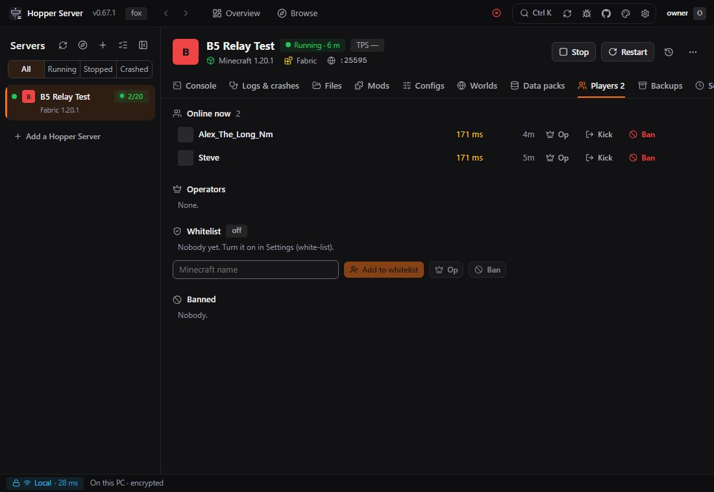

# Relay through a VPS: real ping for relayed players, Velocity 4.3.1 (B5)

**Branch:** t3/vps-relay-b5-ping-velocity-pins   **Commit:** 6df713b (branch t3/vps-relay-b5-ping-velocity-pins)   **Size:** M
**Apps:** Hopper Server (desktop's server Players tab gets the new fields but its tooltip is left for B8; another agent owns `src/gpui`)

## From -> to
- Before: players who joined through the VPS relay showed "—" (or ~0 ms) in the Players tab ping column; the relay ran Velocity 3.5.1 (support ended 2026-09-30) on Java 21.
- After: they show their real ping (to the relay + relay to home), measured at the relay, with a tooltip saying so; the relay installs Velocity 4.3.1 on Java 25, and "Run again" upgrades an existing 3.5.1 relay.

## Screenshots (every state)
| State | Before | After |
|---|---|---|
| Players, 2 relayed players (150 ms + 20 ms netem), dark, 1100 px | no before | after-players-dark-1100.png |
| same, light, 1100 px | no before | after-players-light-1100.png |
| same, dark, 640 px (narrow, sidebar collapsed to top) | no before | after-players-dark-640.png |
| same, light, 640 px | no before | after-players-light-640.png |
| Ping text zoom | | zoom-ping-dark.png |

No before shot: the old build is not to hand; it showed "—" for relayed players (no reading). The look of the column is unchanged; only the value and the tooltip text are new. The tooltip is the native `title`, so it can't be screenshotted; its text read from the DOM: "Measured at the relay: 151 ms to the relay + 20 ms from the relay to this server".

## Measurements
| Claim | State measured | Numbers | Result |
|---|---|---|---|
| Ping on one line, no clipping | dark + light, 1100 + 640 px, "171 ms" | ping box 64 x 18.8 px, getClientRects = 1 | ok |
| Long name not clipped | "Alex_The_Long_Nm" (16 chars) | 114.4 px, scrollWidth = clientWidth | ok |
| Row items on one axis, no overlap | all 4 shots | rows 34 px; every child centre on one y (e.g. 208 at 1100, 404 at 640); no intersecting boxes | ok |
| Row buttons inside the row | 1100 / 640 | buttons end 1018 in 1026 / 614 in 622 | ok |
| Ping text contrast, dark | sampled pixels | rgb(250,204,21) on rgb(18,18,20): 12.22:1 | ok |
| Ping text contrast, light | sampled pixels | rgb(202,138,4) on rgb(250,250,250): 2.81:1 | under 4.5:1: shared `--gold` ping colour, existing, not changed here |
| Shown ping matches real delay | netem on WSL `loopback0` | none: 1 ms; +40 ms: 42–44 (kernel srtt 42.6); +150/+20: 170–173 (relay 151–153 + home 18–20) | ok (within 3 ms) |

Not measured: a side panel open on the server page (the Players tab has no side panel); 3-digit ping at 640 px is measured ("171 ms").

## Files
- `crates/hopperd/src/player_ping.rs`: relay readings, oldest name wins
- `crates/hopperd/src/vps/relay_end.rs`: reads Login Start name, answers ping asks
- `crates/hopperd/src/vps/home.rs`: asks relay, caches answer 3 s
- `crates/hopperd/src/vps/mod.rs`: `pings` flag, `RelayLine`/`Ping`
- `crates/hopperd/src/vps/setup/plan.rs`: Velocity 4.3.1 + Temurin 25 pins
- `crates/hopperd/src/manage_api.rs`, `vps/setup/mod.rs`: call site, comment
- `crates/hopperd/src/vps/tests.rs`: 2 new tests
- `crates/hopperd/ui/src/Players.svelte`: tooltip text
- `design/vps-relay.md`: "B5 as built"

## How tested
- Tests: `cargo test -p hopperd` (incl. new `ping_ask_keeps_the_routes`, `home_gets_the_relays_ping_readings`), `cargo test -p hopper-core --lib`: hopperd 352 passed, 0 failed (3 ignored); hopper-core 1391 passed, 0 failed (60 ignored).
- On screen: scratch Hopper Server (headless Chromium), Players tab with two offline bots joined through the relay on the WSL test VPS.
- Velocity log shows each client's real address + port (PROXY v2, already in B4).
- Upgrade: box set back to 3.5.1 + Java 21, "Run again" replaced both, Velocity 4.3.1 booted, bot logged in.
- NOT checked: real Mojang login (test box runs Velocity offline via `HOPPERD_VPS_TEST_OFFLINE`); aarch64 Java on a real ARM box (hash checked only); NeoForge/PCF on 4.3.1 (FabricProxy-Lite tested).
- Test data: scratch panel + Fabric 1.20.1 scratch server in the session scratchpad; WSL box reset from clean.tar; netem removed.

## Notes for the maintainer
- Desktop tooltip for relayed pings: B8.
- Light-theme ping amber is 2.81:1 everywhere (not new).
- No "Go back" copy of the old jar/Java is kept on upgrade.

## Images on the changelog page
- 
