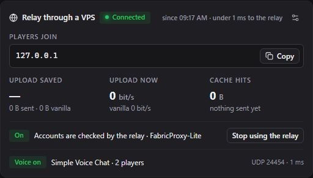
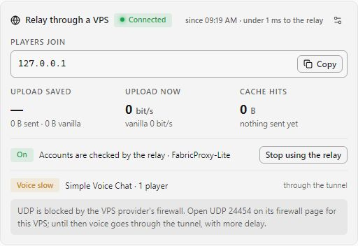

# Relay through a VPS: voice chat goes through the relay too (B6)

**Branch:** t3/relay-voice-b6   **Commit:** 9c9d55d   **Size:** M
**Apps:** Hopper Server (desktop relay card voice row is B8; another agent owns `src/gpui`)

## From -> to
- Before: with a server on the VPS relay, Simple Voice Chat / Plasmo Voice still told players to connect to the home address, so voice chat didn't work for relayed players (and needed a port open at home).
- After: the relay carries voice UDP too (players → VPS UDP 24454 → home, home dials out, sealed with keys from the tunnel). "Use the relay" points the voice mod at the relay (in History, undone by Play at home / Stop). The relay card shows a voice row; if UDP can't get through, voice falls back to the tunnel and the card says "Open UDP 24454".

## Screenshots (every state)
| State | Before | After (full page) | Card crop |
|---|---|---|---|
| Voice on, 1 player, UDP · 1 ms | no row (new) | after-voice-on-{dark,light}-{1100,640}.png | card-voice-on-{dark,light}-1100.png |
| Voice slow, through the tunnel + "Open UDP 24454" note | — | after-voice-tcp-*.png | card-voice-tcp-*.png |
| Checking UDP (first 15 s after connect) | — | after-voice-checking-*.png | card-voice-checking-*.png |
| Old relay (B5 binary): "The relay needs an update for voice." + Repair | — | after-voice-old-*.png | card-voice-old-*.png |
| Not through the relay yet (direct) | — | after-voice-notset-*.png | card-voice-notset-*.png |
| Longest text: added after Use ("stop and use the relay again to add it") | — | after-voice-added-later-*.png | card-voice-added-later-*.png |

No before shot: the row is new; the rest of the card is unchanged. Play at home shows no voice row (its existing note covers it). Mock: https://claude.ai/artifact/1DJqVX2aWJixjJMFqefEGp (option A built).

## Measurements
| Claim | State measured | Numbers | Result |
|---|---|---|---|
| Row on one line, nothing clipped | all 6 states, dark + light, 1100 (card 512 px, narrowest) / 900 / 640 | every child `getClientRects` = 1; `.vt` scrollWidth = clientWidth (not ellipsized) in every state incl. longest text | ok |
| Items on one axis, no overlap | all shots | child centres equal (430.3 / 626.6 / 433 / 473.1 px per state); no intersecting boxes | ok |
| Inside the card | all shots | right gap to card edge 15 px everywhere (card 266–778 at 1100, 18–622 at 640); page scrollWidth = viewport (no horizontal scroll) | ok |
| Note wraps inside card | tcp, 1100 / 900 / 640 | note 482 / 586 / 574 px, scrollWidth = clientWidth | ok |
| Text contrast | sampled pixels, 1100 | row text 14.05:1 dark, 16.12:1 light; right-side text 5.89:1 dark, 5.74:1 light; grey pill 4.98:1 dark, 5.30:1 light | ok |
| Pill contrast | sampled pixels | "Voice on" 6.52 dark / 2.70 light; "Voice slow" 8.48 dark / 2.43 light | light under 4.5:1: shared `.pill.running/.starting` colours; the existing "Connected" pill measures the same 2.70:1. Not changed here |

Not measured: 640 px pixel contrast (sample boxes missed; same CSS as 1100); a side panel on the server page (none opens beside the console card).

## Files
- `crates/hopperd/src/vps/voice/mod.rs`: protocol: keys, seal/open, replay, limits
- `crates/hopperd/src/vps/voice/relay.rs`: relay's UDP voice port
- `crates/hopperd/src/vps/voice/home.rs`: home voice link, TCP fallback
- `crates/hopperd/src/vps/voice/tests.rs`: 14 tests (AEAD, fuzz, end to end)
- `crates/hopper-core/src/hosting/voice_mods.rs`: detect SVC/Plasmo, set/restore address
- `crates/hopperd/src/vps/{link,relay_end,home,mod,forward}.rs`: exporter keys, voice port, Use/Stop step, card JSON
- `crates/hopperd/src/vps/setup/{mod,plan}.rs`: UDP firewall rule, `--voice-port`, repair check
- `crates/hopperd/ui/src/RelayCard.svelte`: voice row + note
- `design/vps-relay.md`: "B6 as built"

## How tested
- Tests: `cargo test -p hopperd` 368 passed (3 ignored), `cargo test -p hopper-core --lib` 1404 passed. Voice: 14 passed (tamper every byte/bit, replay in/out of window, wrong session, oversize, 20k random datagrams, frames split anywhere, buckets, UDP 400/400, tunnel 200/200, forged/garbage/flood, 409k fakes vs players 200/200, nothing passes without home).
- WSL test VPS + scratch panel + Fabric 1.20.1 server with SVC 2.6.27 (port 24455), SVC's own ping as the client, 20 ms apart:
  - direct baseline 500/500, median 0.20 ms
  - through relay UDP 1500/1500, median ~1.0 ms, p95 1.2, worst 1.7
  - home UDP dropped (tunnel) 1000/1000, median 1.23 ms, worst 2.68; checking 15 s → tcp; back to UDP within 2 s after unblock
  - junk flood ~95k pkt/s: 79/200 before the fix found here, 200/200 after
- Use / Play at home / Back / Stop on the running server: SVC log `Voice host is '127.0.0.1:24454'` after Use/Back, empty after Home/Stop; History entries with was/now.
- Repair from a B5 relay binary: "old" → Run again → "Voice on". ufw: Run again added `24454/udp`; Remove took all 3 rules out.
- NOT checked: real game client talking; Plasmo Voice running; real provider UDP block (iptables stand-in); iptables REJECT path on a box (unit tests only).
- Test data: scratch panel/server in the session scratchpad; WSL box reset from clean.tar; hopper-build WSL distro made for the Linux build and unregistered afterwards. Note: `X:\Dev\hopper-vps-test\known_hosts` was empty (0 bytes since 03:18); refilled from the box's key after checking its fingerprint from inside WSL.

## Notes for the maintainer
- Found + fixed during VPS test: fake sealed packets drained the shared tag-check budget so home's real replies were dropped. Now cheap checks first and home's address skips the budget.
- One voice port per relay: with several servers (B7) only the first relayed server with a voice mod gets voice.
- "Ports open from the internet" checks TCP only; UDP is judged by home's voice link (card note).
- Desktop voice row: B8.

## Images on the changelog page
- 
- 
