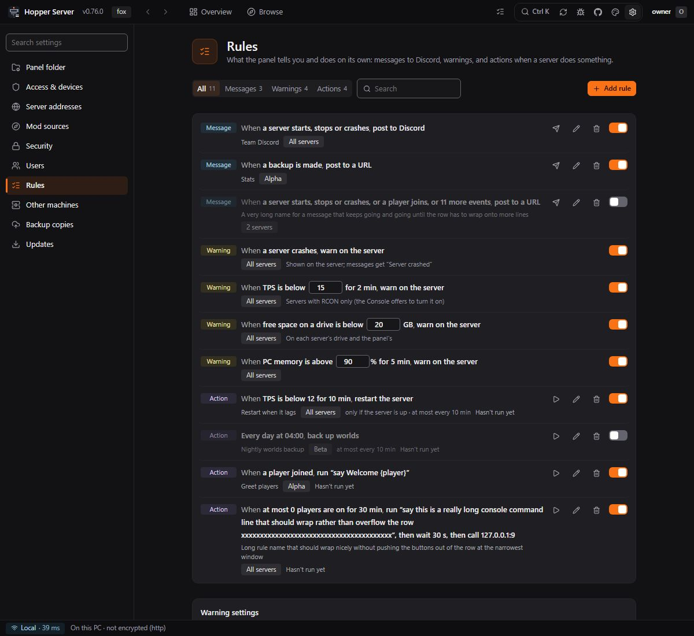
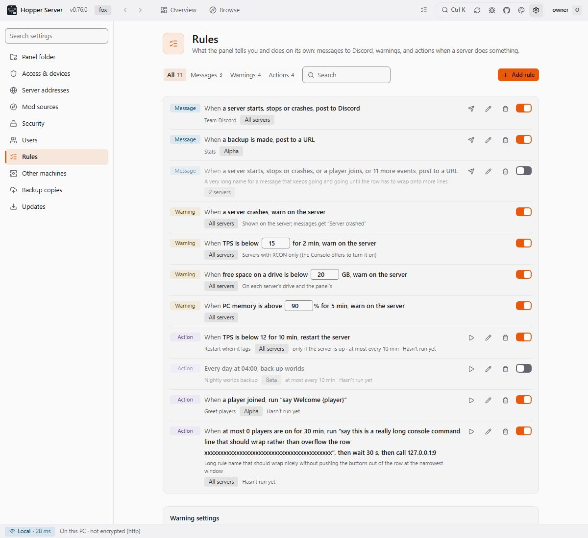
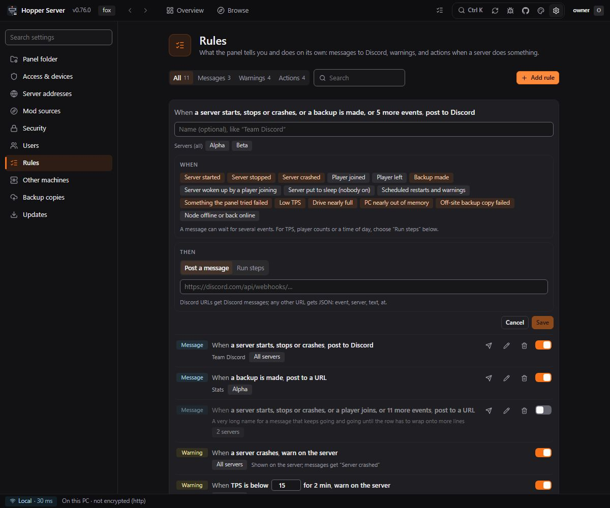
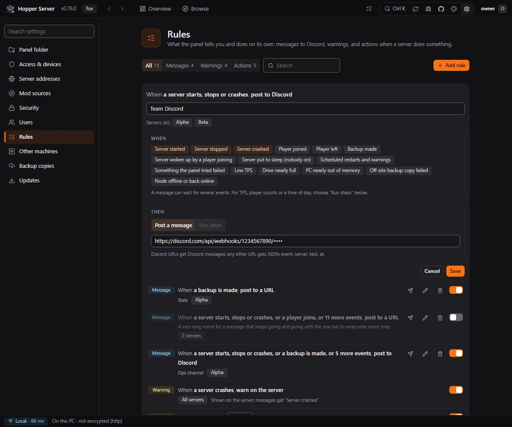
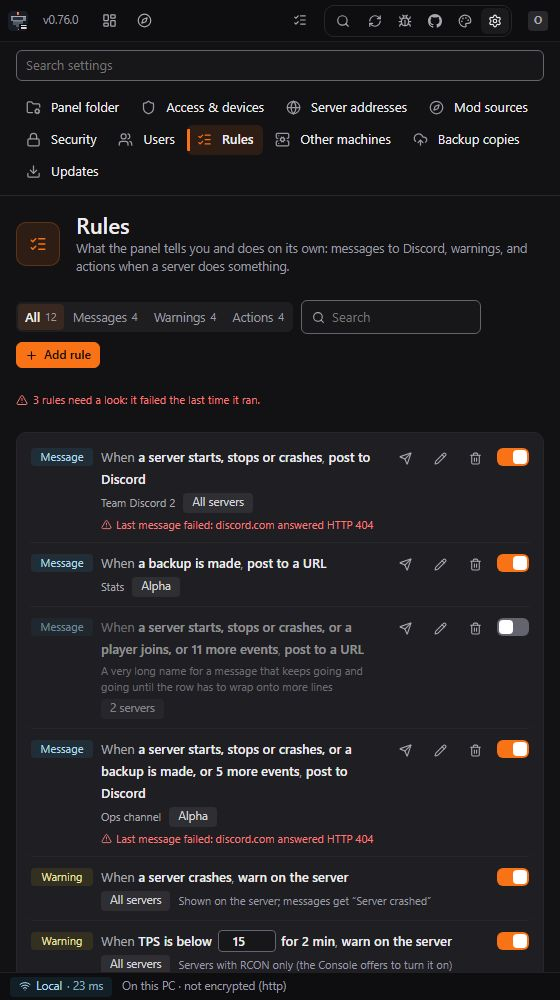
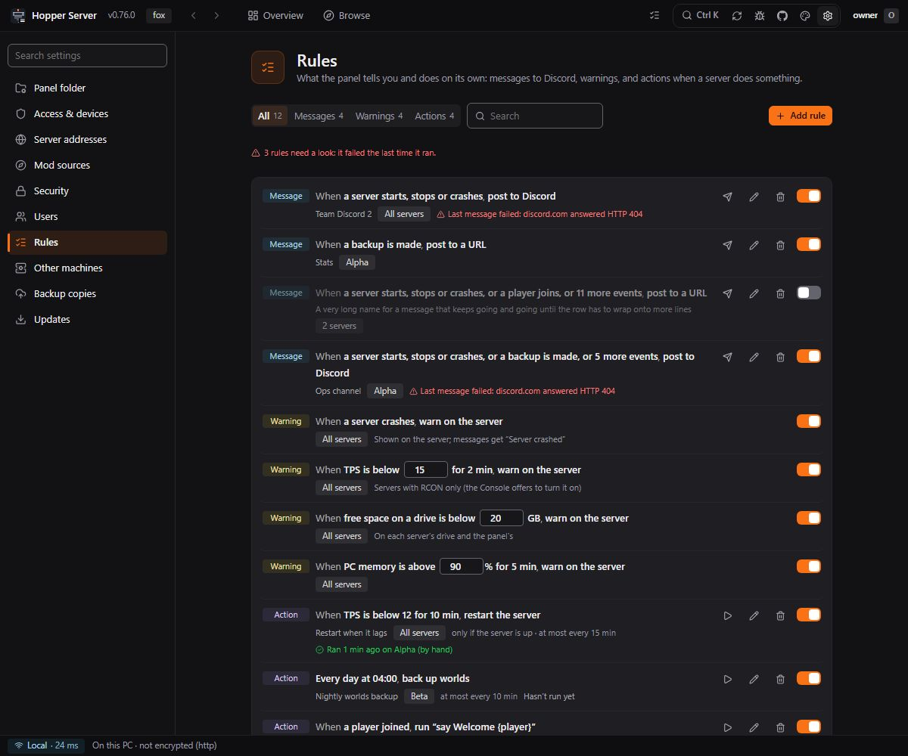
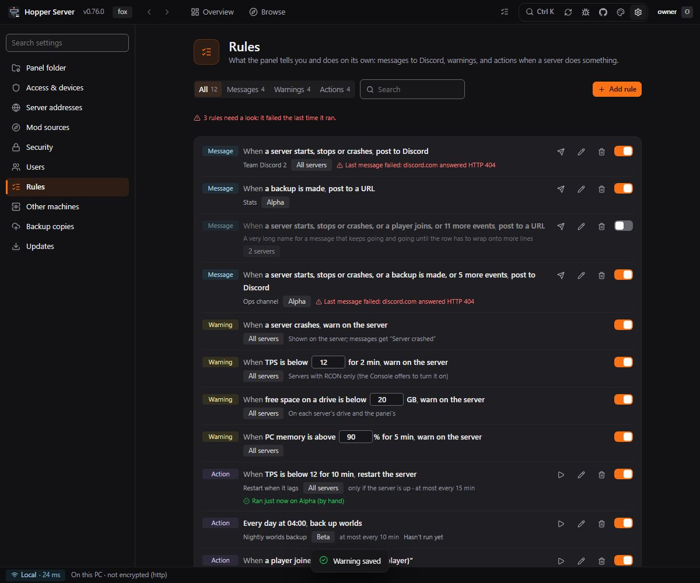

# Rules page: one list of "When X, then Y" sentences

**Branch:** t3/hopperd-rules-sentence-list   **Commit:** be2956bc   **Size:** L
**Apps:** Hopper Server only. Parity N/A: Hopper desktop has no rules screens.

## Mock
https://claude.ai/artifact/YXCpj4mLSUJGYQxFAqPaaY (HTML copies in `X:\Dev\hopper\mockups\hopperd-rules-list\`).
Pick: **Rows A + Editor A**. One row per rule that reads as a sentence, and one editor with When and Then, so a player never has to know which of three lists a rule lives in.

## From -> to
- Before: Messages, Warnings and Actions were three lists with three different forms and buttons.
- After: one list. Each row reads "When **a server crashes**, **post to Discord**" with a kind chip, a server chip, the last run or error, row buttons and an on/off switch. One "Add rule" button opens one editor.

## Screenshots (web UI, headless Chrome on a scratch panel; "no before": the old build was not to hand)
       

Full set kept in the change folder (not copied to the site); the ones above are on the page.

| State | After |
|---|---|
| Whole list, dark / light | 01-all-dark.png, 02-all-light.png, 20-all-1200-dark.png, 20-all-1200-light.png |
| Filters Messages / Warnings / Actions | 03-filter-messages-dark.png, 03-filter-warnings-dark.png, 03-filter-actions-dark.png |
| Search (match, no match) | 04-search-discord-dark.png, 05-search-none-dark.png |
| Add message, add action, switch Then | 06-add-message-dark.png, 07-add-action-dark.png, 08-add-switch-to-steps-dark.png |
| Edit message, edit action | 09-edit-message-dark.png, 10-edit-action-dark.png |
| Switches (message, action, warning) | 11-switched-dark.png |
| Warning number edit: saved, out of range | 12-warning-inline-saved-dark.png, 13-warning-inline-bad-dark.png |
| Failing banner and failing rows | 14-failing-banner-dark.png, 14a-test-toast-dark.png (Send a test fails) |
| Run now: server picker, power confirm, history | 15-run-picker-dark.png, 16-run-confirm-dark.png, 17-run-history-open-dark.png |
| Remove confirm | 18-remove-confirm-dark.png |
| Old link `#/settings/automations` | 19-old-link-automations-dark.png |
| 560 px: list, editor (message / steps), history open; dark and light | 20-all-560-*.png, 21-editor-message-560-*.png, 22-editor-steps-560-*.png, 23-history-open-560-*.png |
| 1200 px editor and history, dark and light | 21-/22-/23-...-1200-*.png |

## Measurements (computed layout and canvas-resolved colours in headless Chrome; raw numbers in `measurements.json`, `contrast.json`)
| Claim | State measured | Numbers | Result |
|---|---|---|---|
| No horizontal scroll, list | 560 px and 1200 px, dark and light, 12 rows incl. longest name and a "11 more events" sentence | document scrollWidth 560 / 560, 1200 / 1200 | ok |
| No row content clipped or overflowing | same, every row: child right edge vs row, scrollWidth vs clientWidth, text block scroll | 0 of 12 rows over, all four runs | ok |
| Switch column lines up | same | right edge 529 px on all rows at 560; 1085 px on all rows at 1200 | ok (all equal) |
| Long sentences wrap, no clipping | longest message row at 560 px | row heights 64 to 187 px; no overflow | ok |
| Editor fits | add message (long name typed), switched to steps, 560 and 1200, both themes | editor 506 px wide at 560 (27 to 533), 0 children outside it, document scroll = window | ok |
| History open does not overflow | 560 and 1200, both themes | document scroll = window | ok |
| Text readable (contrast, ratio) | dark: sentence 6.96, bold 14.05, meta 5.89, failure text 6.19, kind chips 9.1 to 10.0, server chip 9.04 | all >= 4.5 | ok |
| same, light | sentence 5.74, bold 16.12, meta 5.74, failure 6.51, kind chips 6.95 to 8.59, server chip 10.24 | all >= 4.5 | ok |

Disabled rows are dimmed on purpose; their contrast was not measured.

## Behaviour checked on the running scratch panel (API read back after each action)
- Add message and add action saved to the right stores; editor opens as steps when the Actions filter is on.
- Edit keeps the kind: the other Then option is disabled; message URL stays masked; the name and an action's cooldown change saved (name "Team Discord 2"; cooldown 15).
- Switch: message, action and warning each flipped and flipped back (API `enabled` / `disk_on` matched).
- Warning number: TPS 12 saved ("Warning saved"); TPS 50 refused with "Pick a number from 1 to 20." and the box went back to 12. RAM 85 saved. All restored afterwards.
- RCON switch flipped `auto_rcon` and back.
- Send a test on a dead URL: toast with the error. Failing banner: "3 rules need a look".
- Run now: one covered server runs at once (stopped server gave "The server isn't running." and a failed history line); two servers show a picker; a restart asks to confirm, then "ran on Alpha: 1 step done".
- Remove asked "Remove Say hi on join?" and the row and API entry were gone.
- Old links `#/settings/webhooks|alerts|automations` open Messages, Warnings, Actions.
- Page and console errors: none (the only console error is the expected 400 from the failing test).

## Files (all under `crates/hopperd/ui/`)
- `src/Rules.svelte`: one list, filters, search, state, actions
- `src/RuleRow.svelte` (new): the sentence row
- `src/RuleForm.svelte`: one editor, When and Then
- `src/lib/rulesList.js` (new): sentences, items, filter, counts
- `src/lib/ruleForm.js` (new): form state and request bodies
- `src/lib/rulesPage.js`: trimmed to filters and old links
- `src/Webhooks.svelte`, `src/Alerts.svelte`, `src/Automations.svelte`: removed
- `tests/ruleslist.test.mjs`, `tests/ruleform.test.mjs` (new), `tests/rulespage.test.mjs`: tests

No Rust changes. The three stores and routes are as they were; no data migration.

## How tested
- Tests: `pnpm --dir crates/hopperd/ui test`: 109 pass, 0 fail (was 87). `pnpm build` ok.
- Rust: `cargo-ccd1 build -p hopperd --profile fast` ok (embeds the new UI).
- On screen: see above. Scratch hopperd (`--portable --port 18811 --home <scratch> --data <scratch>`, `HOPPERD_SERVICE=hopperd-test`, `HOPPER_LOOPBACK=1`, 127.0.0.1), headless Chrome, two scratch servers.
- NOT checked:
  - Drag across several switches (pointer drag-pick) on the new rows.
  - Keyboard focus ring on the new inline number boxes and row buttons.
  - A message actually delivered to a working Discord URL (only dead and fake URLs).
  - The Node-offline warning row (scratch panel has no nodes) and a node-scoped server chip.
  - Disabled rows' contrast; widths between 560 and 1200 px; zoom levels other than 100%.
  - The old "Warnings" card showed the minutes only as text; they stay non-editable, as today.
- Test data: scratch servers Alpha and Beta, fake webhooks (two pointed at discord.com with a fake id, which answered 404; the rest at 127.0.0.1:9). Nothing real touched. `%APPDATA%\hopperd` untouched. Scratch panel stopped.

## Notes for the maintainer
- A pre-existing svelte warning (`state_referenced_locally` on `$state(start)` in Rules.svelte) is left alone.
- The failing banner says "N rules need a look" for messages too; kept the old wording.
- Follow-up idea: let a message rule use the steps' When options (TPS, daily); today messages use event chips only.
