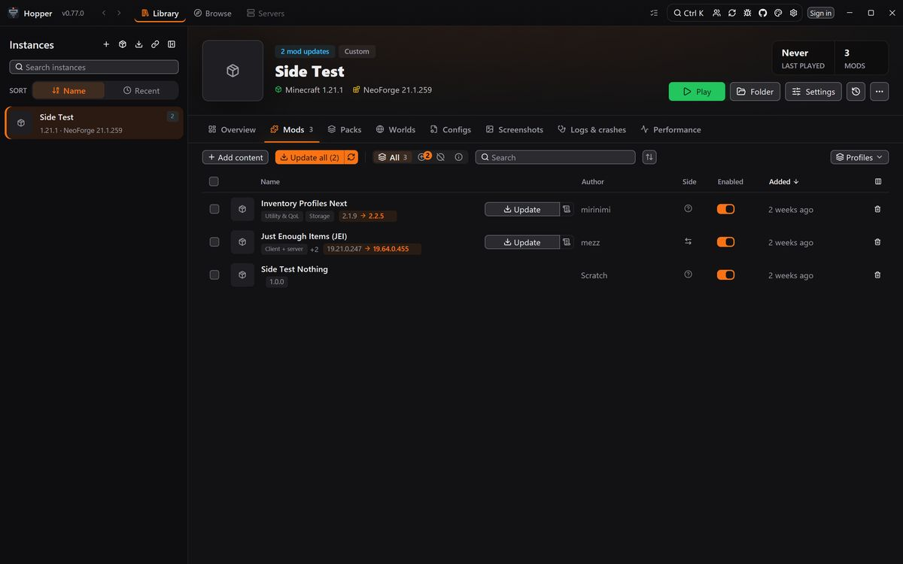
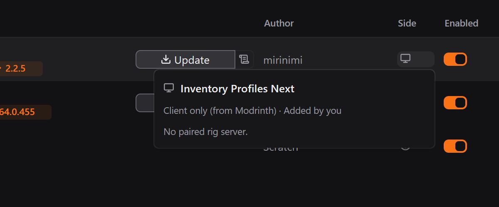

# Mods: Modrinth's side when CurseForge doesn't tag one

Commit `3ca7a4f` on branch `t3/5929ef46` (from main at d9b6114). Not pushed.

## What changed
Mods CurseForge doesn't tag Client / Server (Inventory Profiles Next: its 1.21.1 NeoForge file has only a version and a loader) showed a "?" side and no chip. They now show Modrinth's side. A CurseForge tag still wins; unknown on both stays "?".

- **hopper-core `modsides`** (new, one helper for every list): `resolve(cf_env, modrinth)`, `side_of(addon)` (memory only, no I/O), `look_up(inst)` (blocking, run off the UI thread), `look_up_in_background` (Hopper Server), `generation()` (lists redraw when it moves). The lookup reuses `modrinth::sides_of` (jar sha1, `mrsides2.json`) then `modrinth::sides_by_slug` (CurseForge slug + title match, `mrslugsides.json`): the same lookups and caches server sync uses. Misses are remembered too.
- **Desktop Mods tab**: side icon, "Client only" chip, the side hover card, the Client-only filter and its count, Side sort, the "Keep only on this PC" and "client-only mods on" notices. The chip's tooltip and the card say "Client only (from Modrinth)".
- **Mod peek**: the side line falls back to Modrinth for an installed mod when no CurseForge file says (tooltip "… (from Modrinth)").
- **Server sync rows**: jar's own word, then the shared helper (lookup runs in `rigsync::client_mods`, already off the UI thread).
- **MCP `state`/mod data**: `side` uses the helper.
- **Hopper Server**: `/mods/list` asks in the background, sends `side_from: "modrinth"` and `sides_pending` (the page re-polls as for categories). Side cell, chip and peek say "(from Modrinth)".
- Pack update window: shows no side, so nothing to change. Friends/group lists: no side shown.

## Checked on screen (rig, slot 2, scratch `E:\dev\scratch\mrside`)
Scratch instance "Side Test" (NeoForge 1.21.1): Inventory Profiles Next (CF 495267, env ""), JEI (CF env "both"), "Side Test Nothing" (fake slug, no project). `state` showed only that instance.

| Place | Before | After |
|---|---|---|
| Mods tab, dark 1440x900 |  IPN "?" no chip |  IPN monitor icon + "Client only"; JEI unchanged; fake mod "?" |
| Side hover card |  "Side unknown…" |  "Client only (from Modrinth) · Added by you" |
| Chip tooltip, dark | none |  "Client only (from Modrinth)" |
| Chip tooltip, light | none |  |
| Light, 960x600 (minimum window) | – |  inline side icons by the name |
| Peek open, light 960x600 | – |  no wrap/overlap; IPN chip folds into "+1" like other chips |
| Peek open, dark | – |  |

After a restart the sides show at once (disk caches; no network wait seen).

## Measurements
- Chip vs version chip, same row (column scan of non-background pixels): "Client only" rows 673–707, version chip 672–707 (dark and light): same height within 1 px; wrapping the chip for its tooltip didn't move it.
- Chip text contrast (sampled pixels): light 7.62:1 (#654502 on #F5EFE2), dark 10.11:1 (#FACC15 on #292414).
- Narrowest window (960x600) with the peek open: rows don't wrap or overlap; the name truncates and the chip folds into "+n" (existing behaviour).

## Tests
- `cargo test -p hopper-core --lib`: 1464 passed, 0 failed (3 new in `modsides`: CF wins / Modrinth fills the gap, wording, lookup order jar→slug with misses remembered).
- `cargo test -p hopperd`: 391 passed.
- `pnpm build` of the web UI: ok.

## Not checked
- Hopper Server web UI on screen (no scratch panel run; API + Svelte change built and unit tests green only).
- The peek's Modrinth fallback on screen: IPN's other CurseForge files carry a "Client" tag, so the peek's "Client" came from CurseForge (correct: CurseForge wins). A mod with no CF tag on any file wasn't at hand.
- Server sync page on screen (no paired scratch server).
- The tooltip came up only with a real mouse move (rig-windows), not MCP `hover`.
