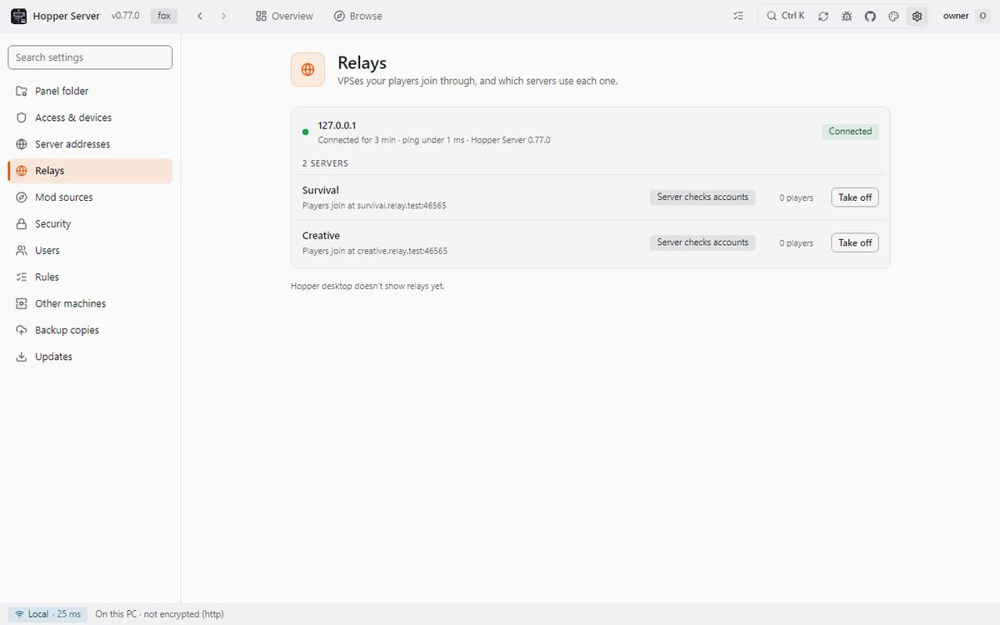
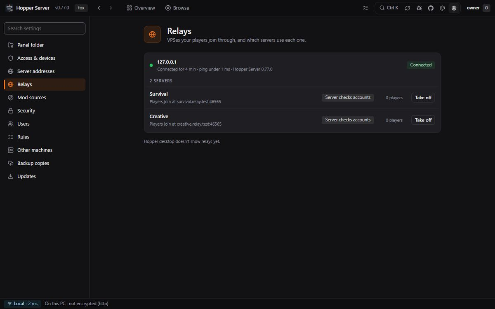
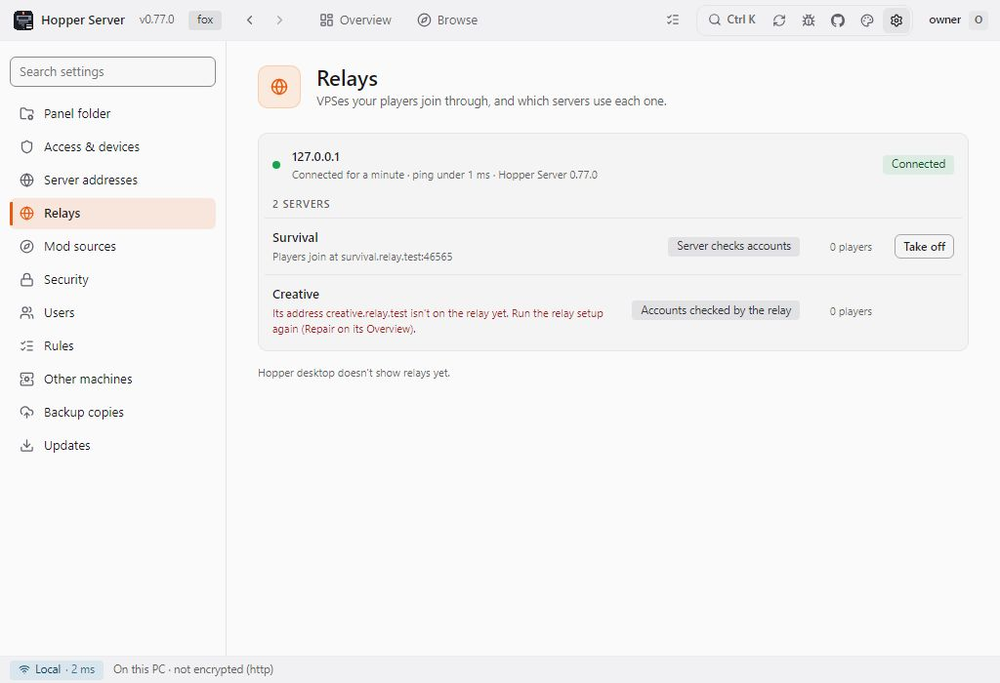
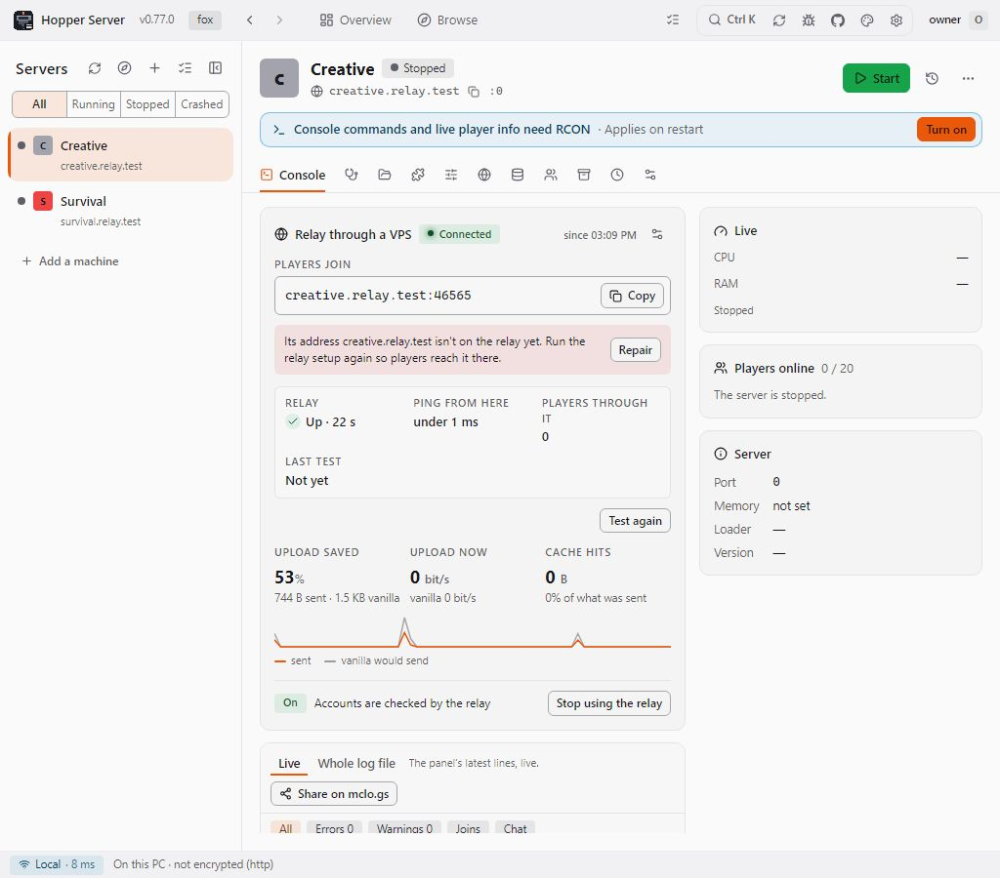
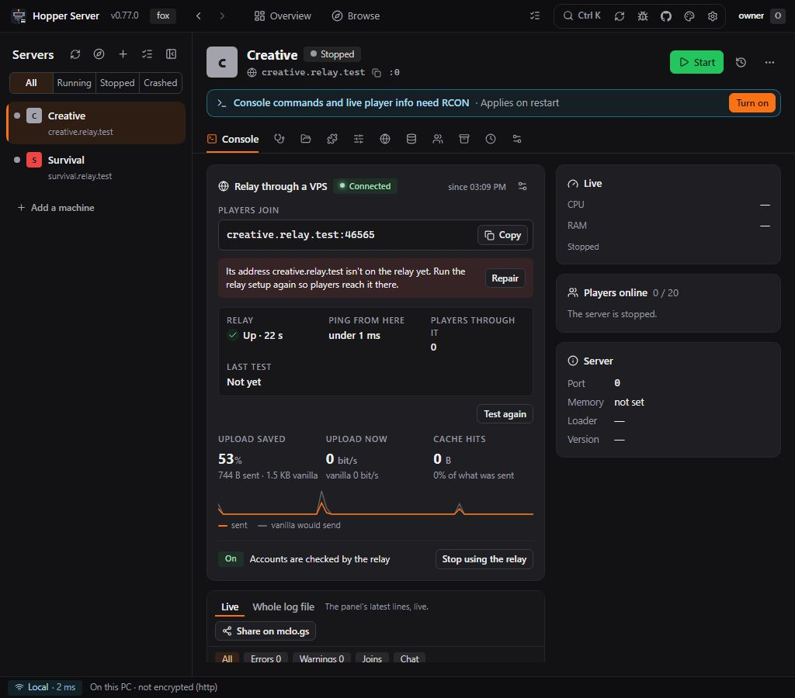
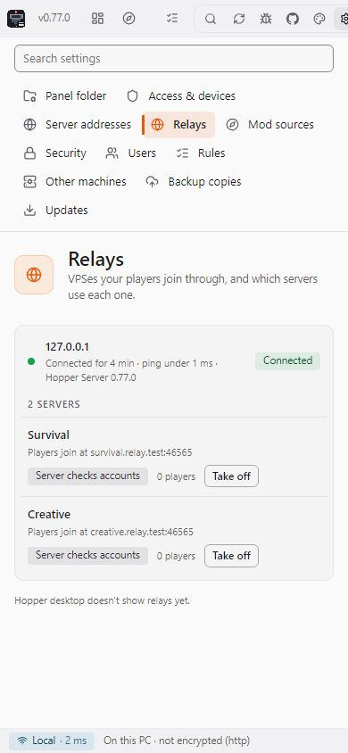

# Several servers behind one relay

**Branch:** t3/vps-relay-multi-server-forced-hosts   **Commit:** da872e19   **Size:** L
**Apps:** Hopper Server only. Desktop shows nothing of the relay yet (B8); the Relays page says so.

## From -> to
- Before: one relay carried one server; a second relayed server's players all landed on the first.
- After: players type each server's own address and the relay sends them to that server (Velocity gets a forced host and a loopback port per server); unknown addresses get a plain refusal; Settings › Relays lists the relay and its servers.

## On the site
     

## Screenshots (every state, both apps)
| State | Before | After |
|---|---|---|
| Settings › Relays, two servers (light / dark) | no before (new page) | after-relays-light.png / after-relays-dark.png |
| Same, 390 px wide (light / dark) | no before | after-relays-narrow-light.png / after-relays-narrow-dark.png |
| Relays: one server with no address of its own | no before | after-relays-noaddr-light.png |
| Relays: one server behind Velocity, address not on the relay yet (light / dark / 390 px) | no before | after-relays-mixed-light.png / after-relays-mixed-dark.png / after-relays-mixed-narrow-light.png |
| Server Overview card, own address (server list side panel open) | no before | after-card-light.png |
| Card: no address of its own (light / dark / 390 light / 390 dark) | no before | after-card-noaddr-*.png |
| Card: address not on the relay yet, with Repair (light / dark / 390 light / 390 dark) | no before | after-card-stale-*.png |
| Zoomed crops | | after-zoom-stale-note.png, after-zoom-relays-row.png |

All web shots: headless Chromium (Playwright's headless shell over CDP) against a scratch panel. No before shots: the old build has no page and no notes to compare.

## Measurements
| Claim | State measured | Numbers | Result |
|---|---|---|---|
| Repair button sits centred in the note | light, 1024 px, stale note | CSS boxes: note 333–384, button 346–371 → 13 / 13 px; text 341–376 → 8 / 8 px. Ink gaps (measure_shot): L 10 / R 10 / T 12 / B 10 | ok. The 2 px ink offset comes from the text's descenders; the boxes are centred |
| Repair text sits like the other buttons | same | Repair ink L 9 / R 9 / T 8 / B 5; existing "Test again" L 9 / R 9 / T 8 / B 5; Copy L 9 / R 8 / T 7 / B 6 | ok: identical to "Test again" |
| Take off centred in its row | light, 1024 px | row 223–281, button 240–265 → 17 / 16 px; right gap 8 px | ok (≤ 1 px) |
| No sideways scroll at the narrowest width | 390 px, Relays and both card states | scrollWidth 390 = innerWidth 390 | ok |
| Red address warning readable | Relays row light / dark | 6.51:1 (172,28,28 on 244,244,245) / 6.19:1 (244,122,122 on 31,31,35) | ok (≥ 4.5) |
| Card note text readable | light / dark | 13.84:1 / 12.65:1 | ok |

Not measured: the voice "goes through the relay for X only" line (needs two servers with a voice mod); the Take off confirm dialog; zoom levels other than 100%.

## Files
- `crates/hopperd/src/vps/mod.rs`: Route hosts/port, pick_route, velocity_knows
- `crates/hopperd/src/vps/relay_end.rs`: pick server by address, extra loopback ports, refusals
- `crates/hopperd/src/vps/home.rs`: backends, address state, players' address, /vps-relays, take-off guard
- `crates/hopperd/src/vps/setup/{mod,plan}.rs`: velocity.toml per server, stable ports
- `crates/hopperd/src/vps/{forward,health}.rs`, `router.rs`: voice owner, per-server address
- `crates/hopperd/ui/src/Relays.svelte` (new), `PanelSettings.svelte`, `RelayCard.svelte`: page, notes
- `design/vps-relay.md`: "B7 as built", B6 not-done and plan rows

## How tested
- Tests: `cargo test -p hopperd -- vps` 67 passed; whole `cargo test -p hopperd` 411 passed, 3 ignored. New: the_address_picks_the_server, velocity_ports_tag_their_server, relay_addresses_and_their_state, two_servers_behind_one_relay, velocity_ports_reach_their_own_server, taking_a_server_off_needs_stop_first, two_servers_get_their_own_ports_names_and_forced_hosts, velocity_config_is_the_same_when_run_again, taking_one_server_off_leaves_the_others_lines.
- On screen / end to end: scratch relay + scratch panel on loopback, two vanilla servers (survival.relay.test, creative.relay.test). Server list ping by address reached each server's own MOTD (case-insensitive); unknown address and bare IP got "No server goes by this address"; a join to an unknown address got "No server here goes by this address. Check the address and try again."; taking Survival off left Creative, and then every address reached Creative (one route takes all, as documented).
- NOT checked: real Velocity with two servers (only in tests); voice with two voice servers; the setup over ssh (no VM touched); the NOT_SET_UP refusal on the scratch relay (the scratch Velocity server was legacy-routed; covered by tests).
- Test data: scratch folder only. The "stale" state was made by writing `{"servers":{"creative":{"mode":"relay"}}}` into the scratch panel's `vps-relay-servers.json` (vanilla servers can't really be relayed through Velocity). Processes stopped; %APPDATA%\hopperd untouched.

## Notes for the maintainer
- Who can do what: new `GET /api/v1/vps-relays` is owner-only (`require_owner`). `PUT /api/v1/vps-relay` now refuses to drop a server that's behind Velocity until "Stop using the relay" runs — narrower than before.
- A velocity.toml change restarts Velocity, which drops players on the other servers for a few seconds; the setup step doesn't warn about that yet.
- With one server left on a relay, any address reaches it (keeps IP joins working).
- Voice: first server with a voice mod only; others' cards say so.
- Pre-existing, not touched: the server header shows ":0" for a server with no port set; at 390 px the top bar's last icon is cut off.
