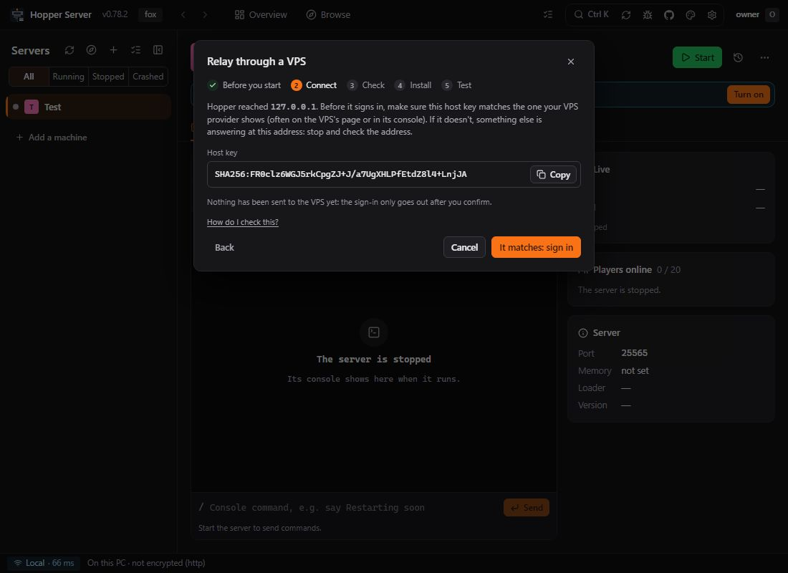
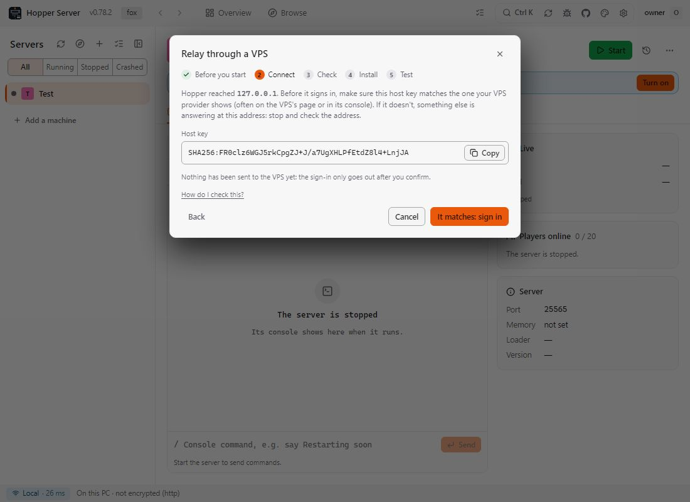
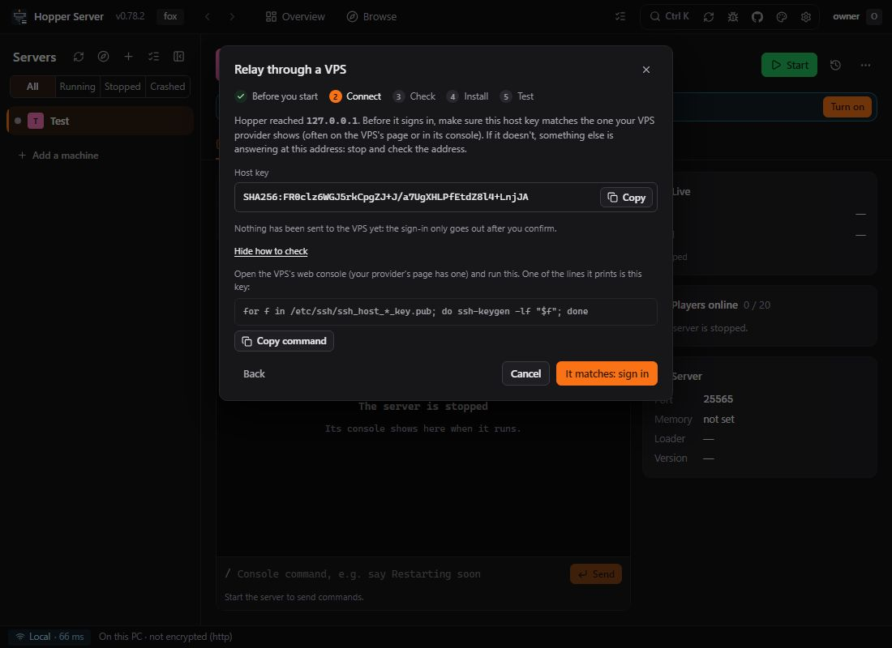
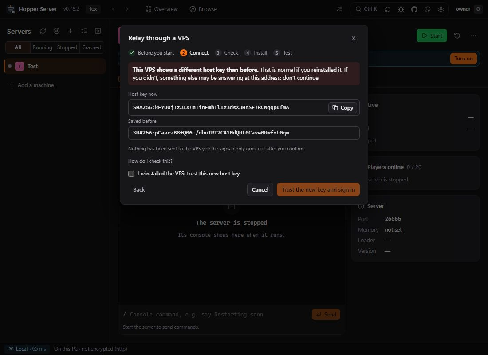
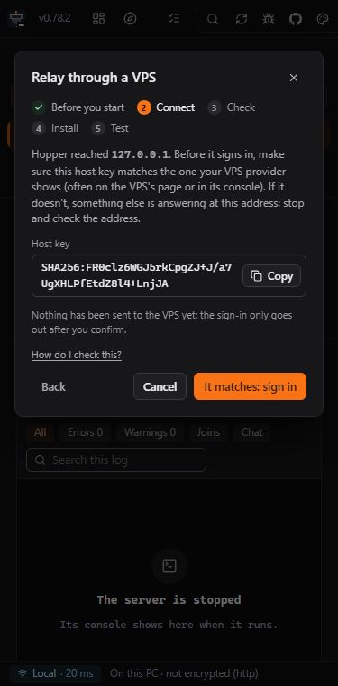

# Relay setup: check the VPS's host key before any password or key is sent

**Branch:** t3/relay-host-key-confirm-before-password   **Commit:** 092add86   **Size:** M
**Apps:** both. The setup runs on Hopper Server (API + web UI); the desktop dialog drives the same API, so it had to change too or it could no longer connect. Desktop is compile-checked only (not seen on screen).

## From -> to
- Before: "Connect" signed in at once (password sent, or key offered) to whatever answered, and only afterwards showed the VPS's host key. Someone on the path at first setup could take the password.
- After: "Connect" first reads the host key, sends nothing, and shows it ("Check it matches what your VPS provider shows"). The sign-in only goes out, pinned to that key, after the owner presses "It matches: sign in". A key that changed shows old and new and needs a tick.

## On the site
    
The site copies are the whole-window shots (`*-full.png`), 1100 px wide; the phone one is the 375 px wide view.

## Mock
`X:\Dev\hopper\mockups\relay-host-key\index.html`: A (check under the form) vs B (its own view). Picked B: one decision on screen, nothing editable behind it, fits a phone, and the same view serves first contact and "key changed".

## Screenshots (web UI, real headless Chromium against a scratch hopperd + a local fake ssh server)
No "before": the old build wasn't to hand (the old flow had no such view).
| State | Dark desktop | Light desktop | Dark phone (375) | Light phone (375) |
|---|---|---|---|---|
| Connect form (password) | a1-form-dark-desktop.png | a1-form-light-desktop.png | a1-form-dark-phone.png | a1-form-light-phone.png |
| Check the host key (first contact) | ../img/0.78.3-hostkey-check-dark-after.jpg (a2-check-dark-desktop.png) | ../img/0.78.3-hostkey-check-light-after.jpg (a2-check-light-desktop.png) | ../img/0.78.3-hostkey-phone-dark-after.jpg (a2-check-dark-phone.png) | a2-check-light-phone.png |
| "How do I check this?" open | ../img/0.78.3-hostkey-how-dark-after.jpg (a3-check-how-dark-desktop.png) | a3-check-how-light-desktop.png | a3-check-how-dark-phone.png | a3-check-how-light-phone.png |
| Key changed (button disabled) | ../img/0.78.3-hostkey-changed-dark-after.jpg (b2-changed-dark-desktop.png) | b2-changed-light-desktop.png | b2-changed-dark-phone.png | b2-changed-light-phone.png |
| Key changed, ticked (button on) | b3-changed-ticked-dark-desktop.png | | | |
| After sign-in (Check step; the fake VPS isn't a real one, so its red check row is expected) | a4-signed-in-dark-desktop.png / b4-signed-in-dark-desktop.png | | | |
(`*-full.png` = whole viewport; the others = the dialog.)

## Measurements (from the screenshots + the page's layout; `measurements.txt`, `metrics-A/B.json`)
| Claim | State | Numbers | Result |
|---|---|---|---|
| Dialog fits the window, no sideways scroll | all 4 themes/sizes, every new state | desktop dialog x 270..830 (560) in 1100; phone x 16..359 (343) in 375; page scroll width = viewport | ok |
| Every control and text box is inside the dialog | same | all buttons/boxes right edge <= dialog right edge | ok |
| Whole fingerprint visible, not cut | phone, longest (two keys on the changed view) | fingerprint box 305 px wide, text wraps to 2 lines, text width <= box width | ok |
| Fingerprint text readable | dark / light | 15.3:1 / 16.5:1 (sampled pixels) | ok (>= 4.5) |
| Small helper text ("Nothing has been sent…", labels) readable | dark / light | 6.4:1 / 5.9:1 | ok |
| Red alert text readable | dark / light | 13.8:1 / 14.2:1 | ok |
| Primary button label | dark | 6.8:1 | ok |
| Primary button label | **light** | **3.3:1** (white on the shared orange `.btn.pri`) | below 4.5 for small text; this is the app's existing primary button in the light theme, not changed here: flagged |
| Disabled primary button (needs the tick) | dark / light | 2.6:1 / 1.9:1 | disabled controls are exempt; reads as disabled |
| Back keeps what was typed | 4 combos | password and address still filled after Back | ok |
Not measured: pixel centring of the copy icon in its button (shared `.btn` style, unchanged).

## Files
- `crates/hopperd/src/vps/setup/ssh.rs`: `host_key_of` (reads, no sign-in); `connect` refuses an empty pin; `clean_host_key`
- `crates/hopperd/src/vps/setup/mod.rs`: `host-key` route; `pin_for`; connect takes `host_key`; `connect_saved` needs a saved key
- `crates/hopperd/src/vps/setup/host_key_tests.rs`: new tests + a hand-run fake VPS (ignored)
- `crates/hopperd/ui/src/VpsRelaySetup.svelte`: the "check the host key" view
- `src/gpui/relay_setup.rs`: the same view on desktop
- `design/vps-relay.md`: two lines about the host key

## How tested
- Tests (`pwsh cargo-test-changed.ps1`: 419 passed, 0 failed; `vps::setup`: 27 pass, 6 new in `host_key_tests`):
  - `reading_the_host_key_offers_no_sign_in`: read returns the key; the fake VPS then saw only the later confirmed sign-in (1 password).
  - `a_wrong_or_missing_pin_sends_no_password`: wrong pin, empty pin and key mode: refused, 0 sign-ins reach the VPS.
  - `connecting_needs_the_confirmed_fingerprint_and_sends_nothing_before`: through the router as owner: no key / "any" / a wrong key (password and key modes) all 400 with 0 sign-ins; the right key signs in once; saved key reused; different key refused; host-key route refuses without a session.
  - `trust_new_takes_only_the_key_named_and_checked`: `trust_new` alone, with "any", with a key that isn't the VPS's: refused, saved key untouched; with the VPS's key named: saved.
  - `the_pin_is_the_confirmed_key_never_empty`, `fingerprints_are_read_strictly`: the pin rules and format.
- On screen (web): scratch hopperd (`--data`/`--home` in scratch, `HOPPERD_SERVICE=hopperd-test`, loopback) + the fake VPS; headless Chromium drove the dialog. The fake VPS log showed no password/key offered while the check view was open, exactly one password + keys only after "It matches" (and 2 key sign-ins after "Trust the new key"). Real `%APPDATA%\hopperd` untouched (last write 10/30).
- NOT checked: the desktop dialog on screen (only `cargo check --bin hopper`; no rig use per the brief); a real VPS and real provider fingerprints; that the console command's output matches the key russh picks on every distro (the text says "one of the lines").
- Test data: scratch dirs in the session scratchpad, processes stopped by PID, no repo hacks.

## Notes for the maintainer
- SECURITY: no secret (ssh password, key signature, relay key, forwarding secret) goes to a host whose key the owner hasn't confirmed. Install/repair/remove reconnect only with the saved, pinned key and now refuse if none is saved. Logins saved by older versions keep the key they learnt then (can't know if it was checked); "Change" with the same address reuses it without a prompt. To re-check one, the owner can Forget the VPS and connect again.
- Mixed versions: a new desktop against an old Hopper Server shows the old server's error on Connect (no `host-key` route); an old desktop against a new server can't connect until updated (the server says "Check the VPS's host key first"). Both fail closed.
- The check cannot protect against a MITM who also answers the owner's provider lookup; the owner must compare against the provider's own page.
- Light-theme primary button contrast (3.3:1) is a shared style issue, not part of this change.
