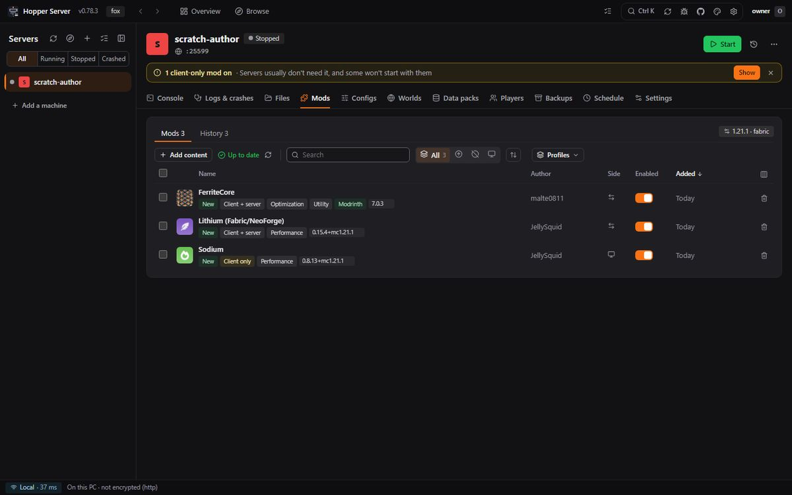
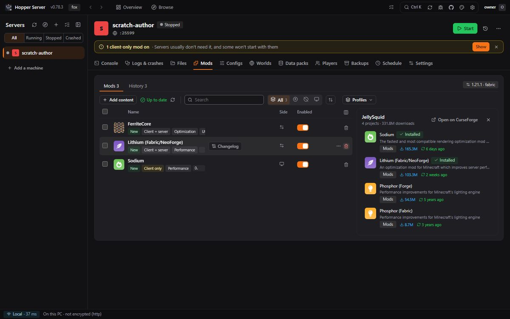
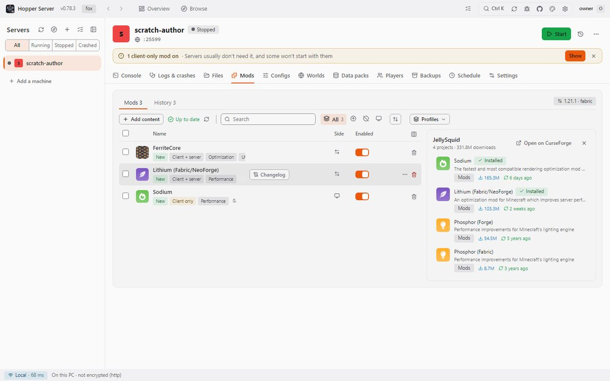
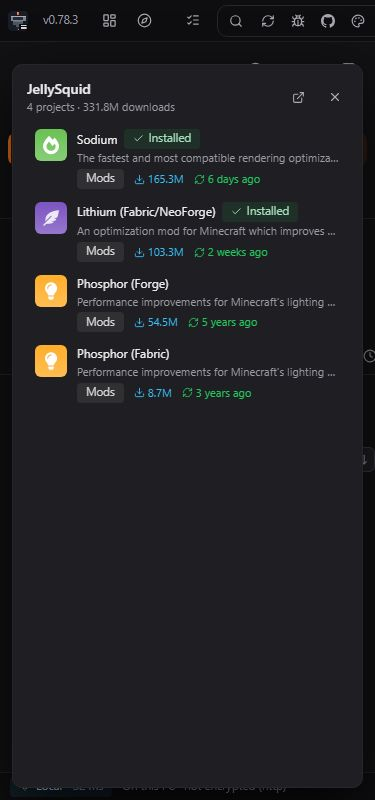
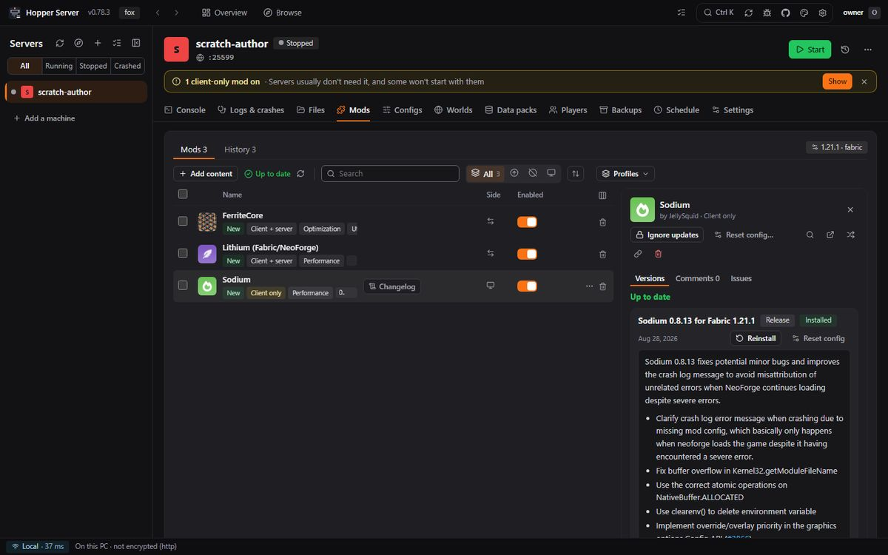
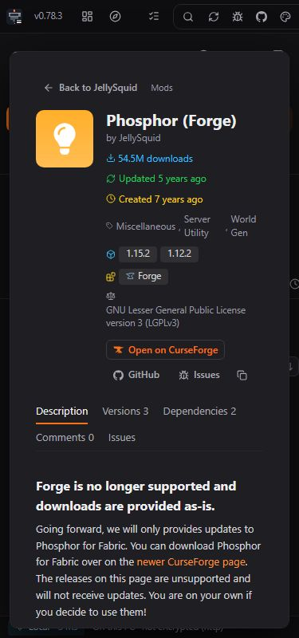
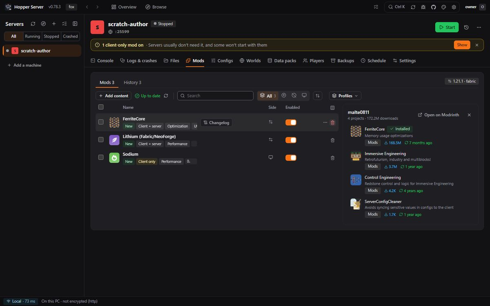
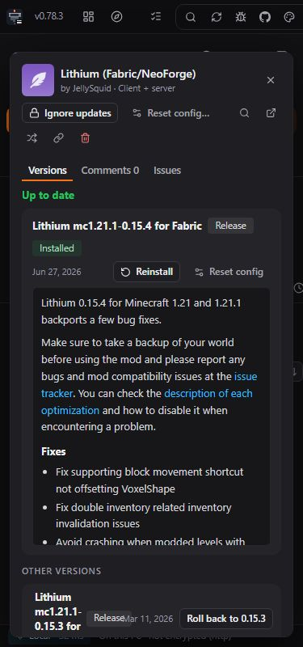

# Hopper Server Mods list: the author opens a side panel with their projects

**Branch:** t3/0770d2ca   **Commit:** see report   **Size:** M
**Apps:** Hopper Server web UI only (parity for the desktop change in 2531e042, card `mod-names-and-authors`)

## From -> to
- Before: the author in the web Mods list (and under the name in the mod panel) was plain text.
- After: it is a real button. It opens a side panel with the author's name, project count, total downloads, "Open on CurseForge/Modrinth", and every project (icon, name, short description, type, downloads, updated; "Installed" on the ones this server has). An installed project opens its mod panel; any other opens its page in the same panel with "Back to <author>".

## On the site
       

## Screenshots (headless Chromium, scratch hopperd, real pixels)
Names: `{dark,light}-{1440,1200,900,375}-N-*.png`. N: 1 list, 2 focus ring crop (1440) or mod panel (narrower, where the Author column is gone), 3 author panel, 4 installed project -> mod panel, 5 other project in the panel with Back. `*-ferritecore-*` = the same on a Modrinth mod (dark 1440, light 375). No "before" shots: the old build wasn't kept (the old state is plain text in the Author column).
| State | Shot |
|---|---|
| Mods list with Author column, dark 1440 | ../img/0.79.0-web-list-dark-after.jpg |
| Focus ring on the author button, dark / light | ../img/0.79.0-web-focus-dark-after.jpg, ../img/0.79.0-web-focus-light-after.jpg |
| Author panel beside the list, dark / light 1440 | ../img/0.79.0-web-author-dark-after.jpg, ../img/0.79.0-web-author-light-after.jpg |
| Author panel, 1200 (beside), 900 (overlay), 375 (overlay) | ../img/0.79.0-web-author-1200-dark-after.jpg, ../img/0.79.0-web-author-900-dark-after.jpg, ../img/0.79.0-web-author-phone-dark-after.jpg, ../img/0.79.0-web-author-phone-light-after.jpg |
| Installed project opens its mod panel | ../img/0.79.0-web-installed-dark-after.jpg |
| Other project in the panel, Back to author | ../img/0.79.0-web-project-dark-after.jpg, ../img/0.79.0-web-project-phone-dark-after.jpg |
| Modrinth author (malte0811) | ../img/0.79.0-web-author-ferritecore-dark-after.jpg, ../img/0.79.0-web-author-ferritecore-phone-light-after.jpg |
| Mod panel with "by <author>" button, phone | ../img/0.79.0-web-modpanel-phone-dark-after.jpg |

## Measurements (getBoundingClientRect / computed style from the running page; contrast and ring from the screenshot pixels, `measure.py`)
| Claim | State | Numbers | Result |
|---|---|---|---|
| Author is keyboard-focusable with a visible ring | dark + light 1440, Tab reaches it (65-72 tabs) | `:focus-visible` true; ring is 2 px, pixel (249,115,22) dark / (234,88,12) light = `--acc`, on the top and left edge of the 130x19 box | ok |
| Real click opens the right panel | mouse click at the button's pixel, all widths | panel heading = the author, 4 rows; at 375 / 900 / 1200 (no Author column) reached through the mod panel's "by" button, also opened with Enter | ok |
| Author text readable | dark 1440, light 1440 | muted text on row: 5.89:1 dark, 5.74:1 light (unchanged colour); panel title 14.05 / 16.12; summary 5.89 / 5.74 | ok (>= 4.5) |
| Page fits beside the panel | 1440, 1200 (sticky panel) | list right edge 995 vs panel left 1007; 755 vs 767 (12 px gap); list scrollWidth = clientWidth (714, 474); document width = window | ok |
| No clip or wrap in the panel | all widths, dark + light | panel scrollWidth = clientWidth (398; 349 at 375); every row scrollWidth = clientWidth; meta line 20 px high (one line) on all rows; header count on one line at 375 | ok |
| Panel fits the phone | 375 | panel x 12..363 (351 wide), document width 375 | ok |
| Project page in the panel fits | all widths | no element past the panel's right edge; tabs wrap to a second line at 375 (cw 285 = sw) | ok |

Not measured: pixel gaps inside rows (icon vs text), hover colours, zoom other than 100%, other themes than Hopper Dark / Light, the text fade in the pack description in light (it looks pale in `light-375-5`; that is the existing pack page, not touched).

## Files
- `crates/hopperd/ui/src/AuthorPeek.svelte` (new): the author side panel
- `crates/hopperd/ui/src/Mods.svelte`: author cell button, `openAuthor`, `authorLink`, panel placement
- `crates/hopperd/ui/src/ModPeek.svelte`: "by <author>" button (`onAuthor`); overlay no wider than the phone
- `crates/hopperd/ui/src/BrowsePack.svelte`: `backLabel` prop; tabs wrap instead of running off a narrow panel

## Same pattern elsewhere
- Mod panel (`ModPeek`) "by <author>": done.
- Browse results list (`Browse.svelte`, " by <author>" inside the clickable result row) and New server pack picker (`NewServer.svelte`): left as text. The row itself opens the project page, and its "by <author>" link already shows everything the author made, so a button inside a button would add nothing.
- Mod panel at phone width was 400 px wide and cut off on the left (pre-existing); now capped to the window (`max-width: calc(100vw - 24px)`).
- No author shown on History or pack-update pages.

## How tested
- No Rust changed (the `/browse/author` route already exists and calls `require`). `cargo-test-changed`: 8 test binaries, all passed (hopperd 427 passed, 4 ignored). `pnpm build` ok; `dist` and `ui.rs` touched before the cargo build.
- On screen: scratch hopperd (`--portable --port 8837 --data/--home` in the scratchpad, `HOPPERD_SERVICE=hopperd-test`, `HOPPER_LOOPBACK=1`, listening on 127.0.0.1 only), one throwaway server with Lithium and Sodium (CurseForge, author JellySquid) and FerriteCore (Modrinth, author malte0811). Headless Chromium through Playwright, 1440 / 1200 / 900 / 375 wide, dark and light. Clicked through: author -> panel; installed project -> mod panel -> "by" button (Enter) -> panel again; other project -> its page in the panel -> Back; close.
- Real `%APPDATA%\hopperd` untouched (folder date unchanged); scratch server stopped and scratch data deleted.
- NOT checked: a CurseForge-only server without an API key (the route's own message shows in the panel; not seen); GitHub/link mods (no author button by design); desktop (unchanged); zoom.

## Notes for the maintainer
- Below 1150 px the panel is an overlay over the list (same as the existing mod panel). It does not push the page.
- The Author column drops out once a panel is open and the list gets under 1050 px, as before; the mod panel's "by <author>" is the way in then.
