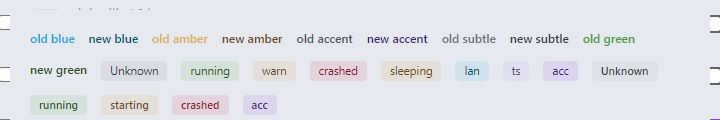
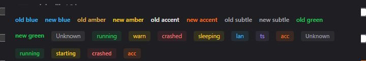
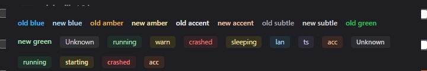

# Web UI: chip and label text readable in every theme

**Branch:** t3/58ccc931   **Commit:** see report   **Size:** S
**Apps:** Hopper Server web UI only (task scope: crates/hopperd/ui). Desktop chips untouched.

## From -> to
- Before: coloured chip text on dark themes was 3.4-4.2:1 (Nord, Everforest, One Dark, Dracula...); History change labels (Added, Updated, Rolled back) used raw theme colours, 1.65:1 for "Rolled back" on Catppuccin Latte.
- After: every chip/pill and those labels are >= 4.57:1 in all 19 themes.

## Items checked
1. Mods rows Remove/Update into ⋯: ALREADY DONE (Mods.svelte foldDel/foldUp, same rule as desktop addons.rs). Wide rows show Remove + hover ⋯; at 420 px Remove is gone from the row and ⋯ is always visible. Not changed.
2. History face column: ALREADY DONE (ModBackups.svelte `.faces` fixed 50 px). Measured 3 rows: faces x=296 w=50, text x=356 on every row. Not changed.
3. Chip contrast: light themes were already fine (min 5.57:1). Dark themes weren't; fixed, plus History labels.

## Screenshots
| State | Before | After |
|---|---|---|
| Chips, Catppuccin Latte |  |  |
| Chips, Hopper Dark |  |  |
| History face column | - | history-face-column.png |
| Mods row 1280 / 420 | - | mods-row-1280.png, mods-row-420.png |

## Measurements
Real Chromium screenshots of each chip/pill (.chip plain/running/warn/crashed/sleeping/lan/ts/acc, .pill plain/running/starting/crashed/acc) on the theme's surface; bg = interior pixel, text = pixel furthest in luminance; WCAG ratio. Full tables: ratios-before.txt / ratios-after.txt.
| Claim | Theme | Min ratio before -> after |
|---|---|---|
| chips readable | Hopper Dark | 4.95 -> 5.59 |
| | Nord | 3.50 -> 6.19 |
| | Everforest | 3.42 -> 4.64 |
| | One Dark | 3.53 -> 4.57 |
| | Rosé Pine Moon | 3.60 -> 6.12 |
| | 6 light themes | 5.57-6.50 -> unchanged |
| History labels (blue/amber/accent/subtle/green text) | Catppuccin Latte | 1.65 -> >= 6.12 (min of all) |
| | Solarized Light | 1.74 -> >= 5.86 |
| History face column | scratch panel, 1280 px | faces x 296 w 50, text x 356 on all rows |

## Files
- `crates/hopperd/ui/src/app.css`: dark `--ink-*` mix 35% toward theme text
- `crates/hopperd/ui/src/ModBackups.svelte`: `.ch` labels use `--ink-*`

## How tested
- `pnpm run check`: 81 pass, 0 fail.
- On screen: scratch hopperd (fast build, port 8851, scratch data/home) + vite dev proxy, headless Chromium via playwright-core.
- NOT checked: History rows with 2+ faces or "+n" (needs a second account); Mods ⋯ menu with an available Update (no source in scratch mods, so no Update button); chips on side-panel-open pages (colour-only change, no layout change); desktop chips.
- Test data: fake jars in scratch home; no real servers.
