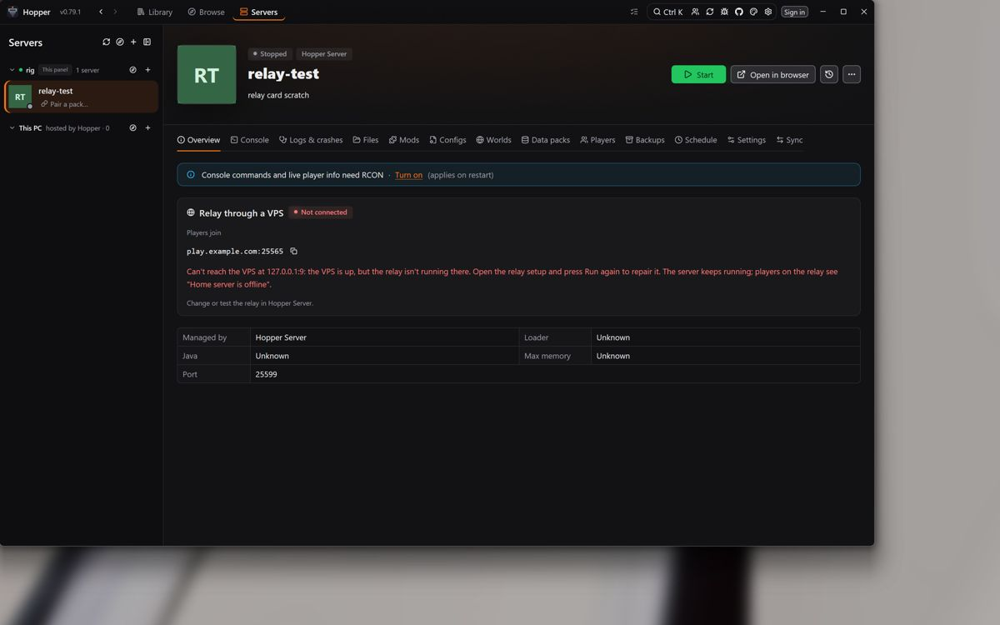

# Server Overview shows the VPS relay (desktop)

**Branch:** t3/0e8841c4   **Commit:** see git log   **Size:** M
**Apps:** desktop (Hopper Server already has the full card; desktop gets the read-only half, setup/test stay in the web UI)

## From -> to
- Before: a server run by Hopper Server that uses "Relay through a VPS" showed nothing about it in desktop.
- After: its Overview shows a "Relay through a VPS" card: Connected / Connecting / Off / Not connected pill, ping, the address players join (copy button), upload saved, upload now, players through it, voice note, and the reason in plain words when it's down.

## Screenshots
| State | After |
|---|---|
| Not connected (relay unreachable) |  |

## Measurements
| Claim | State | Numbers | Result |
|---|---|---|---|
| Card same width as the notice above it | Hopper Dark, 1511 px window | card 306-1487, notice 306-1487 | ok (0 px) |
| Down text wraps, not clipped | same | 2 lines inside the card | ok (eyeballed) |
NOT measured: light theme, narrowest window, side panel open, connected state.

## Files
- `crates/hopper-core/src/relay_view.rs`: relay status parse + wording (5 tests)
- `crates/hopper-core/src/hopperd.rs`: `Client::vps_relay`
- `src/gpui/relay_card.rs`: the card
- `src/gpui/widgets.rs`: `stat_card` (stat card chrome, now shared)
- `src/gpui/server_control.rs`, `servers.rs`: poll relay with the stats; card on Overview

## How tested
- Tests: `cargo test -p hopper-core --lib relay_view` 5/5 pass.
- On screen (rig slot 1, scratch hopperd 8799 + scratch data, MCP 47832): paired scratch panel, server set to relay via PUT /vps-relay to a dead address -> "Not connected" card.
- NOT checked: Connected state (needs a real relay; shown in mockups/desktop-relay-card.html only), voice row, "playing at home" note, light theme, narrow width, card staying put on a one-off failed poll (a failed fetch hides it until the next good poll).
- Test data: scratch only (E:\scratch\relay-card on rig, left in place); scratch hopperd killed, rig app stopped.

## Notes
- Mock: mockups/desktop-relay-card.html, picked A (same answers as the web card).
- Card shows even when the server is stopped (the stat cards hide then).
