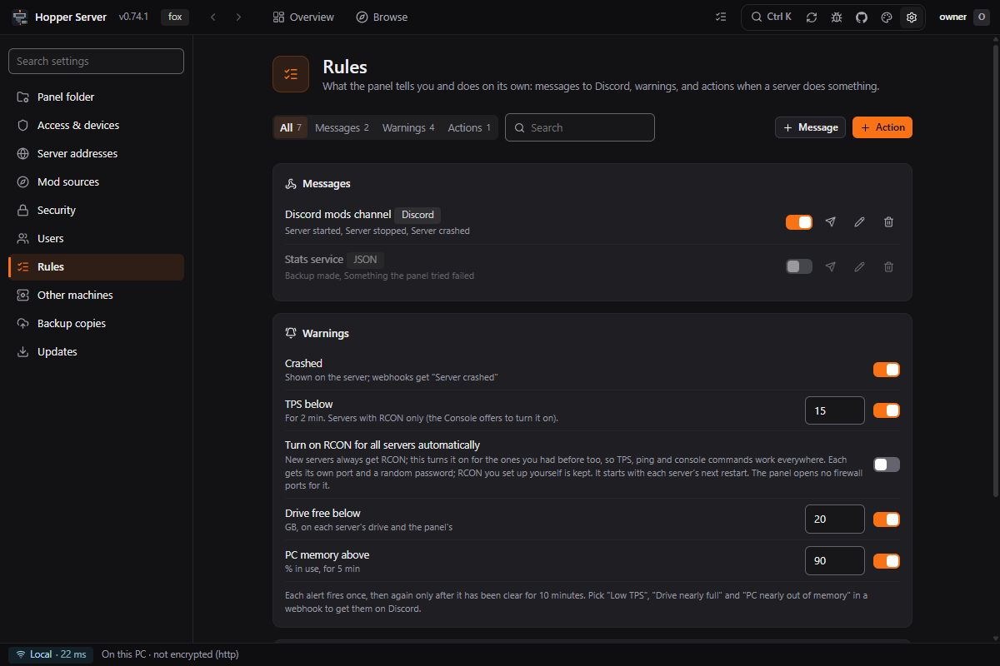
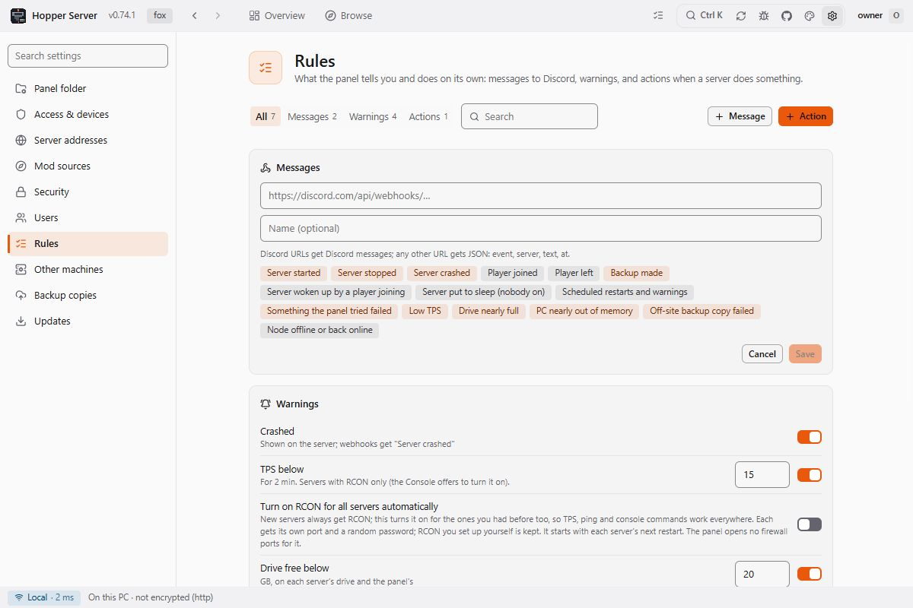
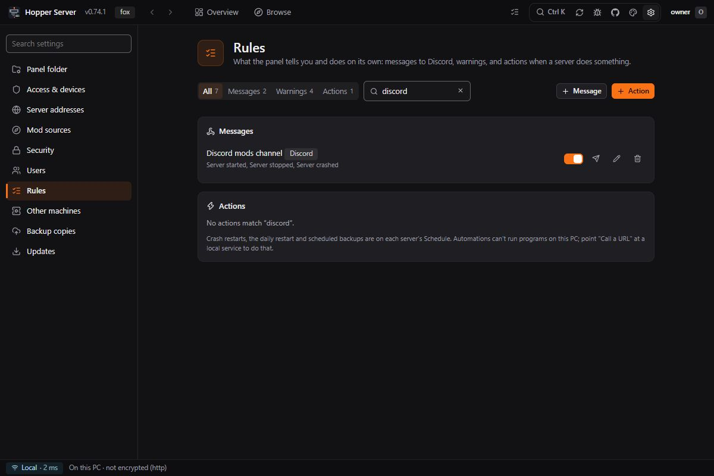
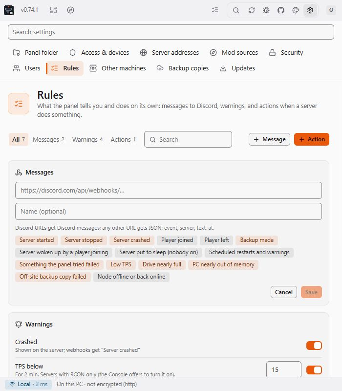

# Hopper Server: one Rules page for messages, warnings and actions

**Branch:** t3/hopperd-rules-page   **Commit:** c30f53ad   **Size:** L (kept to the UI: the server side already had all three)
**Apps:** Hopper Server only. Desktop has no webhooks, alerts or automations screens to match.

## From -> to
- Before: Settings had three pages: Webhooks, Alerts, Automations.
- After: one Rules page. Filter All / Messages / Warnings / Actions (with counts), a search, Add Message and Add Action buttons, a note when a rule failed its last run. Old links (#/settings/webhooks|alerts|automations) open Rules on the matching part.

## Screenshots (web UI, real headless Chrome, scratch panel)
All: 01-all-dark, 09-all-light. Filters: 02-messages-dark, 03-warnings-dark, 04-actions-dark. Search: 05-search-discord-dark, 06-search-none-dark. Add form: 07-add-message-dark. Old link: 08-old-link-alerts-dark. Narrow: 10-narrow-light (700 px), 11-narrowest-dark (560 px). No "before" shot (old build not to hand).

## Measurements (computed layout in the running page, scratch panel)
| Claim | State | Numbers | Result |
|---|---|---|---|
| Toolbar not squashed | 1200 px dark | height 35 px (was 5 px before renaming a clashing `.bar` class) | ok |
| No sideways overflow | 1200 / 700 / 560 px | pane scrollWidth = clientWidth (958/690/550); page scrollWidth = window width | ok |
| Narrow toolbar wraps, not clips | 560 px | height 68 px, two rows | ok |
| Counts right | 2 messages, 4 warnings, 1 action | All 7, Messages 2, Warnings 4, Actions 1 | ok |
Not measured: contrast ratios of the new count digits (they reuse the muted text colour), pixel gaps in the toolbar.

## Files
- `crates/hopperd/ui/src/Rules.svelte`: new page (filter, search, Add buttons)
- `crates/hopperd/ui/src/lib/rulesPage.js`: filter, search, counts, old-link logic
- `crates/hopperd/ui/src/{Webhooks,Alerts,Automations}.svelte`: reused as parts; titles Messages/Warnings/Actions, `hosted` + `query` props, `add()`
- `crates/hopperd/ui/src/PanelSettings.svelte`: three categories -> Rules, old ids alias
- `crates/hopperd/ui/tests/rulespage.test.mjs`: new tests

## How tested
- Tests: `pnpm test` in crates/hopperd/ui: 87/87 pass (6 new in rulespage.test.mjs). `pnpm build` ok (check-effects passes).
- On screen: scratch hopperd (port 18799, loopback, own data/home), seeded 2 messages and 1 action; clicked each filter, searched, opened Add Message, opened the old Alerts link, light/dark, 3 widths.
- NOT checked: Add Action form and Run now on this page (same component as before); editing a rule; the page beside a side panel (Settings has none); rule failing banner (no failing rule seeded); no Rust change so no cargo test run.
- Test data: scratch panel in the session scratchpad; process stopped.

## Notes for the maintainer
- No Design Artifact published; HTML mock with 3 options is `X:\Dev\hopper\mockups\hopperd-rules-page.html`. Pick: B (one page, filter + parts) because it reuses the working cards and keeps every rule's behaviour. C (one flat "When... then..." list) reads best but needs a new editor over three stores.
- Backend untouched: History records only apply to server files; these rules live in the panel's data. Existing routes keep `require_owner`.
- Left: a unified "When X, then Y" list (Option C), per-server view of what fires, and hiding a part with no search hits (now it shows "No actions match").

## Pictures used on the page
   
