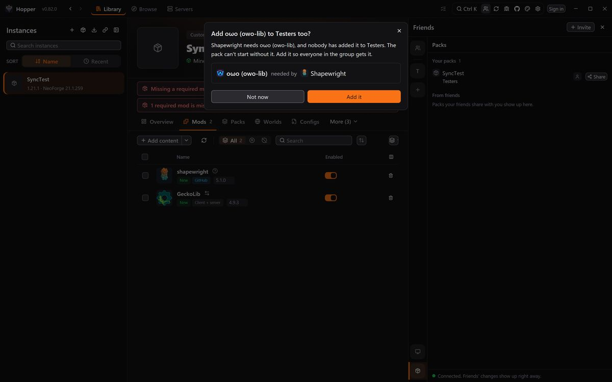
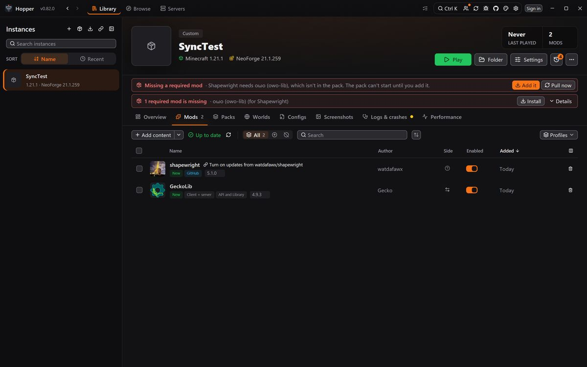
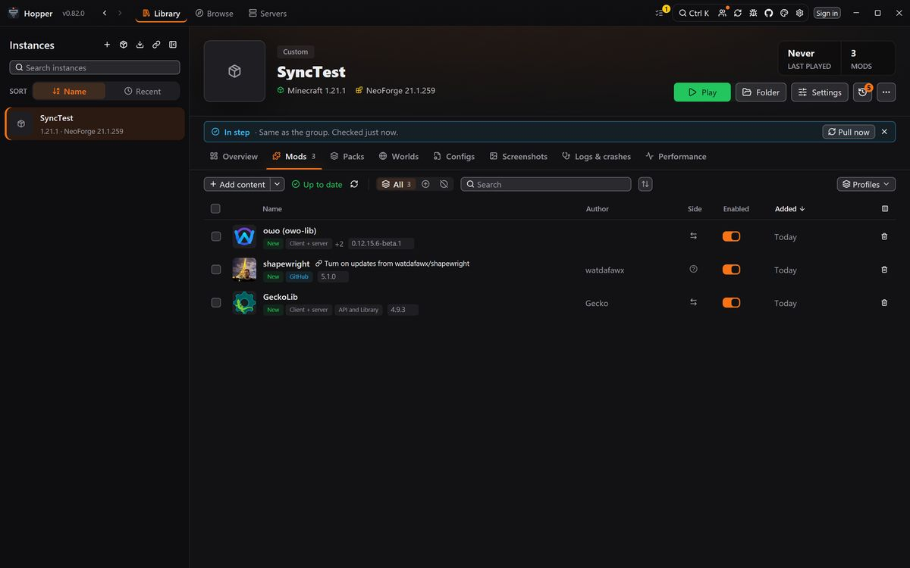

# Friends groups: a mod's missing required mod is asked about, and the sync strip says so

**Branch:** t3/group-required-mod-deps   **Commit:** f0ee9dab   **Size:** M
**Apps:** desktop only. Hopper Server has no friends groups, so there is nothing to port.

## From -> to
- Before: Alice adds shapewright (needs owo-lib) to a group. Both PCs say "In step", nobody is told, and the pack can't start ("Shapewright channel missing on client").
- After: when you add or update a mod in a group, a dialog offers to add what it needs too ("Add owo (owo-lib) to Testers too?", default "Add it"). Any PC whose copy of the pack still lacks a required mod shows "Missing a required mod" (red) in the sync strip, with an "Add it" button, instead of "In step".

**Approach (one line):** needs come from the jars' own metadata (`deps::missing`, same source as the Mods tab banner); the ask covers only jars the player's own add/update brought in; the lasting state comes from a cached background scan of every group copy's mods folder.

## On the site
  

## Screenshots (every state; no "before": old build not to hand, the bug is in the card's earlier run `shapewright-sync-test/s8-b-required.png`)
| State | After |
|---|---|
| Dialog after adding shapewright from GitHub | ../img/0.83.0-group-needs-dialog-dark-after.jpg |
| Alice after "Add it": In step, owo-lib in the pack | s2-after-add-in-step.png |
| Bob receives all 3 mods: In step | s3-bob-in-step-after-add.png |
| Strip "Missing a required mod" + Add it (Bob, owo-lib removed) | ../img/0.83.0-group-needs-strip-dark-after.jpg |
| Alice back to In step after Bob's strip "Add it" | s5-alice-in-step-after-bob-fix.png |
| Bob In step after the strip "Add it" | ../img/0.83.0-group-needs-fixed-dark-after.jpg |

Light theme and narrowest window: **not shot**.

## Measurements (dark theme, 2x screenshots, pixels)
| Claim | State | Numbers | Result |
|---|---|---|---|
| "Add it" label centred in dialog button | s1 | button 439x60; text gaps L 185 / R 185 (T 22 / B 19) | horizontal exact; vertical 3 px = glyph box without descenders |
| "Not now" label centred | s1 | button 437x60; text gaps L 170 / R 170 (T 23 / B 19) | same |
| Dialog buttons same height | s1 | 60 vs 60 px | ok |
| Strip "Add it" button centred in strip | s4 | strip inner y 386..449, button y 395..439: gaps T 9 / B 10 | ok (<= 1 px) |
| Strip right margin | s4 | "Pull now" right edge 2822, strip inner edge 2833: 11 px | ok |
Not measured: light theme, narrow window (strip text wrapping / button overflow), the strip beside an open side panel. The strip reuses the existing sync-strip layout, so I expect the same collapsing, but did not see it.

## Files
- `crates/hopper-core/src/groupdeps.rs` (new): needs from `Missing`, fresh-vs-told decision, dialog and strip wording, unit tests.
- `crates/hopper-core/src/groupstatus.rs`: new `Status::NeedsMod`, ranked after Updating, before Offline/Sending.
- `src/gpui/store/group_needs.rs` (new): background read of group copies, ask after add/update, install by id.
- `src/gpui/group_needs.rs` (new): the dialog.
- `src/gpui/group_pack.rs`: strip look + "Add it" button for NeedsMod.
- `src/gpui/store.rs`, `store/server_offer.rs`, `store/friends.rs`, `app.rs`, `main.rs`, `addons_extra.rs`: small hunks (state, `Msg::Added` carrying the before-listing, event, install_missing delegates to the store).

## How tested
- Tests: `cargo-test-changed.ps1` scoped run: hopper-core groupdeps + groupstatus tests pass (grouping, wrong-version ignored, off provider kept, fresh/told variants, wording, jar end-to-end); hopper-core 1699 and hopper tests pass. Unrelated failure: `hopperd ui::tests::built_page_has_no_inline_script_or_style` (web UI dist not built in this worktree; hopperd untouched). `cargo check` clean, no warnings.
- On screen (rig, scratch relay on 127.0.0.1, two scratch accounts Alice/Bob, `HOPPER_DATA_DIR` scratch, `HOPPER_TEST_WINDOW=1`, `HOPPER_LOOPBACK=1`, driven via `--mcp`): add shapewright from GitHub -> dialog -> Add it -> owo-lib installed, strip In step, Bob gets 3 mods, In step. Removed owo-lib -> both PCs show "Missing a required mod". Bob's strip "Add it" installs it, syncs back to Alice, both In step. Negative: GeckoLib (no needs) stays In step, no dialog.
- NOT checked: light theme, narrow window, 3+ missing mods in one dialog on screen (unit-tested wording only), "Not now" path on screen (told-set unit-tested), turned-off provider case on screen.
- Test data: throwaway SyncTest instance + dummy GitHub jar, scratch relay, all deleted from rig (`G:\rig-run\gneeds`); only my own processes killed. No real packs touched.

## Limits (not built)
- A member's missing-mod state is seen on a PC only after sync reads that PC's own pack; the relay carries no such field and I did not change or deploy the relay. So Alice does not see Bob's missing mod until their packs match and sync.
- Wrong-version deps stay on the Mods tab banner only; a turned-off provider is only mentioned in the strip text.
- MCP `add_from_source` still returns `Msg::InstanceChanged` (no dialog): scripted adds don't ask.
- The new strip and the Mods tab's "1 required mod is missing" banner both show (see s4). Accepted for now; could hide the banner for group copies.

## Notes for the maintainer / found on the side
- Invite code with the displayed inner space ("AD02 0F8C") fails at join: client `mailbox.rs::join` doesn't strip inner spaces and the relay matches exactly (404). Not fixed (relay must not be deployed from here).
- The Mods tab empty state's "Add mods" only goes to Browse (other agent's area, untouched).
- Dummy-jar GitHub warning noise is test-only.
