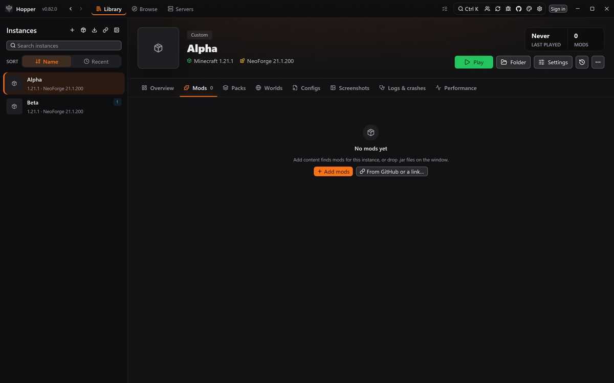
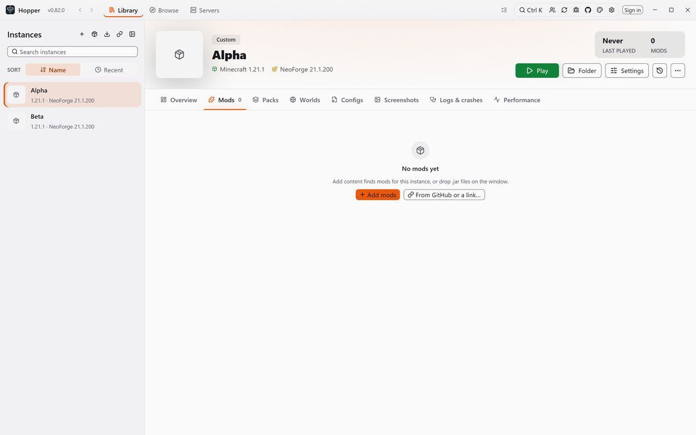
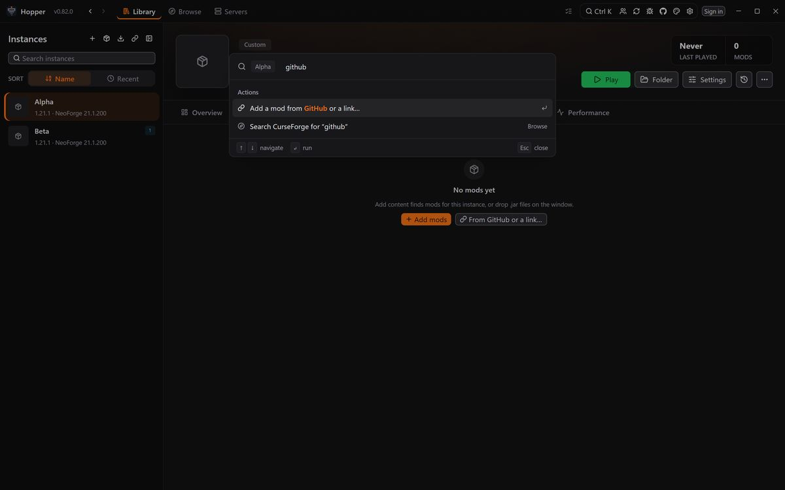
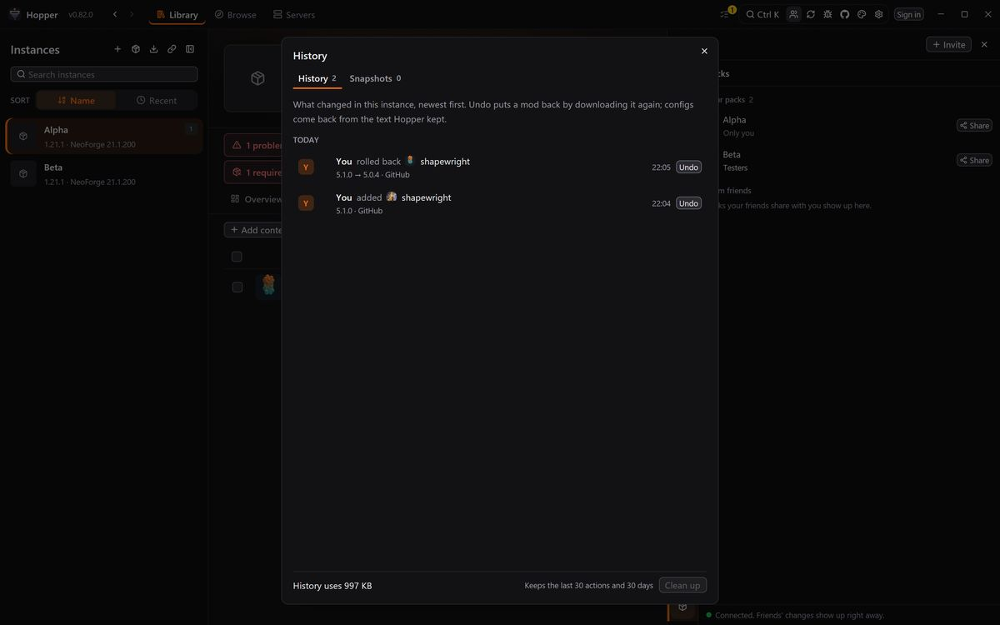
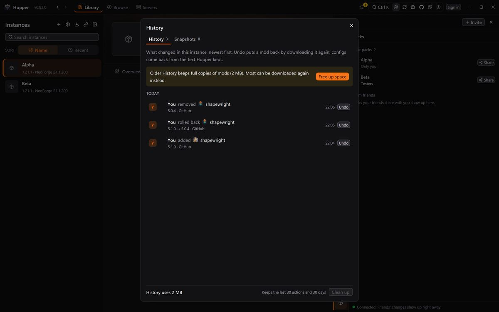
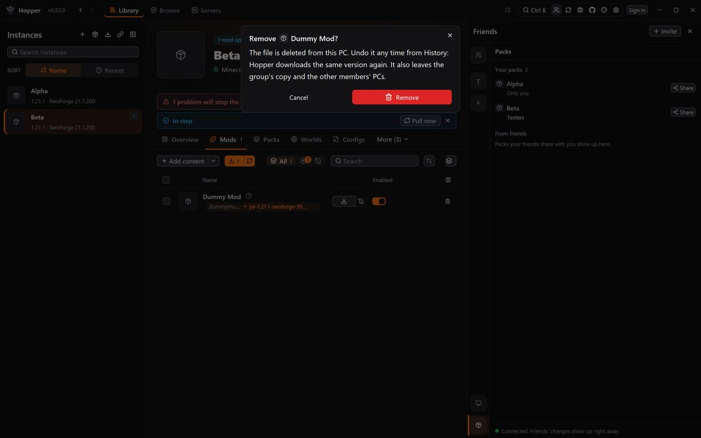
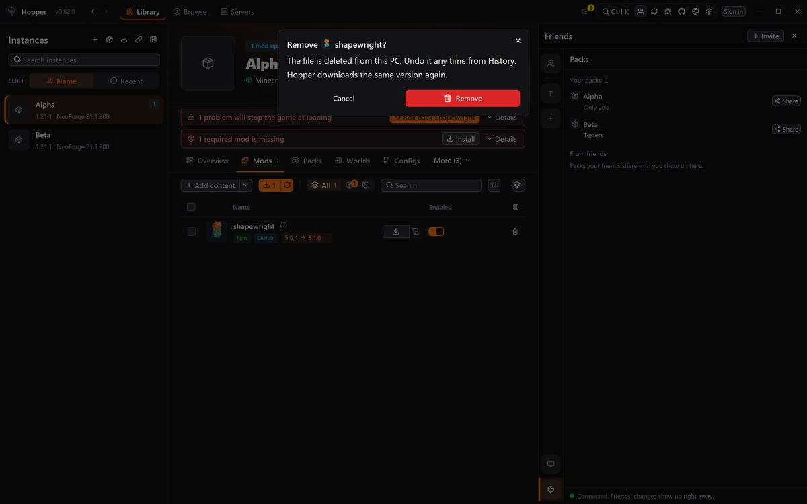
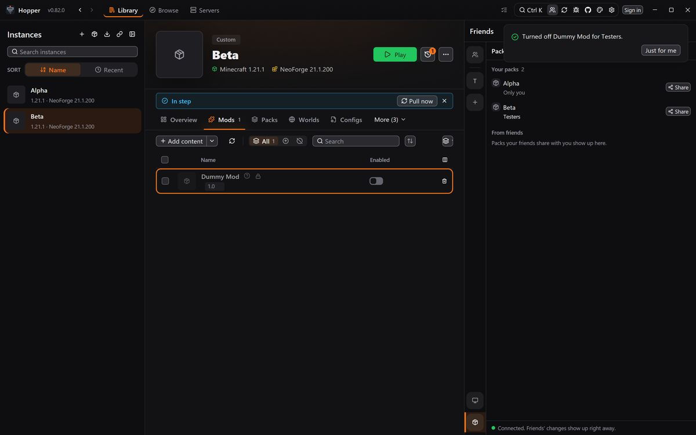
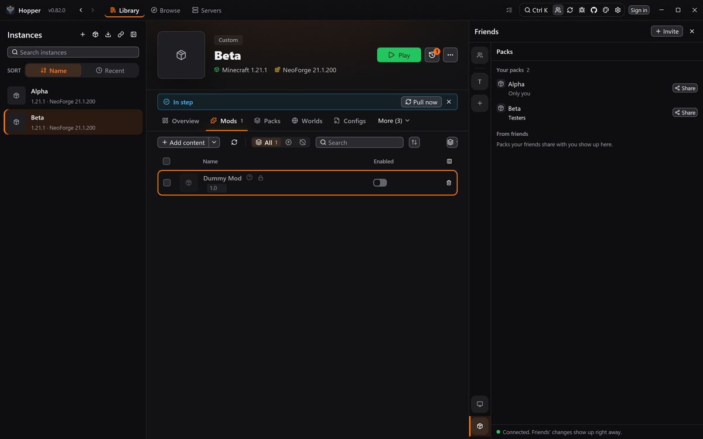

# Group sync small fixes: GitHub add on empty Mods, honest History, clearer Remove, toast clears

**Branch:** t3/group-sync-ui-bugfixes   **Commit:** 40f4fece   **Size:** M
**Apps:** both for bug 1 (empty Mods tab). Desktop only for the rest: History text comes from hopper-core so the web UI gets bugs 2 and 3 for free; the web UI has no group remove confirm and no locked toast.

## From -> to
1. Before: empty Mods tab with "mods from links" on showed only "Add mods". After: also "From GitHub or a link..." (outline button), and a Ctrl K entry "Add a mod from GitHub or a link...".
2. Before: a GitHub mod's History row said "CurseForge". After: GitHub / link / Modrinth / CurseForge, built in one place (`backups::source_label`, `known_site`, `site_of_ref`), used by History, Undo and the saved-entry reader.
3. Before: rollback 5.1.0 -> 5.0.4 logged "removed shapewright 5.1.0". After: one entry, "rolled back" (or "updated") by version order; it stays "rolled back" after the mod is removed later (verdict saved at save time in `.verdicts.json`). Undo works as before.
4. Before: Remove dialog never said the group is affected. After: when the pack follows a group: "It also leaves the group's copy and the other members' PCs." (groups, friends and mixes have their own wording). Not shown when every picked mod is "Only on this PC".
5. Before: "Turned off X for <group>" toast stayed for minutes (gpui-component turns autohide off for any toast with an action; real bug). After: `.autohide(true)`, default ~5 s, pauses on hover.

## On the site
        

## Screenshots (all Hopper Dark unless noted; no "before" shots: old build not to hand)
| State | After |
|---|---|
| Bug 1 empty Mods, dark | ../img/0.83.0-empty-mods-github-dark-after.jpg |
| Bug 1 empty Mods, light | ../img/0.83.0-empty-mods-github-light-after.jpg |
| Bug 1 empty Mods beside side panel (narrow) | empty-mods-beside-panel-dark.png |
| Bug 1 Ctrl K entry | ../img/0.83.0-palette-github-dark-after.jpg |
| Bug 1 entry opens the dialog | palette-opens-dialog-dark.png |
| Bug 1 button opens the dialog | empty-button-click-dark.png |
| Bugs 2+3 GitHub mod added, versions, rolled back | gh-added-dark.png, gh-versions-dark.png, gh-rolledback-dark.png |
| Bugs 2+3 History after rollback | ../img/0.83.0-history-rollback-dark-after.jpg |
| Bugs 2+3 History after remove (still "rolled back") | ../img/0.83.0-history-removed-dark-after.jpg |
| Bug 4 Remove, in a group | ../img/0.83.0-remove-confirm-group-dark-after.jpg |
| Bug 4 Remove, no group | ../img/0.83.0-remove-confirm-nogroup-dark-after.jpg |
| Bug 5 toast shown / gone | ../img/0.83.0-toast-shown-dark-after.jpg / ../img/0.83.0-toast-gone-dark-after.jpg |
Setup shots (friends-*, invite, alice-*, bob-*, beta-mods, locked, rowmenu) show how the scratch group was made.
Web UI empty state: NOT screenshotted (see below).

## Measurements (bug 1 buttons, from the screenshots, 2 px per pt)
| Claim | State | Numbers | Result |
|---|---|---|---|
| Both buttons same height | dark, light, beside panel | both rows 748-827 = 80 px (40 pt) | ok |
| Gap between buttons | all three | 20 px (10 pt) | ok |
| Group centred in page | dark | group centre 1740 vs content centre 1739 | ok (1 px) |
| Link-button text readable | dark / light / beside panel | contrast 12.2 / 17.0 / 12.2 | ok |
Not proven: light-theme centring (my edge detector hit the border colour, gave 1723; by eye it is centred), and the narrowest window below the beside-panel width. Bug 4/5 texts were read on screen, not measured.

## Files
- `crates/hopper-core/src/backups.rs`: source labels, version order, saved verdicts
- `crates/hopper-core/src/actor.rs`: note a file swap at save time
- `crates/hopper-core/src/undo.rs`: use the shared source label
- `src/gpui/addons.rs`: empty-state button, remove wording, toast autohide
- `src/gpui/palette.rs`: Ctrl K "Add a mod from GitHub or a link..."
- `src/gpui/history_view.rs`: shared source label
- `src/gpui/store.rs`, `src/gpui/store/only_here.rs`: `removal_reaches`, `removal_reach`
- `crates/hopperd/ui/src/Mods.svelte`: empty-state link button

## How tested
- Tests: `cargo-test-changed.ps1` all passed (hopper-core 8 binaries, hopperd 412 passed). New: `a_mod_from_github_is_labelled_with_its_source`, `a_github_swap_is_an_update_or_a_rollback_by_its_versions`, `a_rollback_is_still_a_rollback_after_the_mod_is_removed`, `a_new_file_for_the_same_mod_is_a_swap`, `removing_says_who_else_loses_the_mod`. The first hopperd run failed only because `ui/dist` was not built in the worktree; after `pnpm build` it passed.
- On screen (desktop, rig, `--mcp`, scratch data, scratch relay on rig 127.0.0.1, throwaway accounts Alice and Bob, throwaway GitHub-added mod): all five bugs seen working.
- NOT checked: Hopper Server empty state in a browser (UI builds, tests pass, not opened); toast hover-pause (gpui-component behaviour, not tried); light-theme shots for bugs 2-5; narrowest window.
- Test data: scratch only, in `G:\rig-run\gsfix` (deleted at end). No real packs, worlds or servers touched. No test hacks left in code.

## Mock
Skipped. The second button reuses the existing outline button next to the one filled orange button (AGENTS design rules: one filled, secondary outlined); no new look. Say if you want two options mocked.

## Notes for the maintainer
- Other `action_below` toasts (offers, config pushes, config warning, job toast) stay until closed on purpose; left alone. `app.rs` PackOffer `.autohide(false)` is deliberate.
- "CurseForge"/"Modrinth" pills in `library.rs`/`widgets.rs` mean modpacks; left alone.
- The sticky verdict only exists when the set-aside History folder is made before `Instance::save` sees old and new files with the same mod key. Older entries are judged as before.
- shapewright needs owo-lib; dependency handling is the other agent's job, not touched.
- A dummy mod with a fake file id shows a spurious "update" to jei in the scratch instance: unrelated, not looked at.
