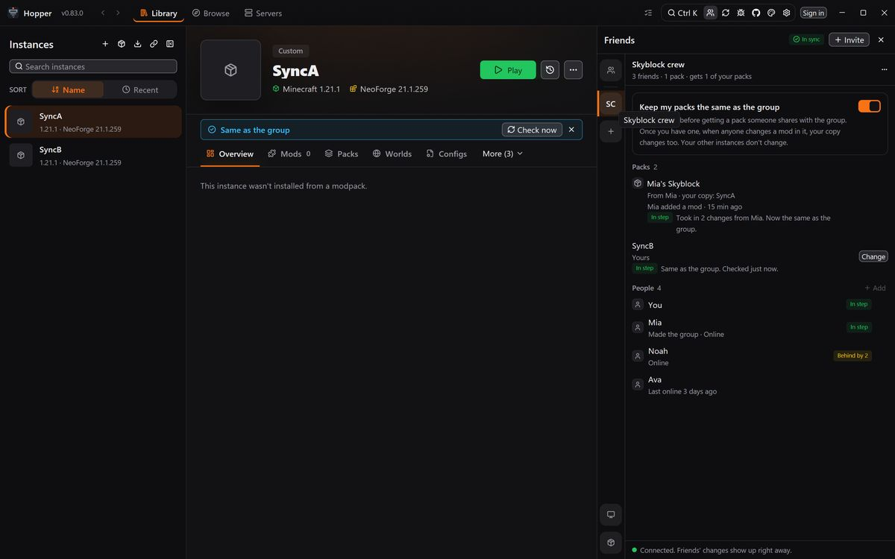
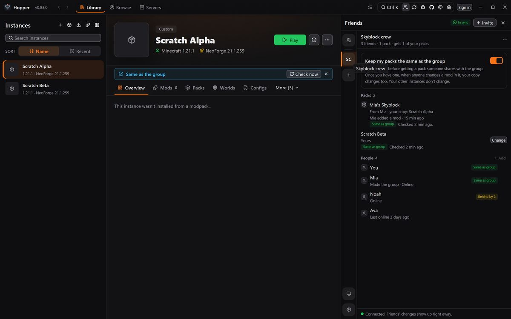
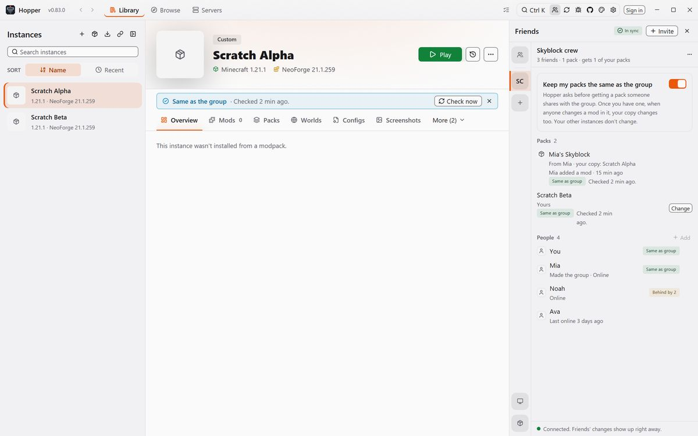
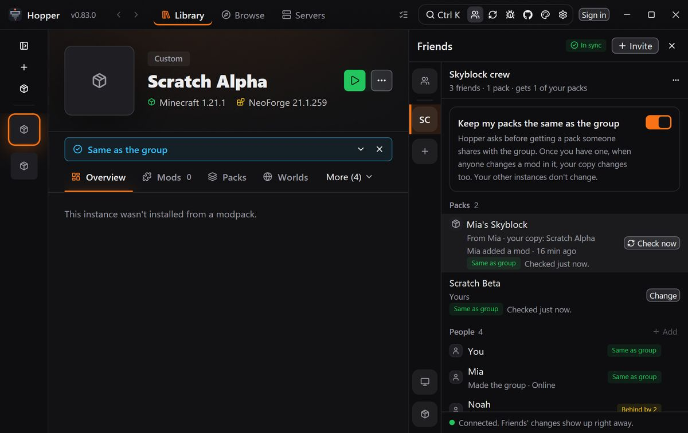

# Friends group chips say "Same as group", not "In step"

**Branch:** t3/81223168   **Commit:** e883626c   **Size:** S
**Apps:** desktop only (Hopper Server has no friends groups; its web UI has no "In step" text for groups or pack-server pairing: grep of `crates/hopperd/ui/src` finds only code comments)

## From -> to
- Before: group page rows had green chips "In step" next to a detail "Same as the group. Checked 2 min ago."; the strip said "Same as the group". Pack banner chip for a server paired with a pack: "In step".
- After: group page chips say "Same as group" (pack rows and person rows, `Member`/`Status::label`); the row detail drops the repeated sentence: "Checked 2 min ago." Pack banner server chip: "Same as pack"; "Sync to all servers" tooltip: "Brings every server paired with this pack up to match it (it asks first)"; its confirm lines: "<server>: same as the pack" (and ", left alone").
- Why this wording: "Same as the group" is already the strip's title, so chip = strip. "Same as group" is shortest (~76 pt wide, one line) and fits beside a name. "Same as pack" is the same idea for servers. No new jargon.

## On the site
   

## Screenshots (made-up group via `--dialog group-sync --state in-step`, scratch data on rig)
| State | Dark | Light |
|---|---|---|
| Group page, 1440x900 | ../img/0.83.1-chips-dark-after.jpg | ../img/0.83.1-chips-light-after.jpg |
| Group page, narrowest 960x600 + Friends panel open | dark-960.png | light-960.png |
| Friends panel at its narrowest (dragged) at 960x600 | ../img/0.83.1-chips-narrowpanel-dark-after.jpg | light-960-narrowpanel.png (drag did not narrow it: same width as light-960) |
Before: ../img/0.83.1-chips-dark-before.jpg (old "In step" chips, dark 1440, same scratch group, 2 px per point; the strip above them already had the wording from the card before this one).

## Measurements (screenshots of the running app; `chips.py` in my scratchpad: finds the chip fill box from a seed pixel, then the text box inside; dark shots 2 px/pt, light shots 1.75 px/pt)
| Claim | State measured | Numbers | Result |
|---|---|---|---|
| Chip text on one line, not clipped, padding even | dark 1440, pack rows + person rows | chip 150x35 px (pack rows), 148x35 (person rows); text 122 px wide, 17 px tall (one line); gaps L14 R14 (pack) / L13 R13 (person) | ok |
| Same, narrowest window + panel | dark 960 (panel 884 px wide) and dark 960 with panel dragged to its minimum (778 px) | all four "Same as group" chips 150x35 px, gaps L14 R14, text 122x17 | ok |
| Same, light | light 1440 and light 960 | chip 133x32 px, text 108 px wide, gaps L12 R13, text one row 15 px | ok |
| Chip height unchanged by the longer word | dark 1440 old (wording-strip/group-page.png) vs new | old "In step" chips 82x35 px; new 150x35 px (and "Behind by 2" 122x35 px): same height, only wider | ok |
| Row layout of the People list did not shift | dark 1440 old vs new | row text pitch You->Mia->Noah->Ava: old 55/92/93 px, new 55/92/93 px; chip right edges 2803/2804/2804 (You/Mia/Noah-Behind) = aligned within 1 px | ok |
| Chip text readable | dark: green on (16,32,24) = 7.42:1; amber Behind 10.52:1; light: dark green on (219,230,225) = 9.20:1; amber 7.09:1 | all >= 4.5:1 | ok |
Not measured: other themes, zoom other than 100 %, offline/updating/behind states (only the green chip changed), keyboard focus, group page rows on a pack with a long name.

## Files
- `crates/hopper-core/src/groupstatus.rs`: chip labels + 2 test asserts
- `src/gpui/friends.rs`: row detail drops repeated sentence
- `src/gpui/library.rs`: "Same as pack" chip, tooltip
- `src/gpui/rigsync.rs`: sync-all confirm lines
- `design/group-sync-status.md`: quoted labels

## How tested
- Tests: `groupstatus` 29 pass (`nothing_waiting_is_in_step_with_the_time_it_checked`, `a_member_with_every_change_is_in_step` assert the new label). `cargo-test-changed`: hopper 125 pass, hopper-core 1641 pass, crash_corpus 2 pass; hopperd 411 pass, 1 fail `ui::tests::built_page_has_no_inline_script_or_style` ("style attribute in index.html"): `crates/hopperd/ui/dist` not built in this worktree, same failure as before this change; no hopperd file touched.
- On screen: Hopper debug build on rig slot 1, `HOPPER_DATA_DIR=G:\rig-run\chip-wording` with 2 throwaway empty instances (state showed only them), `HOPPER_LOOPBACK=1`, `HOPPER_TEST_WINDOW=1`, `--mcp --embed-windows --dialog group-sync --state in-step --theme dark|"Hopper Light"`. Opened Friends panel and the group page, window set with SetWindowPos on my own pid, panel divider dragged.
- NOT checked: the server-pairing chip "Same as pack" and the Sync-to-all tooltip/confirm lines were NOT seen on screen (needs a pack paired with a server; code change is a plain string). Real two-PC group via relay.
- Test data: scratch dir on rig deleted; rig app stopped with `-Stop -Slot 1`. Pid 8408 (E:\rig-test\hopper) is another session's, untouched.

## Notes for the maintainer
- Small side change (not asked): in group page rows, the status detail no longer repeats "Same as the group." when the chip already says it (same trick as the strip's `in_step_line`). Pulled/changed lines like "Took in 2 changes from Mia. Now the same as the group." still repeat next to the chip.
- Known wrap (existing behaviour): in the "Yours" pack row the hidden "Check now" button reserves room, so the detail can wrap: light 1440 shows "Checked 2 min / ago." on two lines (see light-1440.png). With "just now" it stays on one line. The chip never wraps.
- Still says "in step" in player text, left as is (your call): `library.rs:1802` ("Hopper can host it, keep its mods in step and start it from here"), `servers.rs:2719` ("keep a server's mods in step with its pack"), README and docs site ("keeps servers in step with their pack", "Mods in step with the pack", "always in step"), docs changelog (old releases). The setting "Keep everyone in step" appears only in design notes/comments/older cards; the shown setting row already reads "Keep my packs the same as the group". Relay API routes `/in-step`, JSON `in_step`: internal names, unchanged.
