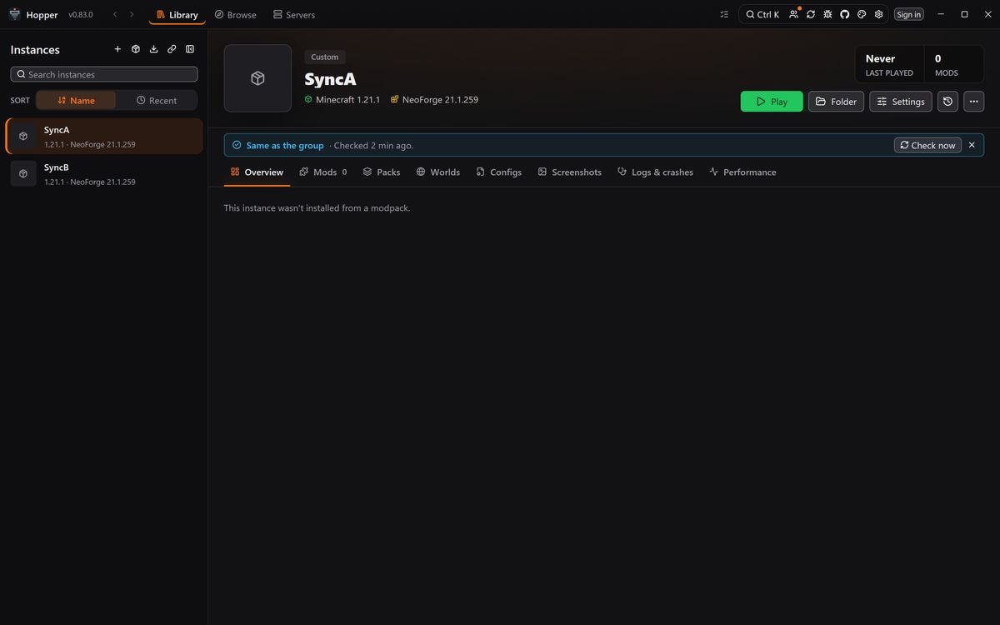
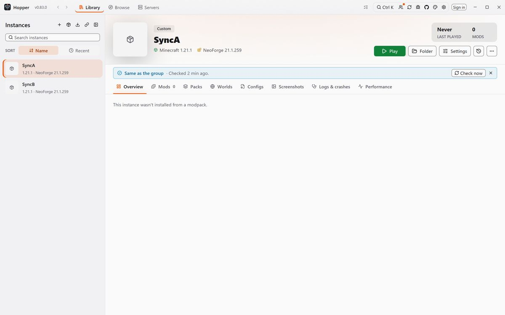
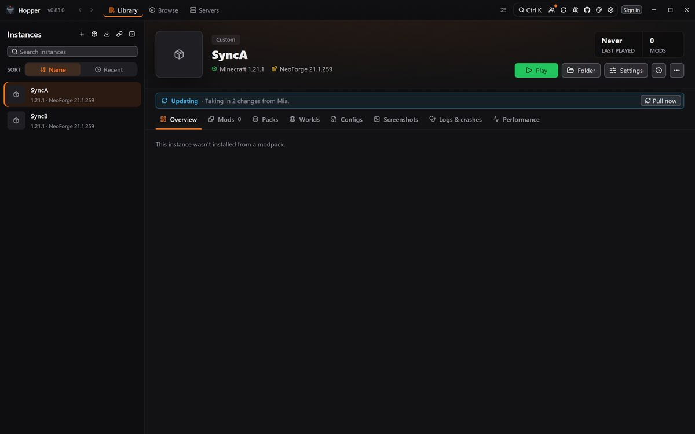
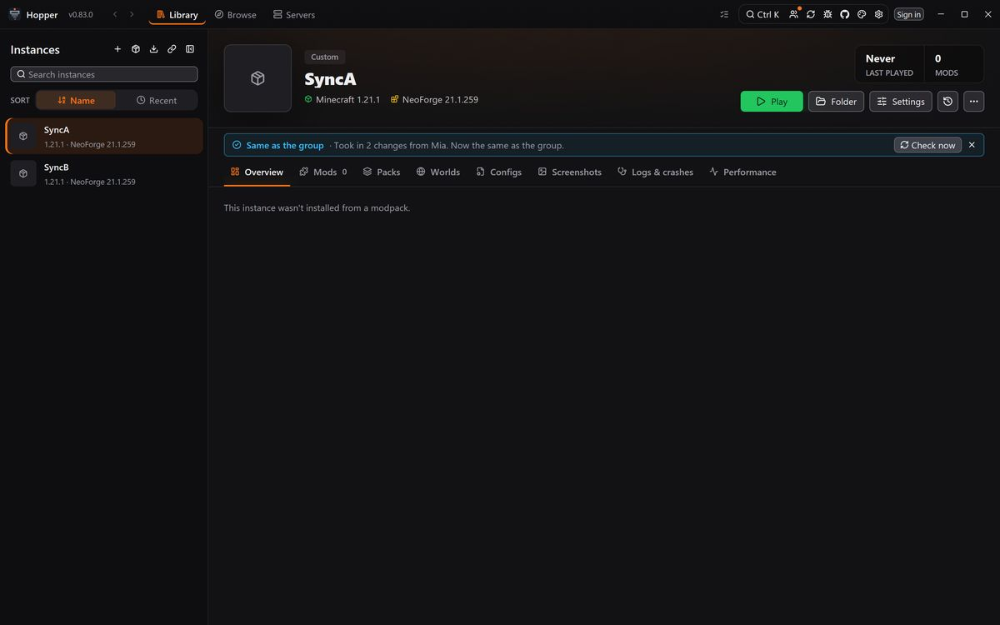
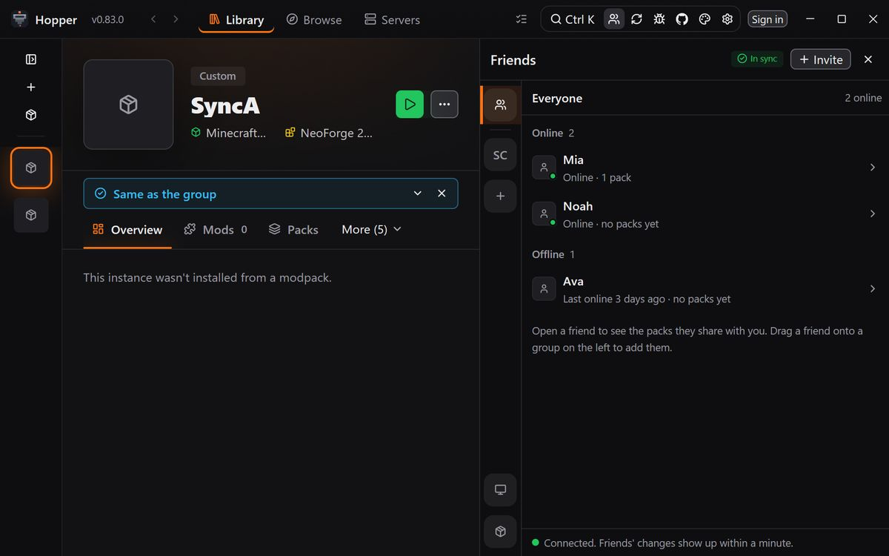

# Group sync strip: "Same as the group" and "Check now" (verified on screen, one fix added)

**Branch:** t3/4ddc36d3 (worktree; wording-strip e5463c85 merged in)   **Commit:** 61a82f5f (fix on top of merge a763b058)   **Size:** S
**Apps:** desktop only (Hopper Server has no friends groups; grep of `crates/hopperd/ui/src` finds no "In step" / "Pull now" for groups)

## From -> to
- Before (e5463c85 alone): strip says "In step" and the button "Pull now" even when nothing waits; after a Pull now the strip showed "Nothing new to take in." and hid what the pull did ("Took in 2 changes from Mia...").
- After: strip says "Same as the group" + "Check now" when nothing waits ("Pull now" and the old titles in every other state). After a pull it keeps the pull's own line: "Took in 2 changes from Mia. Now the same as the group." The pull lines now say "the same as the group", not "in step".

## On the site
    

## Screenshots (made-up group via `--dialog group-sync --state NAME`, scratch data on rig, no relay needed)
| State | Dark | Light |
|---|---|---|
| Same as the group, wide (1440x900) | ../img/0.83.1-strip-dark-after.jpg | ../img/0.83.1-strip-light-after.jpg |
| Same as the group, narrowest (960x600) | instep-dark-960.png | in-step-light-960.png |
| Narrowest + Friends side panel open | ../img/0.83.1-strip-narrowpanel-dark-after.jpg (button tucked into the chevron: instep-dark-960-friendspanel-overflow.png) | - |
| Wide + Friends side panel | instep-dark-1440-friendspanel.png | - |
| Updating (waiting, "Pull now") | ../img/0.83.1-strip-waiting-dark-after.jpg, updating-dark-960.png | - |
| Behind: close the game | game-dark-960.png | game-light-960.png |
| Behind: needs you | pick-dark-960.png | - |
| Can't update + Allow and install | left-out-dark-960.png | left-out-light-960.png |
| Can't update (failed) | failed-dark-960.png | - |
| After the fix: Updating -> Pull now -> kept line | ../img/0.83.1-strip-pulled-dark-after.jpg, pullfix-during.png | - |
| Group page rows, hover shows "Check now" | group-page-hover-mine.png, group-page-hover-theirs.png, group-page.png | - |
No "before" build (the old strip was not run); the old wording is in the code diff.

## Measurements (screenshots of the running app; 2 px per point)
| Claim | State measured | Numbers | Result |
|---|---|---|---|
| Button is vertically centred in the strip | dark 1440, dark 960, light 960, light 1440; also the "Pull now" buttons | gap above button 9 px / below 9 px in every shot; strip 67 px high everywhere (also 67 px with the side panel open) | ok |
| "Check now" label fits its button with even padding, same as "Pull now" | dark + light | Check now: content left 17 / right 17 px (button 195x45); Pull now: left 17 / right 16 px (button 167x45) | ok (<= 1 px) |
| Title on one line, nothing clipped or wrapped, narrowest + side panel | dark 960 with Friends panel | strip x 180..989 (panel divider at 1036), title text x 246..466, one text row 409..433 (25 px), strip height 67 = same as wide; button folds into the chevron as the strip design says | ok |
| Title readable | dark: title (56,189,248) on (21,31,38) = 7.81:1; detail 5.99:1; button label 10.78:1. Light: title 5.20:1; detail 5.50:1; button label 16.97:1 | all >= 4.5:1 | ok |
Not measured: Hopper Light with a side panel open, light "Updating"/"Behind: needs you"/failed strips, the zoom levels other than 100 %, the dismissed (hidden) in-step strip.

## Files
- `src/gpui/friends.rs`, `src/gpui/group_pack.rs`: wording-strip commit (Same as the group / Check now), merged as is
- `src/gpui/group_pack.rs`: `in_step_line` keeps what Pull now did; 2 tests
- `crates/hopper-core/src/groupstatus.rs`: pull lines "Already the same as the group." / "Now the same as the group."; test strings updated
- `design/group-sync-status.md`: same quote

## How tested
- Tests: `cargo-test-changed`: hopper `group_pack::tests::in_step_line_keeps_what_pull_now_did`, `in_step_line_drops_the_repeated_sentence` pass (2); hopper-core `groupstatus::tests` 29 pass (incl. `pull_now_says_what_it_did`). In the full run, hopper (125) and hopper-core pass; hopperd 411 pass, 1 fails: `ui::tests::built_page_has_no_inline_script_or_style` ("style attribute in index.html") because `crates/hopperd/ui/dist` is not built in this worktree. Not caused by this change (no hopperd file touched); not re-run with a built UI.
- On screen: Hopper debug build on rig (slot 1), `HOPPER_DATA_DIR=G:\rig-run\wording-strip` with 2 throwaway empty instances (state showed only them), `HOPPER_LOOPBACK=1`, `--mcp --embed-windows --dialog group-sync --state <name> --theme <name>`. Driven via MCP (navigate, click Pull now, Friends panel, group page hover). Window resized to 960x600 / 1440x900 with SetWindowPos on my own pid.
- NOT checked: a real two-PC group through a relay (the made-up group's "Pull now" settles by itself, so the real network path was not run); other themes; zoom != 100 %; keyboard focus ring on the button; hopperd (n/a).
- Test data: scratch dir and scripts on rig deleted; rig app stopped with `-Stop -Slot 1`. Another Hopper (pid 8408, E:\rig-test\hopper) is running on rig: not mine, not touched.

## Notes for the maintainer
- Bug found and fixed: after Pull now, e5463c85 replaced the pull's line with "Nothing new to take in." even when changes were just taken in. Now the line stays.
- Still says "In step" (not changed, your call):
  - Friends panel, group page: green chips "In step" on every pack row and person row, next to the detail "Same as the group. Checked just now." (`Status::label`, `Member::label` in `groupstatus.rs`, drawn in `friends.rs`). Now reads inconsistent with the strip's "Same as the group". See group-page.png.
  - Toast text and member details: "Noah's copy has the group's latest changes." is fine; strings with "in step" in comments only otherwise.
  - Pack banner chip "In step" for a server paired with a pack (`library.rs:2868`) and "Brings every server paired with this pack in step" (`library.rs:2897`): a different feature (servers), same unexplained phrase.
  - Setting row "Keep my packs the same as the group" already uses the plain wording.
- The strip's narrow layout drops the detail line under 960 wide windows and folds "Check now" into a chevron when a side panel is open (existing `notice_slot` behaviour, unchanged).
