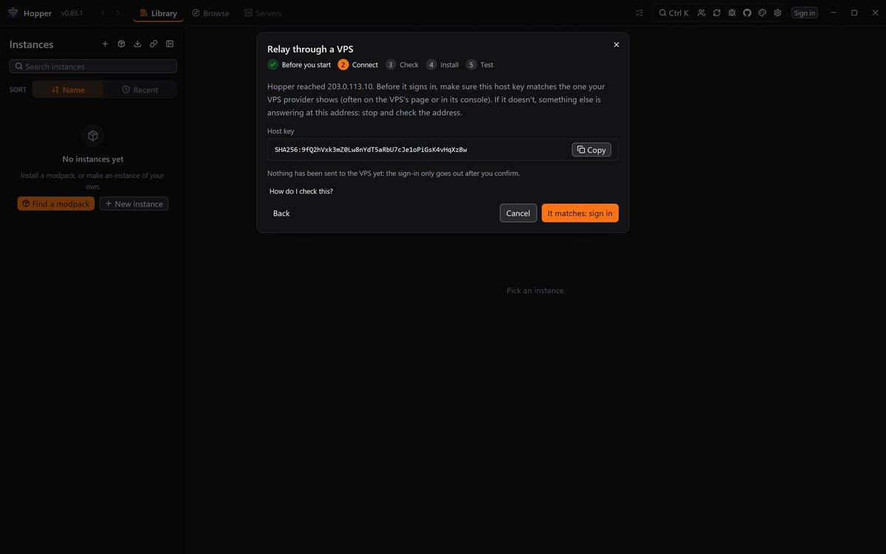
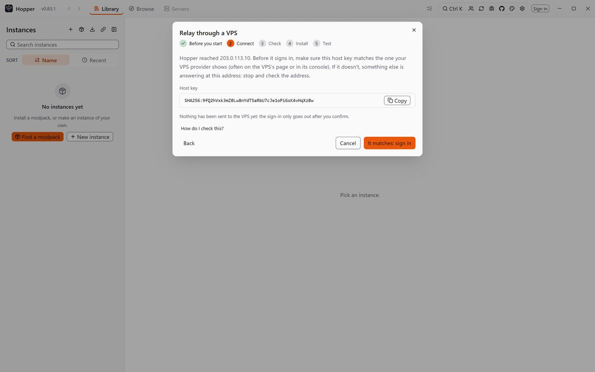
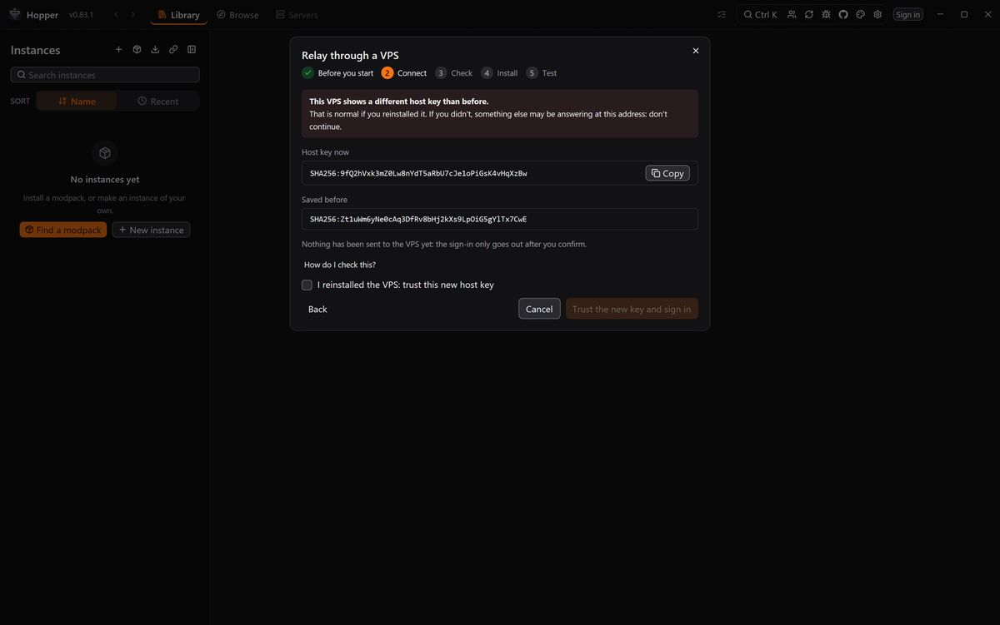
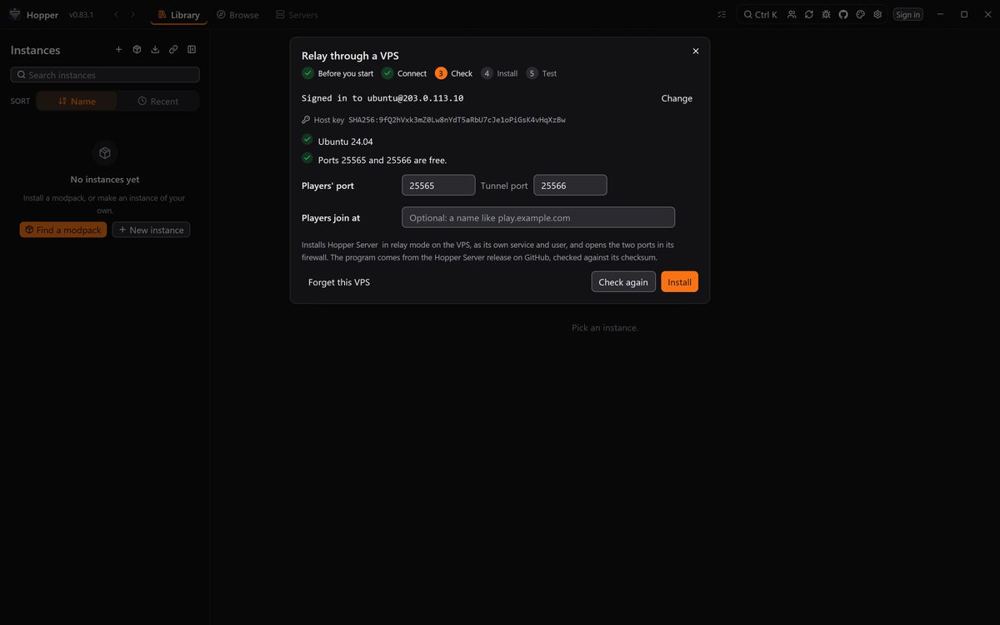

# Relay setup (desktop): the "check the host key" view, seen on screen

**Branch:** t3/relay-host-key-desktop-check   **Commit:** 2775a91c (on top of merge 626a401e = main + M2 commit 092add86)   **Size:** S/M
**Apps:** desktop only here. The web view of the same flow was checked in the M2 card (`..\relay-host-key\card.md`); this card is the desktop half that M2 only compile-checked.

## From -> to
- Before: the desktop "check the host key" step (between Connect and signing in) had never been seen on screen.
- After: seen in 6 states, dark and light, at 1440x900 and 960x600, with real clicks. Wording matches the web view word for word. One difference fixed: the changed-key warning now bolds its first sentence (web does; desktop showed it plain). Added a test-only way to open the dialog with made-up data (`--dialog relay-host-key --state ...`).

## On the site
   
From the 1440 wide shots: `first-dark-1440.png` -> `../img/0.83.2-hostkey-first-dark-after.jpg`, `first-light-1440.png` -> `../img/0.83.2-hostkey-first-light-after.jpg`, `changed-dark-1440.png` -> `../img/0.83.2-hostkey-changed-dark-after.jpg`, `signed-in-dark-1440.png` -> `../img/0.83.2-hostkey-signedin-dark-after.jpg`.

## Screenshots (Hopper debug build on rig, real window, 2 px per point; `*-960` = 960x600 window, `*-1440` = 1440x900 window)
Each as `<state>-<dark|light>-<960|1440>.png`:
| State | file prefix |
|---|---|
| Connect form (password mode, for comparison) | `form-` |
| Host key shown, first time | `first-` |
| "How do I check this?" open | `how-` |
| Key changed, "I reinstalled" unticked (button off) | `changed-` |
| Key changed, ticked (button on) | `changed-ticked-` |
| Signed in (Check step) | `signed-in-` |
Real clicks (dark, 1440): `click-tick-enables.png`, `click-untick-disables.png`, `click-how-opens.png`, `click-confirm-error.png` (no server behind the preview: error note shows, dialog stays usable), `click-back-form.png` (Back returns to the form, address / user / mode / password kept).
No "before": the step did not exist on desktop before M2.

## Measurements (from the screenshots, `measure`-style pixel scans; 2 px = 1 point)
| Claim | State measured | Numbers | Result |
|---|---|---|---|
| Dialog opens at the same top as every dialog (`DIALOG_TOP`) | all 6 states, 4 theme/size combos | dialog top 106-107 px in all 24 shots (±1 px); width 1196 px (598 pt) in all | ok |
| Dialog fits the narrowest window | 960x600, tallest states: changed 837 px, form 841 px, how 833 px | window 1200 px high: bottom at 944 / 948 / 940, 252+ px spare; left 362 / right margin 362 px (centred) | ok |
| Fingerprint fits on one line, nothing clipped | changed (two keys), dark + light, 960 | text x 418..1036; copy button starts ~1375; box right edge 1526: 339 px free before the button, 490 px to the box edge. The key is always 50 characters, so this is the worst case | ok |
| Key text sits in its box evenly | changed, 960 | box 70 px high; gaps top 26 / bottom 24 px (ink includes descenders) | ok (≤ 2 px) |
| Back / Cancel / primary line up | all combos | Cancel 120x60 and primary 378x60 px, top 817 / bottom 876 in both; text centre of Back 847 vs button centre 846.5; 16 px between Cancel and primary; primary 33 px from the dialog's right edge, 32 px from its bottom (same as the form's Connect row) | ok |
| Primary label centred | "Trust the new key and sign in", 960 | ink x 1167..1503 in button 1148..1525: centre 1335 vs 1336.5 (0.75 pt) | ok |
| Fingerprint / body text readable | dark / light | key 16.0 / 17.0; helper text ("Nothing has been sent…", intro) 6.7 / 6.05; warning text on its tint 14.1 / 14.3; command box 14.1 / 15.1; checkbox label 16.0 / 17.0 | ok (≥ 4.5) |
| Primary button label readable | enabled, dark / light | 6.76 / 5.18 | ok |
| Disabled primary reads as disabled | changed vs changed-ticked | fill (52,32,20) vs (249,115,22) dark; (248,226,215) vs (234,88,12) light; label 2.4 / 2.0 (disabled, exempt) | ok |
| "It matches: sign in" / "Trust the new key and sign in" on/off exactly as web | clicks on the running app | first time: enabled at once; changed: disabled until the tick (click ticks → on, click again → off), as web `disabled={busy \|\| (changed && !reinstalled)}` | ok |
Not measured: a long host or odd address in the intro sentence (it wraps; not tried with a very long name); zoom other than 100 %; light theme with a side panel open (not applicable: it is a dialog).

## Wording check against the web view (`VpsRelaySetup.svelte`)
Same strings: intro, "Host key" / "Host key now" / "Saved before", "Nothing has been sent to the VPS yet…", "How do I check this?" / "Hide how to check", the console sentence and command, "Copy" / "Copy command", the tick text, "Back" / "Cancel", "It matches: sign in" / "Trust the new key and sign in" / "Signing in…". Layout parity: same order of parts, Back on the left, Cancel + one filled orange primary on the right.
Difference: the web's warning runs the bold sentence inline; desktop puts the bold sentence on its own line, then the rest (gpui has no inline bold without styled-text spans). Fixed the missing bold only.

## Files
- `src/gpui/relay_setup.rs`: `open_preview` (test states), split `new` / `build`, bold lead line on the changed-key warning
- `src/gpui/app.rs`: `--dialog relay-host-key` arm

## How tested
- Tests: `cargo-test-changed.ps1`: hopper 125 passed, 0 failed. hopperd 426 passed, 1 failed: `ui::tests::built_page_has_no_inline_script_or_style` ("style attribute in index.html"). The worktree has no `crates/hopperd/ui/dist` (nothing to touch, so the brief's touch fix did not apply); I changed no hopperd file; same failure as other worktrees (wording-strip card). Not re-run with a built UI. `vps::setup::host_key_tests::*` all pass.
- On screen: Hopper debug build on rig slot 2, `HOPPER_DATA_DIR=G:\rig-run\relay-hk` (scratch, `{}` settings; `state` showed no instances), `HOPPER_LOOPBACK=1`, `HOPPER_TEST_WINDOW=1`, MCP port 47833, `--mcp --embed-windows --dialog relay-host-key --state <name> --theme <Hopper Dark|Hopper Light>`. Window sized with SetWindowPos on my own exe path. Clicks and screenshots via the app's MCP endpoint.
- NOT checked: the flow against a real hopperd (the preview has no server: Connect / confirm only reach the error path; the M2 web check and the 6 M2 server tests cover the server side; desktop `sign_in` → host-key probe → confirmed sign-in code path is therefore still only compile-checked, plus the "error shown, dialog usable" click); a real VPS; keyboard focus ring (Back, "How do I check this?", Copy, checkbox are all gpui-kit `Button` / `Checkbox`, no hand-built clickables, but I did not Tab through them); screen reader; zoom != 100 %.
- Test data: preview-only fake host, key and rows, no network. Scratch dir `G:\rig-run\relay-hk` and the scheduled task I made were deleted; my app stopped with `-Stop -Slot 2`. Another Hopper (pid 8408, E:\rig-test\hopper) runs on rig: not mine, untouched.

## Notes for the maintainer
- The preview is not behind a build flag: like the other `--dialog` previews it only runs when asked on the command line and does nothing in a normal run.
- Small look note, not changed: "How do I check this?" and "Back" are ghost buttons (plain text until hovered), same as the existing "Show the commands" toggle in this dialog.
- Primary button contrast on desktop is fine (dark label on orange: 6.76 dark / 5.18 light). The web UI's light primary (white on orange, 3.3:1, flagged in the M2 card) is a different, shared web style.
- Window sizes: 960x600 shots are exactly 960x600 points; "1440x900" shots are 1427x893 points of content (the window's frame takes the rest).
