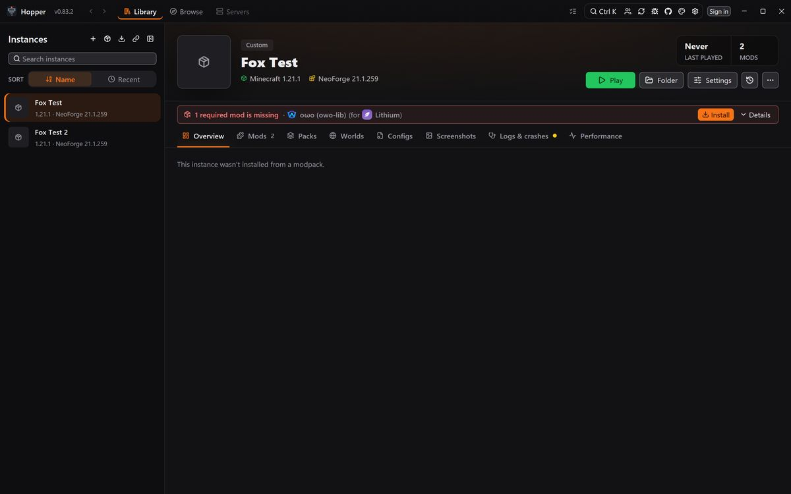
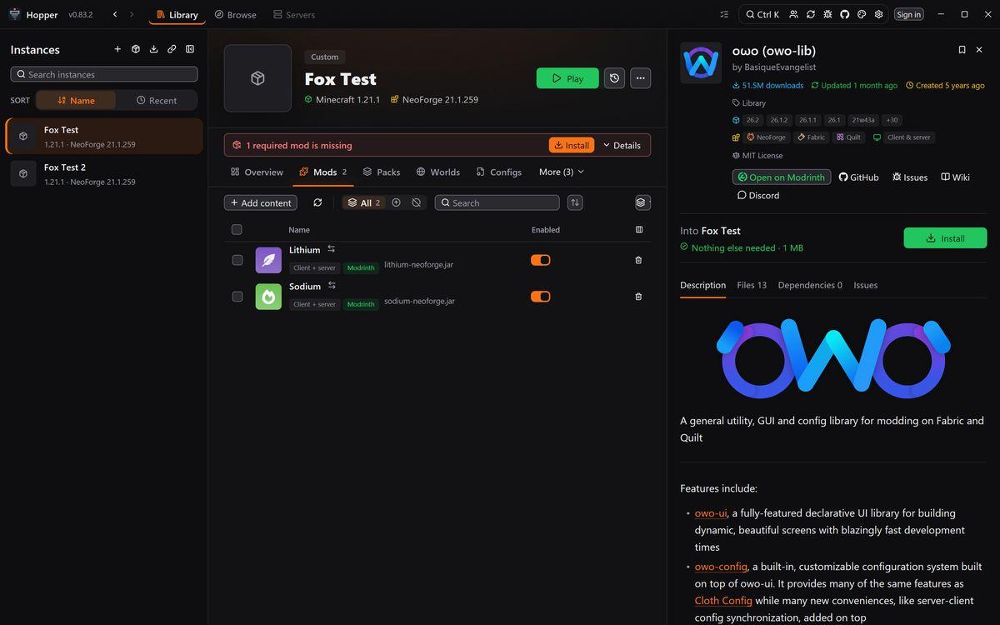
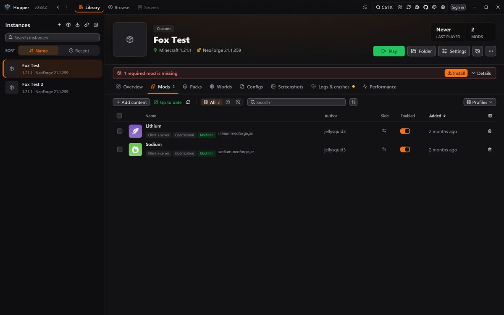
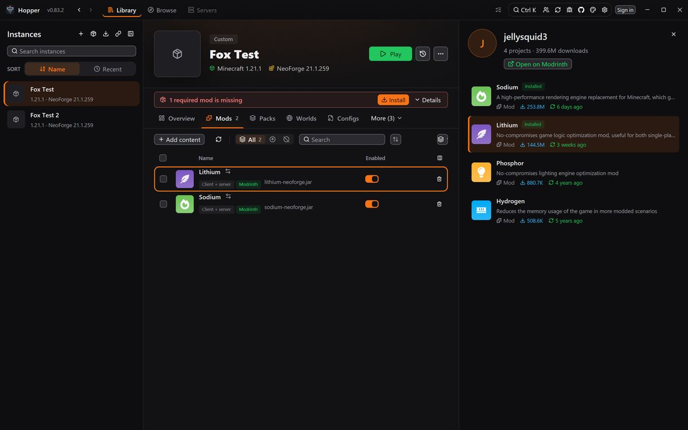
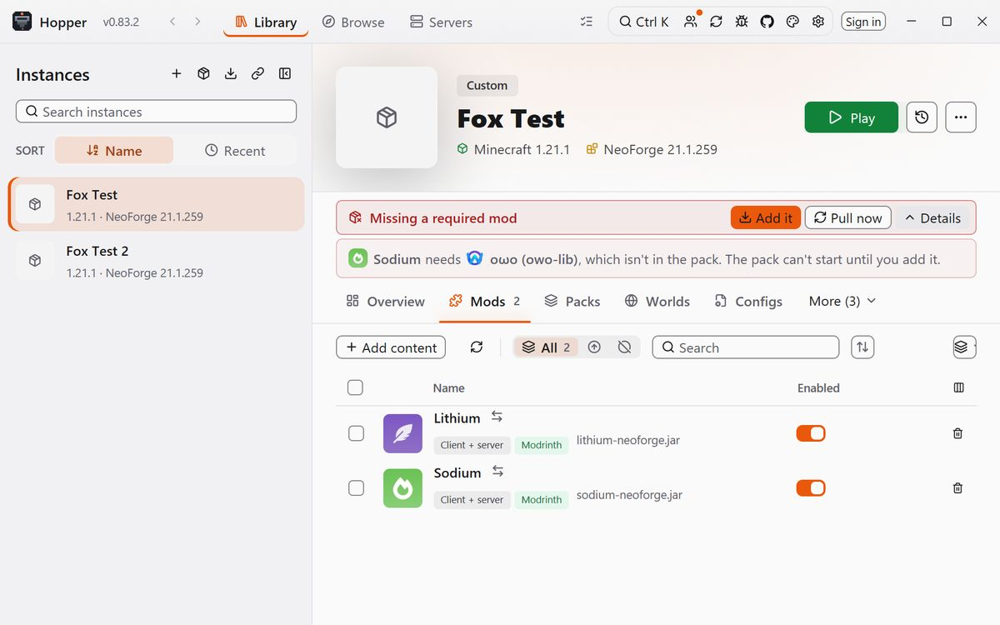
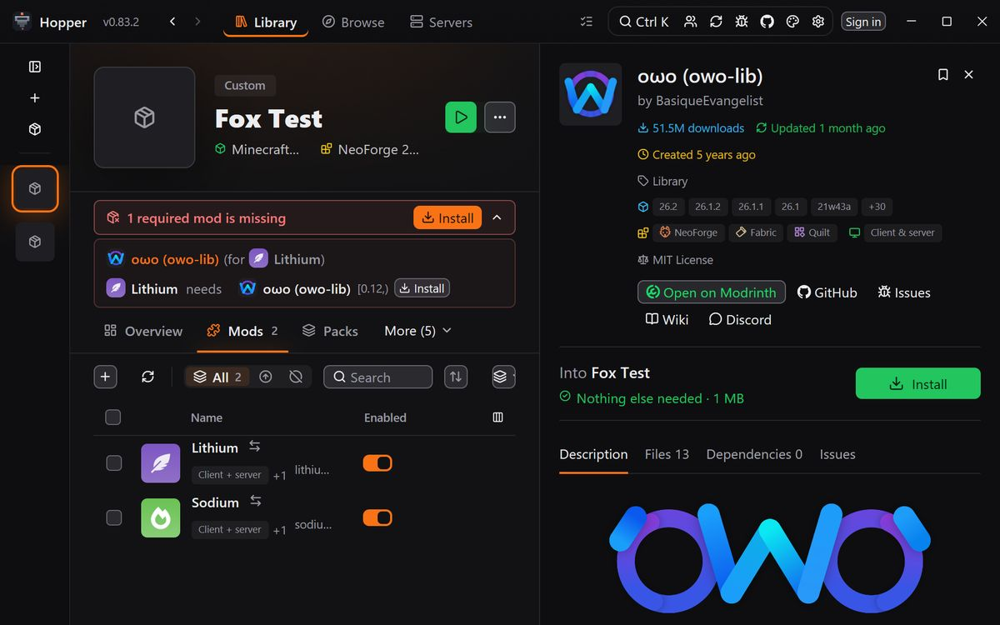
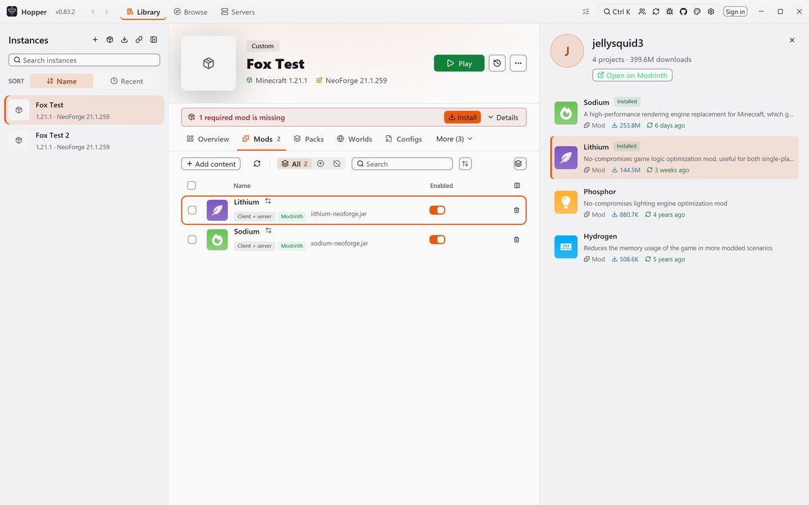

# Mod names in notices open their page; author in the Mods list opens a peek

**Branch:** t3/mod-names-and-author-links   **Commit:** 2531e042   **Size:** M
**Apps:** desktop only. Hopper Server's web UI left alone (see Notes).

## From -> to
- Before: "1 required mod is missing" listed bare ids ("arcane_framework (for Spell Atlas)"); mod names in other notices were plain text; the Mods list author was plain text.
- After: every mod a notice names shows its icon and real name and opens its page beside the view; the author in the Mods list opens a side peek with that author's projects.

## On the site
       

## Screenshots (every state)
| State | Before | After |
|---|---|---|
| Missing-mod strip, Hopper Dark 1440 | (maintainer's report screenshot) | ../img/0.84.0-missing-strip-dark-after.jpg |
| Click owo-lib -> page beside the Mods tab, dark 1440 | none | ../img/0.84.0-dep-click-dark-after.jpg |
| Mods list with Author column, dark 1440 | none | ../img/0.84.0-mods-author-column-dark-after.jpg |
| Author link -> jellysquid3 peek, dark 1440 | none | ../img/0.84.0-author-peek-dark-after.jpg |
| Group strip "Missing a required mod", dark 1440 | none | ../img/0.84.0-group-strip-dark-after.jpg |
| Group strip click-through, dark 1440 | none | ../img/0.84.0-group-strip-click-dark-after.jpg |
| Group strip, light 960x600 (names under Details) | none | ../img/0.84.0-light-960-after.jpg, ../img/0.84.0-light-960-details-after.jpg |
| Missing-mod strip, dark 960x600, details, page beside | none | ../img/0.84.0-dark-960-after.jpg, ../img/0.84.0-dark-960-details-after.jpg, ../img/0.84.0-dark-960-peek-after.jpg |
| Strip + author peek, light 1440 | none | ../img/0.84.0-light-1440-after.jpg, ../img/0.84.0-light-author-after.jpg |

## Measurements
| Claim | State measured | Numbers | Result |
|---|---|---|---|
| Names readable | light 960 details (Hopper Light), dark 1440 | contrast 5.3-5.65 light (muted text on strip tint), 6.07 dark | ok (>= 4.5) |
| Icon size | light 960 details, 2 px/pt | Sodium icon 37 px = 18.5 pt | ok |
| Icon vs text alignment | light 960 and 1440 | icon centre 2.5-3 px (about 1.3 pt) above the glyph centre | not centred to 1 px; same widget everywhere; not changed |
| Not clipped, no wrap | light 960 details row | last glyph at x 1804, row inner edge about 1872; one row (y 477-513) | ok |
| Not clipped beside side panel | dark 960 with peek open | strip collapses to chevron; no wrap, no overlap | ok (by eye on f3) |
| Real click-through | rig MCP clicks at screenshot pixels | strip dep link, group strip dep link, author link, each opened the right panel | ok |

Not measured: pixel gaps of the author cell; dark 960 contrast; hover colours.

## Files
- `src/gpui/notice_slot.rs`: `Notice::subject_rich`, `strip` (rich line under Details when no room), `list_row`
- `src/gpui/widgets.rs`: `mod_link_lookup` (name + open by id)
- `src/gpui/addons_extra.rs`: `lacks_line`, `missing_banner`, `duplicate_banner`, `mods_subject`, `peek_mod_id`, tests
- `src/gpui/addons.rs`: `open_author`, author cell link, `only_here_note`
- `src/gpui/browse.rs`: `peek_author`, `frame`, `author_link`
- `src/gpui/group_pack.rs`: `group_status_bar`, `needs_line` (small)
- `src/gpui/server_crash.rs`: `notice`; `src/gpui/stuck.rs`: `blamed`, `stuck_bar`
- `crates/hopper-core/src/groupdeps.rs`: `Piece`, `list_pieces`, `detail_pieces`
- `src/gpui/store/group_needs.rs`, `store/friends.rs`: harness `preview_group_needs` only

## How tested
- Tests: groupdeps (14, 2 new), addons_extra (3 new), `cargo-test-changed` all pass (8 binaries); hopperd `ui::tests` pass after `pnpm build`.
- On screen: rig slot 1, scratch data `G:\rig-run\mod-names`, throwaway instances with Modrinth mods only; clicks via the app's MCP.
- NOT checked: server crash and stuck-start notices on screen (code path shared with the strip, built, not seen); the duplicate-mods strip on screen; Hopper Server UI; zoom other than 100.
- Test data: scratch only, stopped with `-Stop -Slot 1`.

## Notes for the maintainer
- Where the strip has no room (under 46 rem) the names open under Details; the old plain tooltip stays.
- Web UI: its Mods list author column is plain text and the web has no missing-mod strip with names ("breaks X" chip already has icon and peek). An author panel needs a new side panel in `Mods.svelte` (the `/browse/author` route exists, no new security surface); left for a follow-up.
