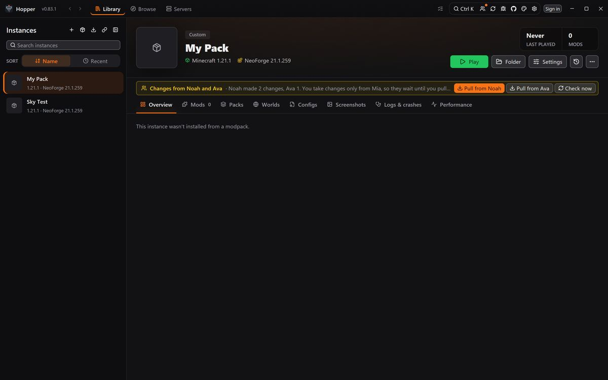
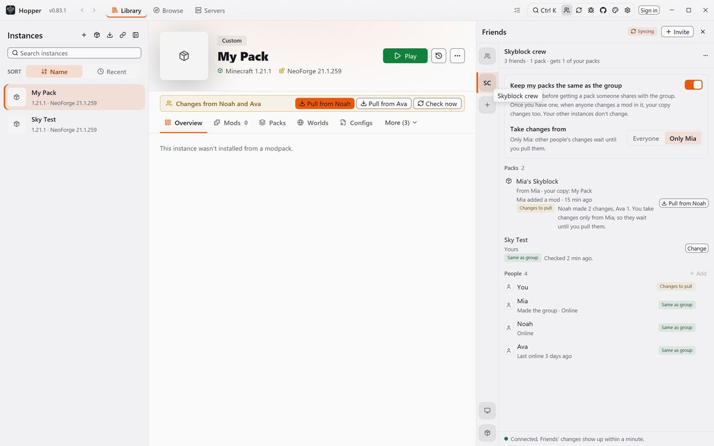
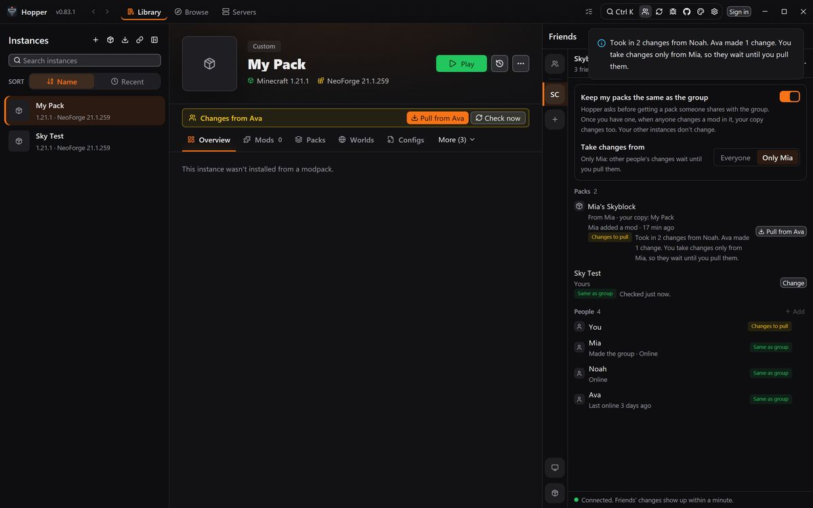
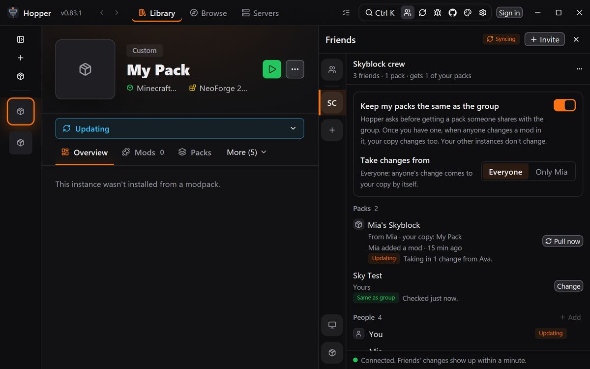
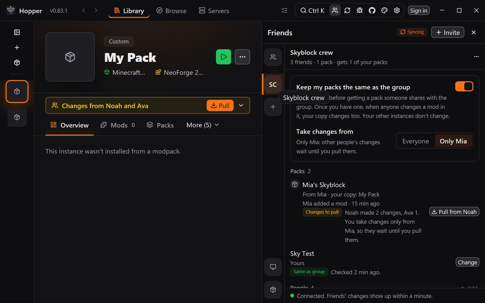
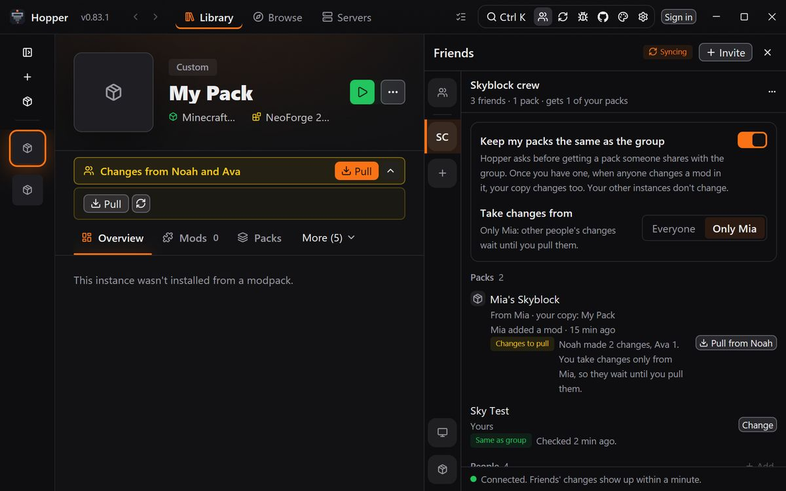
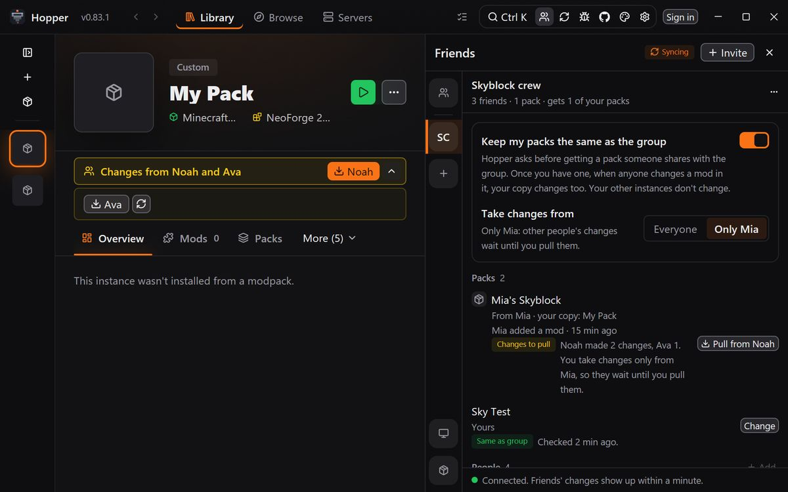
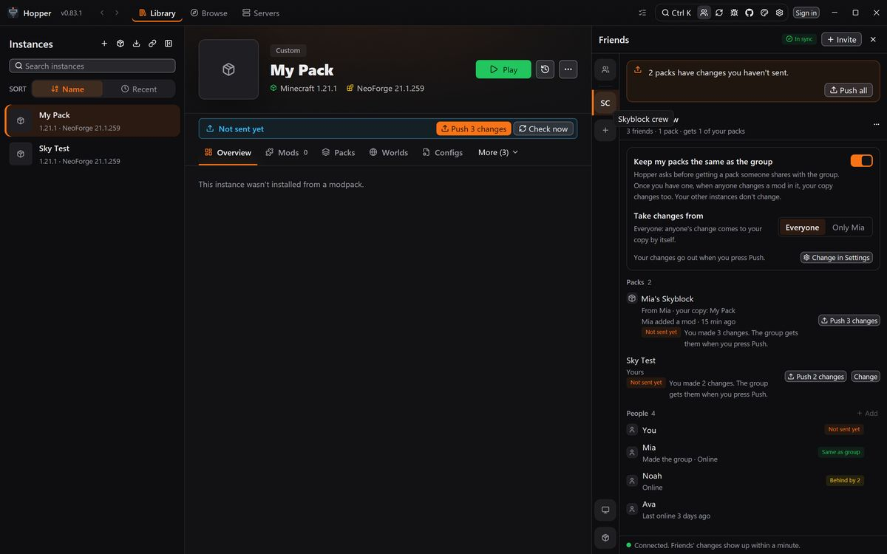
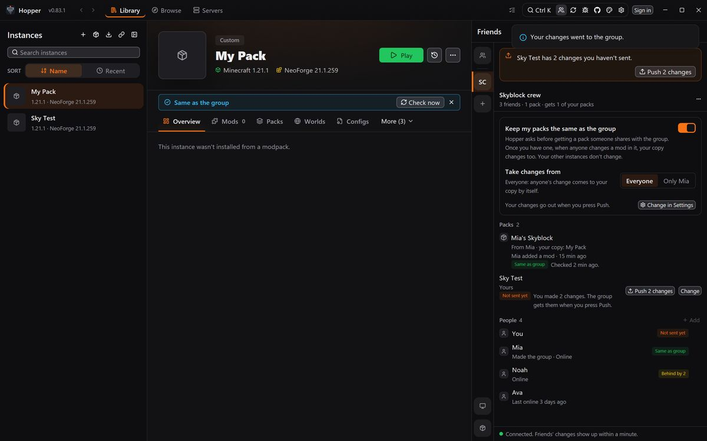
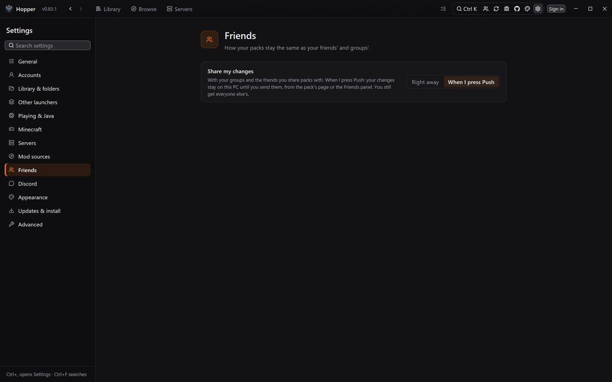

# Friends groups: take changes only from the group's maker, and push your changes by hand

**Branch:** t3/group-sync-pull-and-push-options   **Commit:** 534af575   **Size:** M (ran long, see notes)
**Apps:** desktop only. Hopper Server has no friends groups, so there is nothing to match there.

## From -> to
- Before: every member's change to a group pack came into your copy by itself, and every change you made went out within a second or two.
- After:
  - **Take changes from** (per group, on this PC): Everyone (default) or Only <maker>. With Only, other people's changes wait. The pack page and the Friends panel say whose changes wait and how many, with a "Pull from <name>" button for each person.
  - **Share my changes** (Settings › Friends, per PC): Right away (default) or When I press Push. With Push, your changes stay on this PC until you press "Push 3 changes" (pack page, group row) or "Push all" (Friends panel).

## On the site
         

## Screenshots (all on rig, scratch data, made-up group via `--dialog group-sync`)
No "before" shots: these states didn't exist before this change.

| State | Shot |
|---|---|
| Only Mia, Noah's and Ava's changes wait (1440, dark) | ../img/0.84.0-parked-dark-after.jpg |
| Same, with the group open in the side panel (1440 dark / light) | ../img/0.84.0-parked-panel-dark-after.jpg, ../img/0.84.0-parked-panel-light-after.jpg |
| After "Pull from Noah": only Noah's changes came in, Ava's still wait | ../img/0.84.0-pulled-noah-dark-after.jpg, ../img/0.84.0-pulled-noah-960-dark-after.jpg |
| Switched back to Everyone: Ava's changes come in by themselves, old note gone | ../img/0.84.0-everyone-after-pull-dark-after.jpg |
| Only one person waiting (parked-one, 960 dark) | ../img/0.84.0-parked-one-dark-after.jpg |
| Narrow strip at 960 (dark / light) | ../img/0.84.0-parked-960-dark-after.jpg, ../img/0.84.0-parked-960-light-after.jpg |
| Narrow strip menu: before the fix both buttons read "Pull"; after, "Noah" / "Ava" | ../img/0.84.0-narrow-menu-dark-before.jpg, ../img/0.84.0-narrow-menu-dark-after.jpg |
| Push by hand: strip "Push 3 changes", group rows, "Push all" bar | ../img/0.84.0-to-push-panel-dark-after.jpg, ../img/0.84.0-to-push-960-dark-after.jpg, ../img/0.84.0-to-push-960-light-after.jpg |
| After pushing one pack: it reads "Same as the group", the bar now names the other pack | ../img/0.84.0-pushed-one-dark-after.jpg |
| Settings › Friends › Share my changes | ../img/0.84.0-settings-friends-dark-after.jpg |

## Measurements
| Claim | State measured | Numbers | Result |
|---|---|---|---|
| "Pull from Noah" label centred in its button | 1440, dark, parked | gaps L 13 / R 13, T 7 / B 8 px (2x) | ok |
| "Push 3 changes" label centred | 1440, dark, to-push | L 13 / R 12; T 7 / B 2 (the "g" descender) | ok horizontally; vertical gap is the descender |
| "Only Mia" in the selected segment | 1440, dark | L 15 / R 16; T 13 / B 5 (the "y" descender) | ok horizontally; the segment is the shared `widgets::Segmented` |
| Nothing clipped at 960x600 with the side panel open | parked, parked-one, to-push; dark and light | viewport 960x600 from MCP `state`; the strip folds to one button plus the menu, and the card and segments fit inside the panel | ok, checked on the screenshots |
| The scratch app no longer reaches the friends service | to-push run after the fix | data folder holds no `mailbox.json` or `peer-id.txt` | ok |

Not measured: colour contrast of the new chips. They use the shared `Tone::Warn` / `Tone::Busy` chip colours that already exist.

## Files
- `crates/hopper-core/src/syncmode.rs` (new): author filter, parked list, merge view, pending own changes, push wording.
- `crates/hopper-core/src/groupstatus.rs`: new statuses `Parked` ("Changes to pull") and `ToPush` ("Not sent yet"), with their wording.
- `crates/hopper-core/src/settings.rs`: `FriendGroup.owner_only`, `push_by_hand`, `pushed_codes`.
- `src/gpui/store/sync_modes.rs` (new): store side (pull from one person, hold back, push, preview).
- `src/gpui/store/friends.rs`: merge, follow and publish use the filter and hold-back; the preview no longer starts the real friends service.
- `src/gpui/group_pack.rs`, `src/gpui/friends.rs`: strip and row buttons, group card with Take changes from, Push bar.
- `src/gpui/settings_page.rs`, `src/gpui/app.rs`: new Friends category, "Change in Settings" action.

## How tested
- Tests: syncmode 8 new, groupstatus +4, settings +2, all pass. `cargo-test-changed`: hopper 125 ok, hopper-core 1654 ok + 1 fail (`remotefs::ftp::tests::ftps_round_trip`, a local TLS race under load; passes alone, 7/7), hopperd 420 ok + 1 fail (`ui::tests::built_page_has_no_inline_script_or_style`: this worktree has no `crates/hopperd/ui/dist`; no hopperd files changed).
- On screen, on rig slot 3 through Hopper's MCP:
  - Opened the Friends panel and the group.
  - Pulled from Noah: 2 changes in, Ava's still waiting.
  - Switched to Everyone: Ava's change came in.
  - Pushed one pack: it now reads "Same as the group", and the bar names only the other pack.
  - Opened Settings › Friends.
  - Opened the narrow strip menu.
- NOT checked:
  - A real two-PC group through the relay. Only the made-up group was used; nothing was sent for real.
  - Restart while changes are held. Covered by a unit test only (`held_back_changes_are_found_again_after_a_restart`).
  - Friend shares that aren't in a group: their Push lives only in the Friends panel bar, and it wasn't seen on screen.
  - The "Change in Settings" button's jump.
- Test data:
  - Scratch `G:\rig-run\syncmodes` with two empty instances; deleted afterwards.
  - App stopped with `-Stop -Slot 3`.

## Notes for the maintainer
- **Friends service contact (my fault, now fixed):**
  - One scratch run signed a throwaway identity into the real friends service (`sync.kyuubi.dev`).
  - Cause: the first preview run saved `peer_sync=true` into the scratch settings. The next start signed in before the preview took over, because `mailbox_url` was the default.
  - The publish loop may have sent the two empty scratch packs under that identity to the made-up group `g-preview`.
  - The local identity files are deleted. The account itself may still exist on the service.
  - Fix: `preview_group_sync` now drops the mailbox. Scratch settings should also set `mailbox_url: ""`.
- Bugs found on screen and fixed:
  - After switching back to Everyone, the last pull's note still said "You take changes only from Mia".
  - In the narrow strip menu, two people's buttons both read "Pull". They now show the person's name.
- Limits:
  - A group row in the Friends panel shows a pull button for the first waiting person only; the pack page strip shows up to 3.
  - A newly shared pack goes out right away even with Push by hand: sharing is the player's own decision.
  - Plain friend shares (not in a group) get only the Friends panel "Push" bar, not a button on their row.
- No relay or protocol change.
