# Friends panel: many shared settings fit in one small card, with a Manage window

**Branch:** t3/friends-shared-settings-manage   **Commit:** 66698aa5   **Size:** M
**Apps:** desktop only. Hopper Server's web UI has no Friends panel ("Shared settings" exists only in `src/gpui/friends.rs`), so nothing to port.

## From -> to
- Before: every mod that shares its settings with a group got its own row (about 60 px each, with a Stop button), so 20 mods pushed People out of view.
- After: 4 or fewer mods keep today's rows. 5 or more show one card (overlapping icons, "+8 more", "43 settings changed. Your friends get them right away.", `Manage...` and `Stop all`). `Manage...` opens a window with search, an All / Changed / No changes yet filter and a table you can tick (drag across rows, Shift-click for a range) and stop sharing in one go. Mock picked: "B + Manage" (https://claude.ai/artifact/PKU2jTHf1p4rdf7EafAzrk).

## On the site
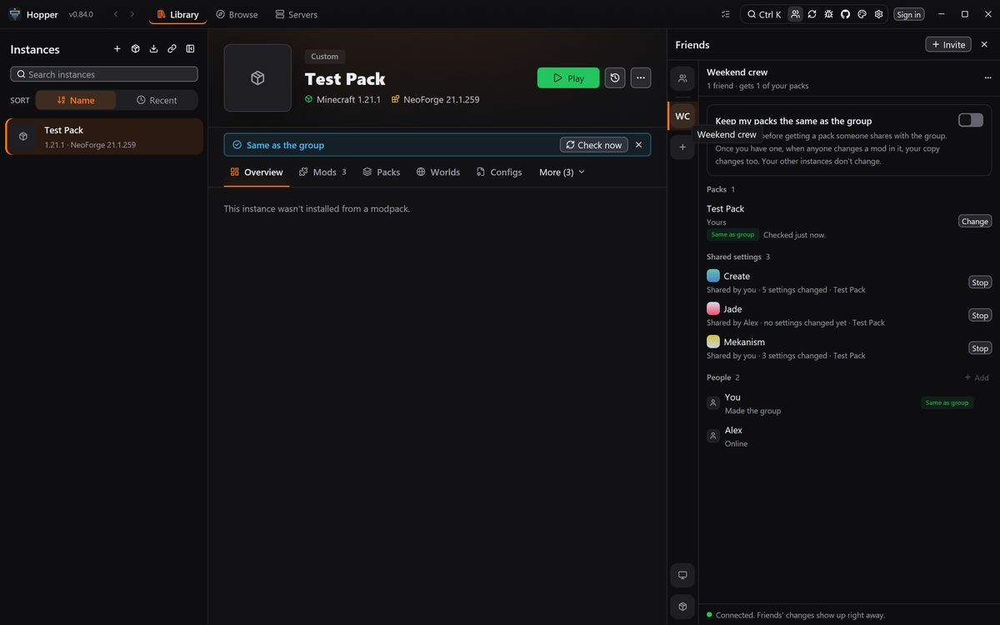 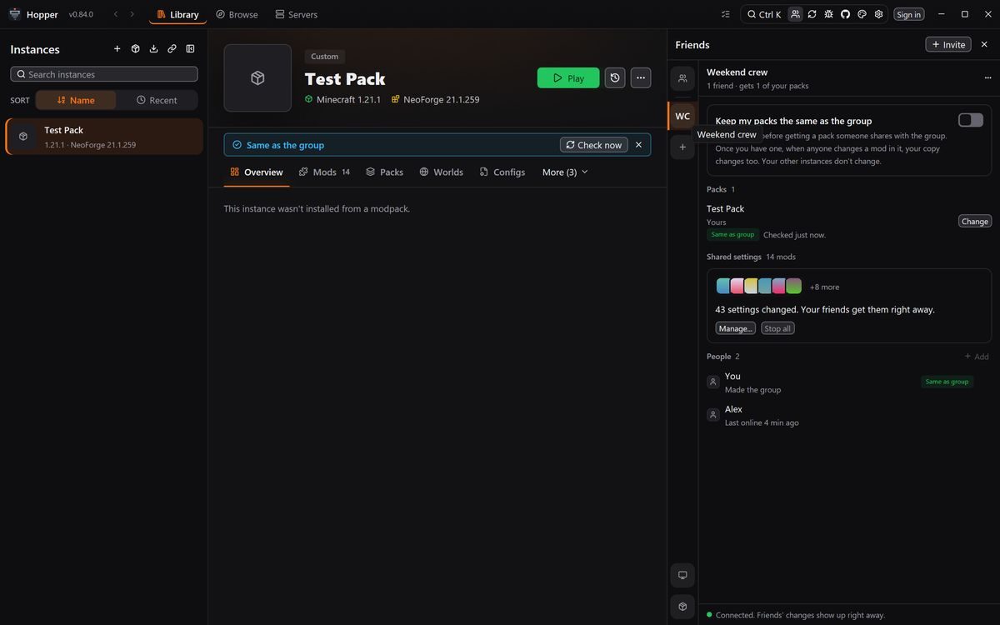 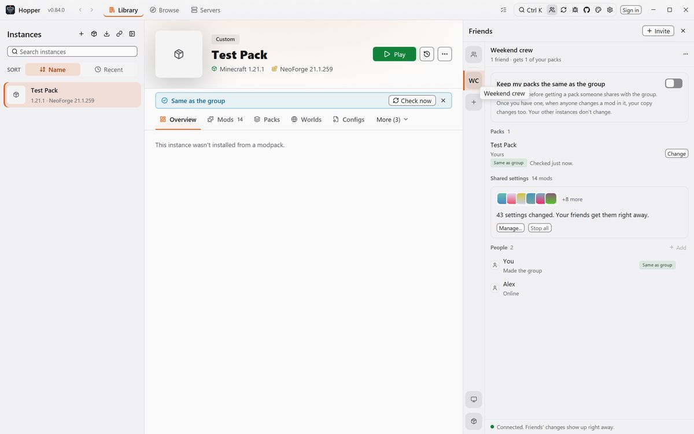 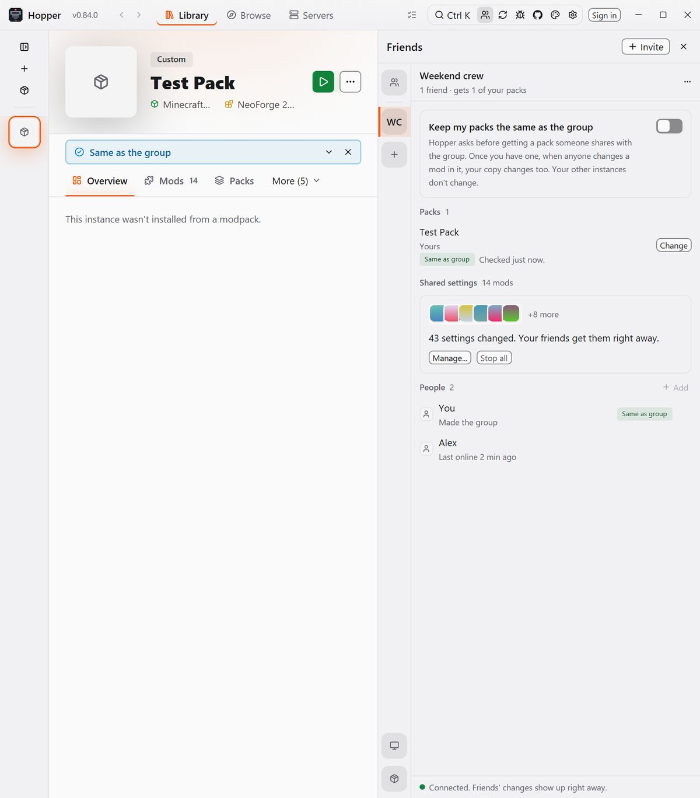 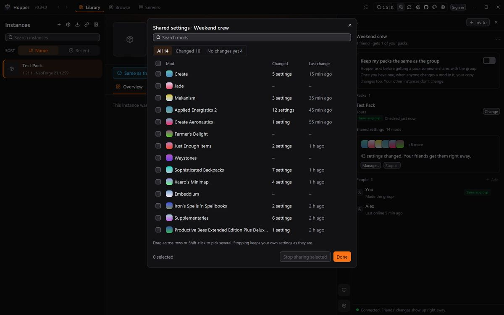 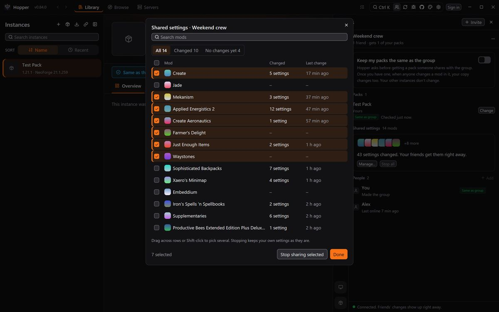 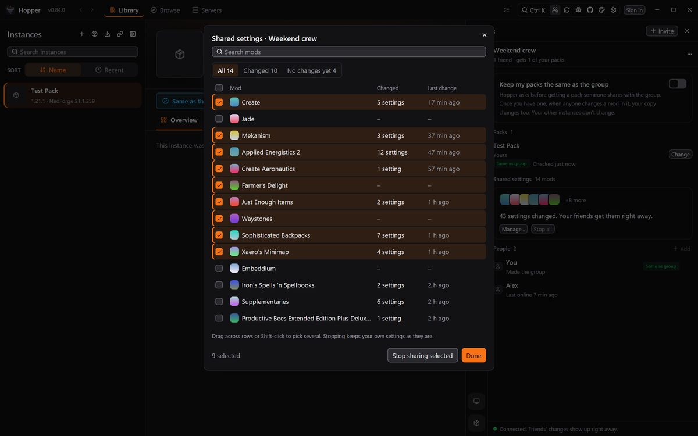 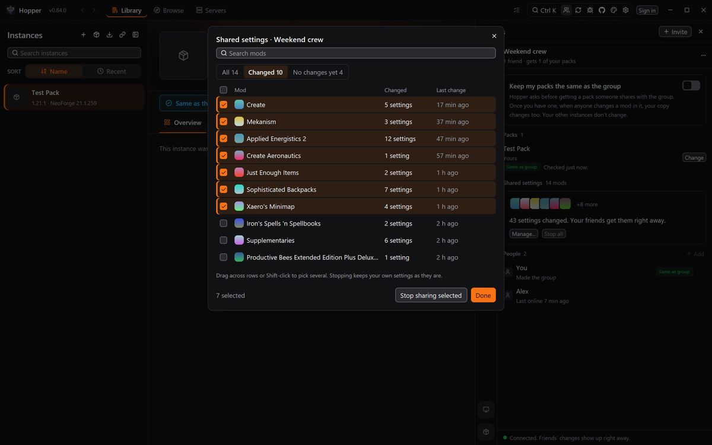 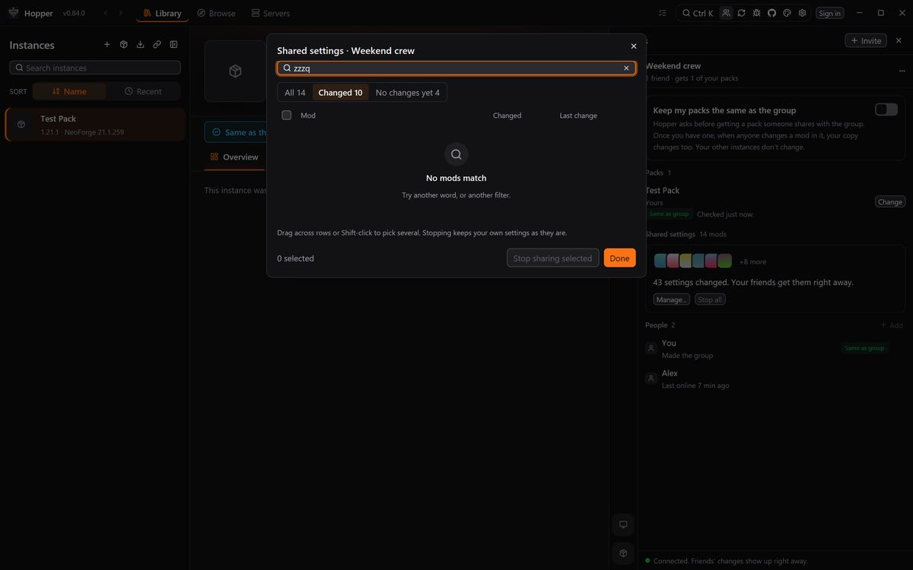 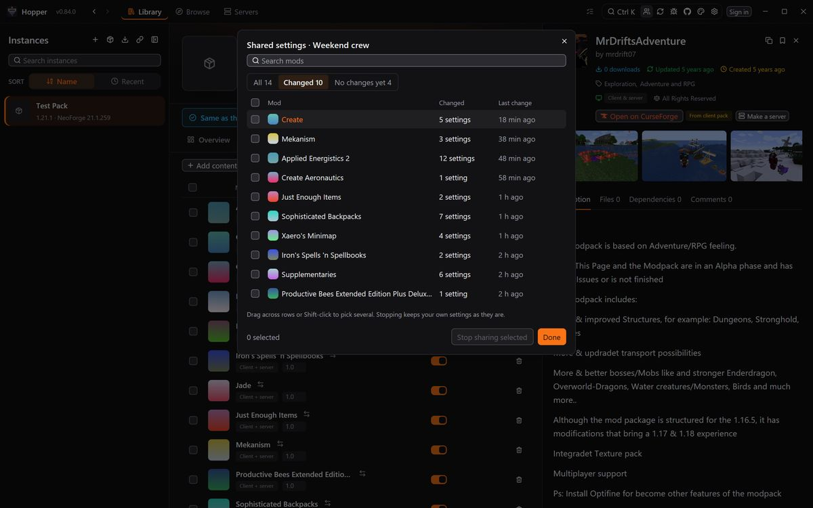 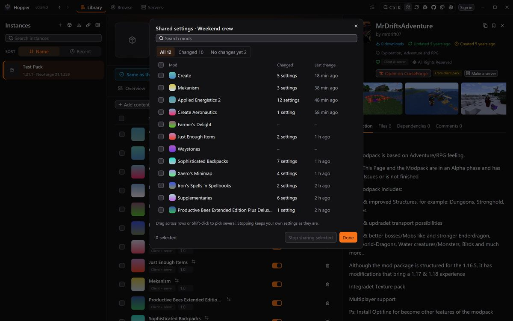 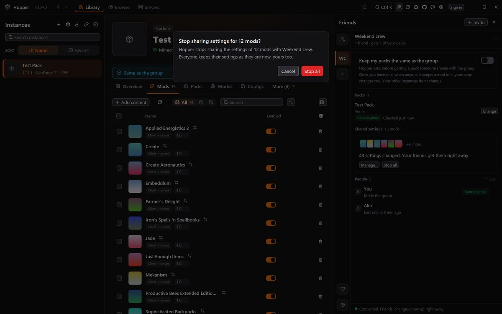 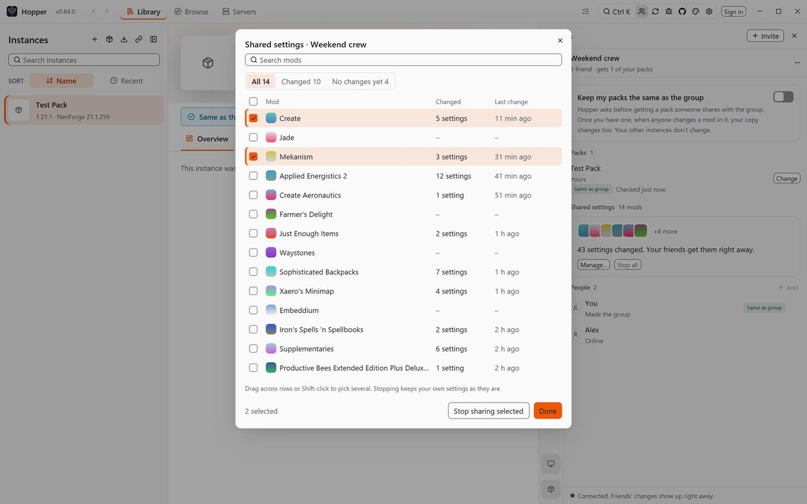 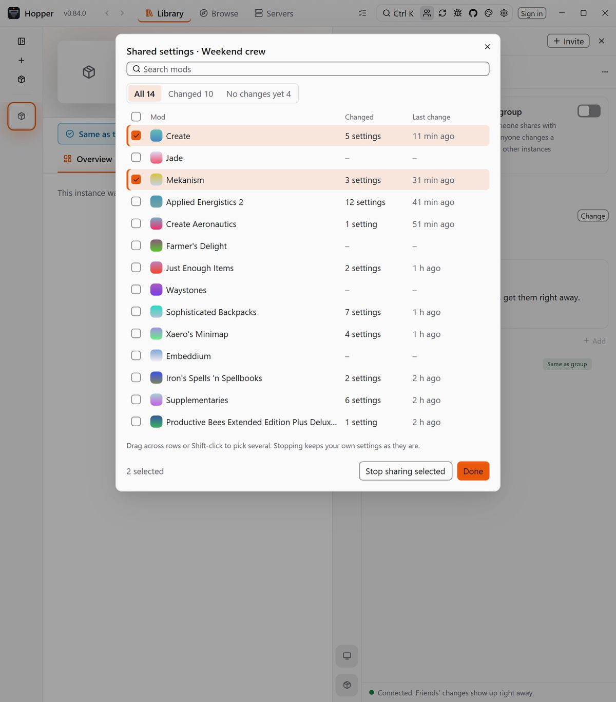

## Screenshots (every state)
Scratch data only: local mailbox on rig loopback, fake group "Weekend crew", fake mods. No "before" for 14 mods (the old build was not to hand; the old layout is the 3-mod rows, unchanged).
| State | Before | After |
|---|---|---|
| 3 shared mods (rows, unchanged) | no before (code path untouched) | ../img/0.85.0-3mods-rows-after.jpg |
| 14 mods, card, People visible (dark) | no before | ../img/0.85.0-card-dark-after.jpg |
| 14 mods, card (light) | no before | ../img/0.85.0-card-light-after.jpg |
| 14 mods, card, narrowest window (light) | no before | ../img/0.85.0-card-narrowest-light-after.jpg |
| Manage, All, nothing ticked (dark) | n/a | ../img/0.85.0-manage-all-dark-after.jpg |
| Manage, drag across rows -> 7 selected | n/a | ../img/0.85.0-manage-drag-7-dark-after.jpg |
| Manage, Shift-click range -> 9 selected | n/a | ../img/0.85.0-manage-shift-9-dark-after.jpg |
| Manage, Changed filter (hidden ticks dropped, 9 -> 7) | n/a | ../img/0.85.0-manage-changed-filter-dark-after.jpg |
| Manage, search with no match (empty state) | n/a | ../img/0.85.0-manage-no-match-dark-after.jpg |
| Manage, clicking a mod opens its page beside, dialog stays | n/a | ../img/0.85.0-manage-mod-peek-dark-after.jpg |
| Manage, after Stop sharing selected (14 -> 12, dialog shrinks) | n/a | ../img/0.85.0-manage-after-stop-12-dark-after.jpg |
| Stop all confirm | n/a | ../img/0.85.0-stop-all-confirm-dark-after.jpg |
| Manage, 2 ticked (light) | n/a | ../img/0.85.0-manage-selected-light-after.jpg |
| Manage, narrowest window (light) | n/a | ../img/0.85.0-manage-narrowest-light-after.jpg |

## Measurements (rig, 1.75 px per point, `measure_shot.py` and pixel scans)
| Claim | State measured | Numbers | Result |
|---|---|---|---|
| People visible without scrolling | dark, 14 mods, side panel open, window 900 pt tall | last People row (Alex) ends at y 1076 of 1575 px: 499 px (285 pt) spare | ok |
| Icons do not run into "+8 more" | dark and light, 14 mods | icons end x 2019, label starts x 2041: gap 22 px (12.6 pt), same both themes | ok |
| Card icons overlap each other | 14 mods | ring 28 pt, stride 20 pt: rings overlap 8 pt | ok |
| Footer: count and Done sit the same distance from the dialog edges | Manage, dark and light, normal width | gaps L 20 / R 20 px; title left edge 21 px | ok (<= 1 px) |
| Footer symmetric at narrowest window | Manage, light, window at its minimum (960 pt wide) | gaps L 15 / R 15 px | ok |
| Table rows same height | Manage, light, narrowest | row pitch 60 px (34 pt) for 5 rows in a row | ok |
| Long name does not break the row | "Productive Bees Extended Edition Plus Deluxe Pack" | cut with "..." before the Changed column in all shots | ok (seen, not pixel-measured) |
| "+8 more" readable | dark / light | contrast 6.91 / 5.59 | ok (>= 4.5) |
| "Stop all" (dimmed) readable | dark / light | contrast 5.26 / 6.05 | ok |
| Helper text, "N selected", Last change readable | dark / light | 6.70 / 6.05, 6.70, 6.70 / 5.22 | ok |
| Dialog fits the narrowest window | light, window at its minimum (960 pt wide) | dialog 600 pt wide at x 316..1364 of 1680 px, nothing clipped, no overlap with the card | ok |

Not measured: 1080p window height (the rig window can't be set taller than the 900 pt test window through the app's tools; 900 pt is shorter than a 1080p window's content, so it is the harder case). 20-mod pack (seeded, not screenshotted). Hover colours and keyboard focus ring on the new buttons (they are gpui-kit buttons/checkboxes).

## Files
- `src/gpui/shared_settings.rs` (new): counting/filter/selection helpers + the Manage dialog
- `src/gpui/friends.rs`: summary card, Stop all confirm, rows kept for 4 or fewer
- `src/gpui/main.rs`: `mod shared_settings;`

## How tested
- Tests: 12 new in `shared_settings::tests` (summary_starts_at_five, changed_line_counts_and_pluralises, total_changed_sums_every_mod, more_label_only_past_the_icons, settings_label_says_dash_one_or_many, filters_count_and_split_the_mods, search_needs_every_word_in_the_name, filter_index_round_trips, click_flips_one_and_shift_ticks_a_range, shift_without_a_start_just_ticks_the_row, select_all_toggles_and_filtering_drops_hidden_ticks, last_change_is_the_newest_setting). `cargo test --bin hopper`: 140 passed. `cargo-test-changed.ps1`: hopper ok; **hopperd fails** `ui::tests::built_page_has_no_inline_script_or_style` ("style attribute in index.html"): not my change (I touched nothing in hopperd), looks like a stale/odd `ui/dist` in this worktree.
- On screen: rig slot 2, test build, scratch `HOPPER_DATA_DIR`, `HOPPER_LOOPBACK=1`, `HOPPER_TEST_WINDOW=1`, MCP on 47833. Clicked Manage..., ticked boxes, dragged, Shift-clicked, switched filters, searched, clicked a mod name, Stop sharing selected, Stop all (confirmed on scratch). Dark and light theme, normal and narrowest window.
- NOT checked: Ctrl-click range (code path shares the Shift/modifier helper, unit-tested for Shift only); real friends service sync.kyuubi.dev (never contacted, the app pointed at a local mailbox; I did not capture connections, only the settings); keyboard-only use of the dialog; Hopper Server.
- Test data: fake pack "Test Pack" with 3 / 14 / 20 fake mods, fake users "Me" / "Alex", local mailbox on rig 127.0.0.1:38791. All removed afterwards.

## Notes for the maintainer
- Clicking a mod name in Manage looked up the fake project id on CurseForge (the peek showed an unrelated real mod). It is only a read, but it is the one outside request the test made.
- Typing in the search box or changing the filter drops ticks on rows that are now hidden, so "Stop sharing selected" only ever acts on rows you can see.
- Found on the side, not fixed: the preview fixture `--dialog group-sync --state` sets the mailbox to none, so Shared settings never shows in it. `groupsync::reconcile` also prunes seeded copies that no `shared_with` backs, which cost me a re-seed.
- The section only shows when `Store::settings_sharing()` is true, as before; I did not change that rule.
