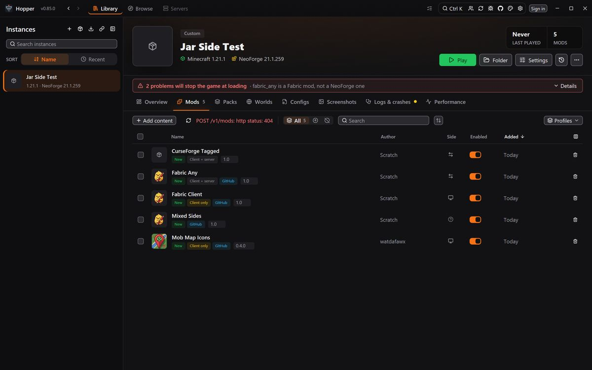
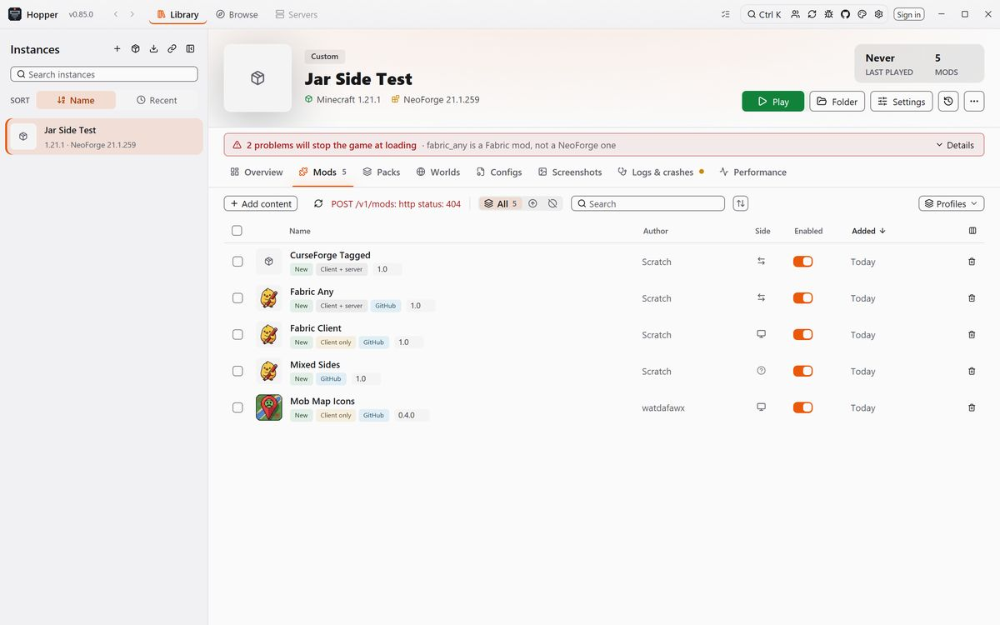
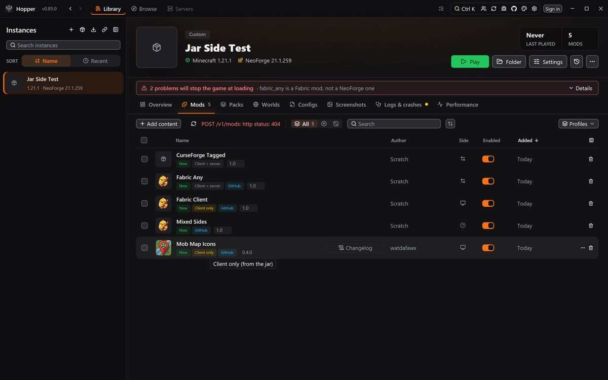
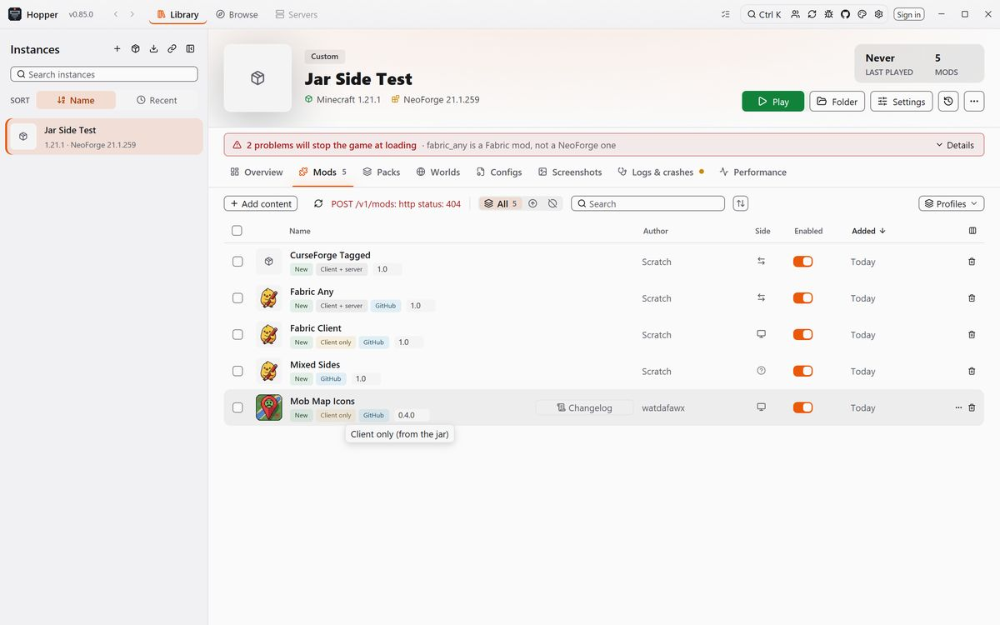
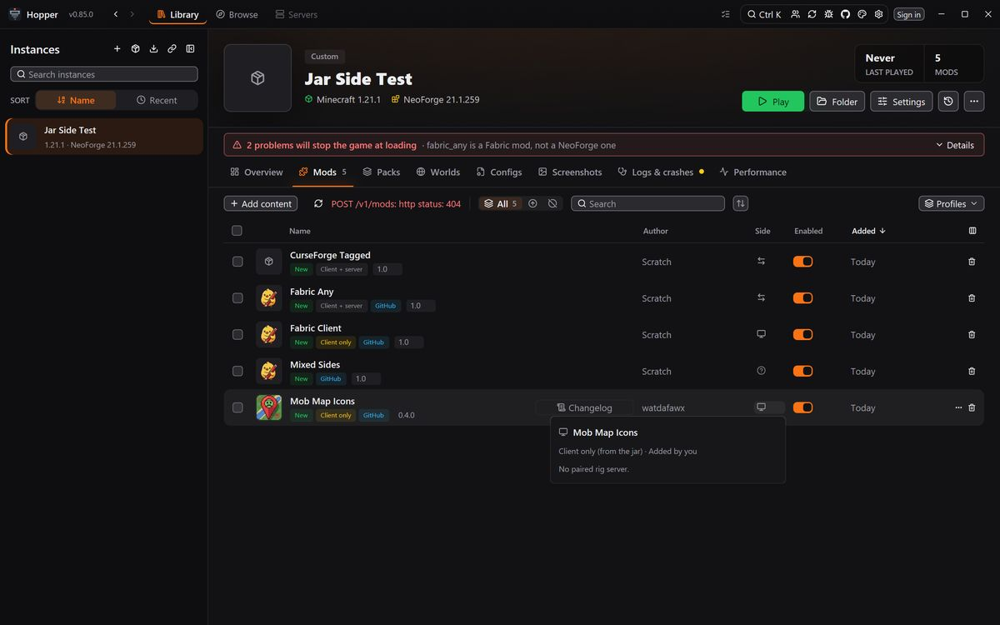

# Mods that only say "client" in their own jar now show it (no more "?")

**Branch:** t3/read-mod-side-from-jar   **Commit:** see git log on the branch   **Size:** M
**Apps:** both. Core logic is shared (hopper-core); desktop gets the tooltip/word change, Hopper Server's web UI gets the same "(from the jar)" text. Hopper Server web UI not checked on screen.

## From -> to
- Before: a mod on GitHub only (Mob Map Icons) matched neither CurseForge nor Modrinth, so its Side showed "?" and it had no chip; server sync didn't know it was client-only.
- After: Hopper reads the side from the jar as a third fallback (CurseForge tag > Modrinth > jar). Mob Map Icons shows the "Client only" chip, tooltip and hover card say "Client only (from the jar)", and server sync keeps it off the server (overridable with "Sync anyway").

## Rules (jar)
- NeoForge/Forge: client-only when every dependency block of the mod's own id that targets `minecraft`, `neoforge` or `forge` has `side = "CLIENT"`. Mixed, BOTH, SERVER, no side, no deps, other mods' blocks only => unknown (never guessed as "both").
- Fabric/Quilt-style `fabric.mod.json`: `environment` client => client, server => server, `*` or missing => unknown. A jar with a mods.toml is read by it, not by fabric.mod.json.

## On the site
    

## Screenshots (rig, scratch instance, Hopper 0.85.0 debug build + change)
| State | Before | After |
|---|---|---|
| Mods tab, dark | no before (old build not to hand) | after-mods-dark.png |
| Mods tab, light | no before | after-mods-light.png |
| Chip tooltip, dark / light | no before | after-chip-tooltip-dark.png / after-chip-tooltip-light.png |
| Side column hover card (dark) | no before | after-side-card-dark.png |

Rows in the scratch instance: Mob Map Icons (real v0.4.0 jar, GitHub-tracked) -> Client only (from the jar). Fabric Client (fabric.mod.json client) -> Client only. Mixed Sides (neoforge CLIENT + minecraft BOTH) -> no chip, "?" icon. CurseForge Tagged (CF env "both", jar says client) -> Client + server (CF wins). Fabric Any (`*`) -> Client + server: this is pre-existing, `sources/looks.rs` already copies the scan's jar side (`*` => both) into `env` for GitHub-tracked mods, see notes.

## Measurements
| Claim | State measured | Numbers | Result |
|---|---|---|---|
| Tooltip text readable | dark, "Client only (from the jar)" | fg (237,237,239) on bg (23,23,26): 15.3:1 | ok (>= 4.5) |
| Tooltip text readable | light | fg (24,24,27) on bg (247,247,248): 16.5:1 | ok |
| Tooltip not clipped | both themes | text x 884-1129 inside a 2520 px window, tooltip box fully visible | ok |
NOT measured: padding of the tooltip box (no pixel claim made), the narrowest window, the longest-text case. The chip itself is unchanged (same widget as the Modrinth case).

## Files
- `crates/hopper-core/src/deps.rs`: jar side parser (`jar_side`), reuses its Toml structs + tests
- `crates/hopper-core/src/modsides.rs`: `From::Jar`, `resolve_with`, jar cache + lookup, "(from the jar)"
- `crates/hopper-core/src/serverpack.rs`: server sync treats jar-says-client like Modrinth-says-client
- `src/gpui/widgets.rs`, `addons.rs`, `rigsync.rs`: chip tooltip takes the source (`env_from`)
- `src/gpui/browse.rs`, `side_card.rs`: comments only
- `crates/hopperd/src/mods_api.rs`, `ui/src/Mods.svelte`, `ModPeek.svelte`: `side_from: "jar"` + text

## How tested
- Tests (all pass): `cargo test -p hopper-core --lib` = 1661 passed, 0 failed, 62 ignored. New: modsides (`jar_fills_only_what_both_sites_leave_open`, `jar_answer_fills_gaps_after_modrinth_and_is_read_once`, `a_jar_is_opened_once_until_it_changes`, updated `words_say_where_it_came_from`, `look_up_asks_by_jar_then_by_slug_and_remembers_misses`), deps (`mods_toml_side_is_client_only_when_every_loader_dependency_says_so`, `mods_toml_side_ignores_other_mods_dependency_blocks`, `fabric_environment_decides_the_side`, `jar_side_reads_the_jars_own_files`), serverpack (`a_jar_that_says_client_only_stays_off_the_server`). `cargo check -p hopperd` ok.
- On screen: desktop on rig (slot 2 dark, slot 3 light), scratch HOPPER_DATA_DIR, loopback, test window; state showed only the throwaway instance. Opened Mods tab, hovered chip and Side cell.
- NOT checked: Hopper Server web UI on screen (text-only change, svelte not built), server sync dialog on screen (covered by unit test only), the "?" for a mod hovered, Browse mod page fact row.
- Test data: throwaway instance "Jar Side Test" in `E:\rig-scratch\jarside` on rig (deleted), real Mob Map Icons v0.4.0 jar downloaded to a temp folder (deleted). No real packs.

## Notes for the maintainer
- Pre-existing duplicate: `scan.rs`/`sources/looks.rs` read a jar's side (displayTest IGNORE_*, fabric `*` => "both") and store it in `Addon.env` for GitHub mods, which then shows as if CurseForge said it. Mob Map Icons slipped through only because it has no displayTest. Unifying that with `deps::jar_side` is a follow-up (not done: out of scope).
- Fabric Any (`environment: "*"`) shows "Client + server" because of that, not because of this change.
- A "POST /v1/mods: http status: 404" error shows in the scratch Mods toolbar on rig (no CurseForge key there); unrelated.
- The jar is read once per size+mtime (memory); Modrinth stays asked first, so a jar is only opened when Modrinth has nothing.
