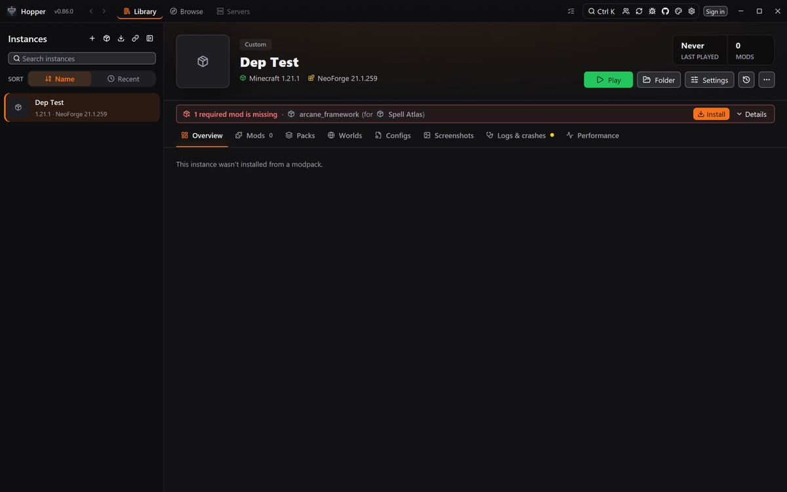
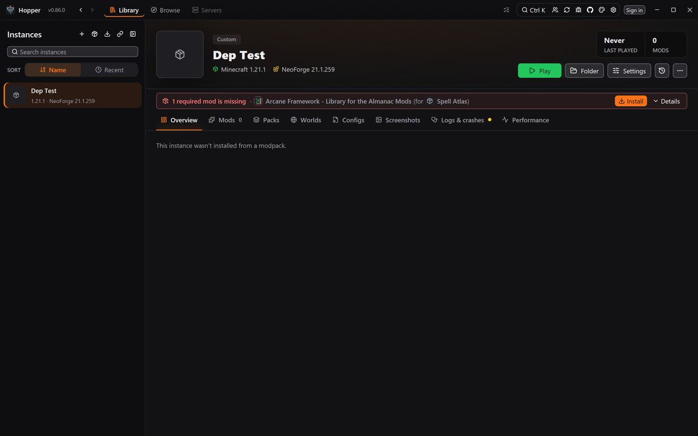
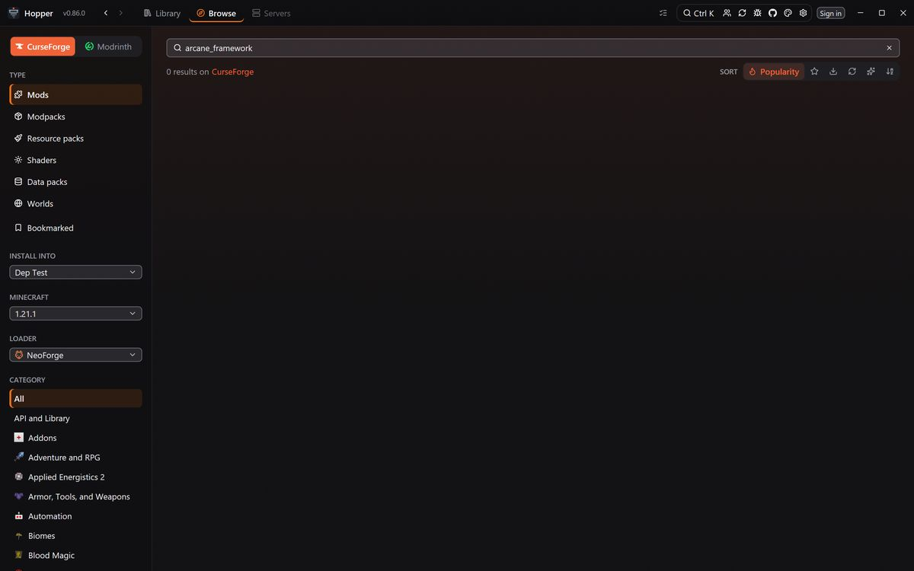
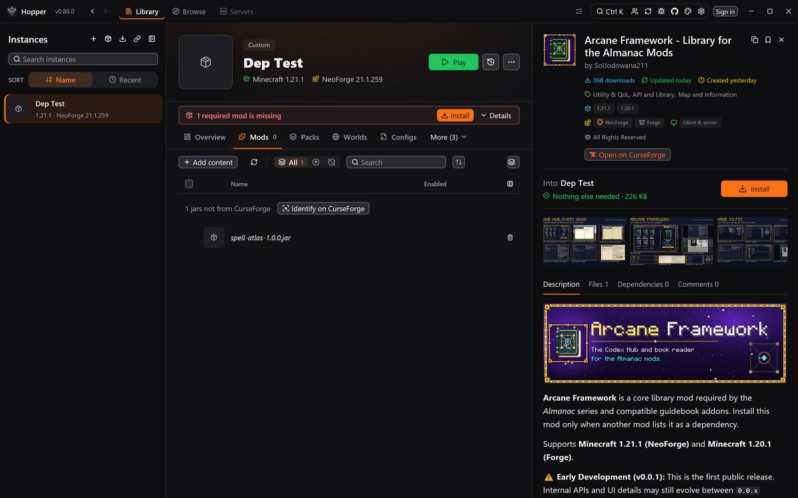

# Missing-mod banner finds the mod by name

**Branch:** t3/missing-dep-mod-id-lookup   **Commit:** see `git log` on branch (HEAD)   **Size:** S
**Apps:** both (shared lookup in hopper-core; web UI has no banner of its own, see notes)

## From -> to
- Before: "1 required mod is missing · arcane_framework (for Spell Atlas)"; clicking it opened Browse with `arcane_framework` and "0 results on CurseForge".
- After: the banner shows "Arcane Framework - Library for the Almanac Mods" with its icon at first paint; clicking opens that project's page beside the list ("Nothing else needed · 226 KB"). A mod that can't be found opens Browse searching its words (`zz not real mod`), not the raw id.

## Root cause
CurseForge search did return the project (1 hit), but `hit_is_mod_id` threw it away: its slug is `arcane-framework-library-for-the-almanac-mods` and its name `Arcane Framework - Library for the Almanac Mods`; neither squashes to `arcaneframework`. (Not search ranking, and the slug is not `arcane-framework`: `cf::by_slug("arcane-framework")` is None. Checked with the ignored network test `real_arcane_framework`.) The peek worked because it uses the project id from the CurseForge dependency list, not a search.

## Screenshots (rig, scratch instance "Dep Test", jar-only fixture: neoforge.mods.toml requiring `arcane_framework`)
| State | Before | After |
|---|---|---|
| Banner | before-banner.png | after-banner.png |
| Click on the name | before-click.png (Browse `arcane_framework`, 0 results) | after-click.png (project page) |
| Id that exists nowhere (`zz_not_real_mod`) | no before | after-offline-banner.png, after-offline-details.png, after-offline-click.png (Browse `zz not real mod`) |

## Measurements
None: no layout/pixel claim made (no visual change beyond text and icon in the existing banner). Not measured.

## Files
- `crates/hopper-core/src/install.rs`: name subtitle match, slug lookup, shared search text, tests
- `src/gpui/addons_extra.rs`: Browse fallback uses id words

## How tested
- Tests: `cargo-test-changed`: hopper-core 1667 pass, hopper 140 pass, crash_corpus pass. New: `names_lose_their_subtitle`, `search_text_is_the_id_words`, extended `hits_match_by_slug_name_or_versioned_slug` (arcane fixtures + lookalikes still rejected). hopperd: 426 pass, 1 fail `ui::tests::built_page_has_no_inline_script_or_style` (no `ui/dist` built in this worktree; hopperd untouched).
- Network (ignored) tests `real_arcane_framework`, `real_mod_id_lookup`, `glued_suffix_ids_resolve`: pass (geckolib, architectury, cyclopscore, codechickenlib, cloth_config, curios still resolve; notarealmod_xyz -> None).
- On screen: debug builds on rig (before = main checkout at 0563d83f, after = this branch), MCP, throwaway instance, loopback, test window.
- NOT checked: Install button actually downloading it (not clicked, no changes made to files); light theme; narrow window; the user's real LL8 pack.
- Test data: `E:\dev\scratch\missingdep` on rig, deleted; rig app stopped.

## Notes for the maintainer
- (c) background lookup already existed (`dep_projects`, filled when the notice paints); it only failed for the reason above, so no extra code.
- Other `AddonsEvent::Find` callers use fixed names ("iris"/"oculus", "paxi"), not mod ids: unchanged.
- Hopper Server: no missing-dependency banner in the web UI; its crash card Install uses `install::install_mod_id` -> `project_for_mod_id`, so it gets the fix. The crash card still prints the raw id ("Needs arcane_framework") as the crash report wrote it: left as is.
- Added cost on a miss: up to 2 `cf::by_slug` calls before the text search.

## On the site
    
