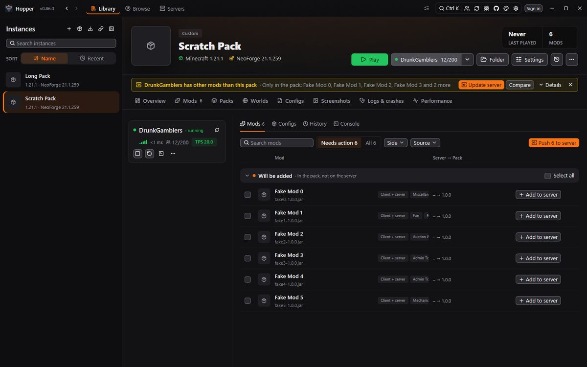
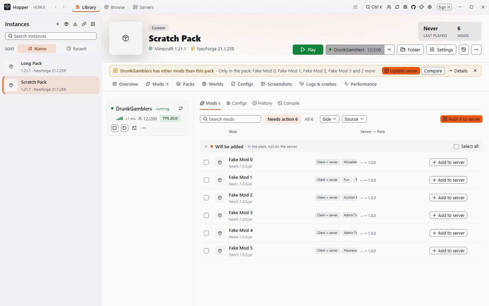
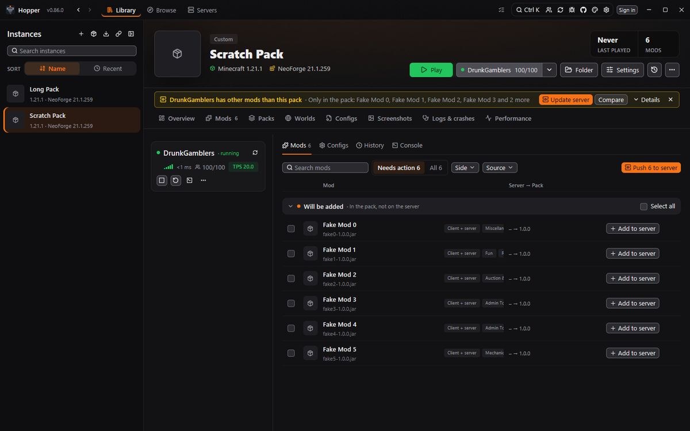
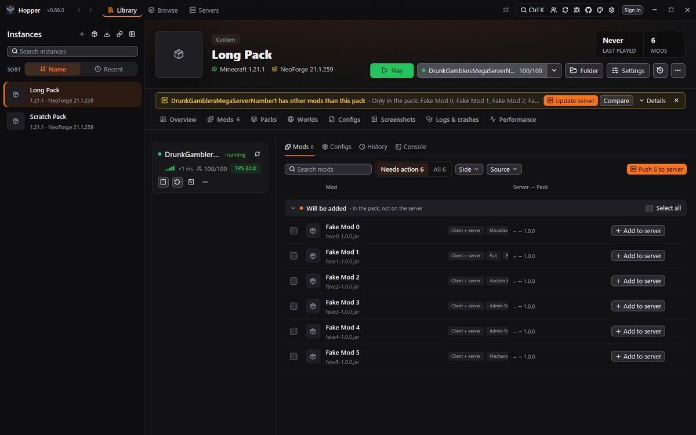
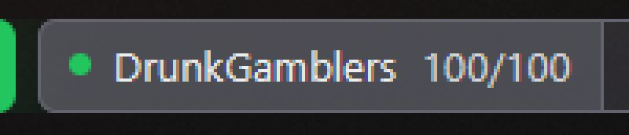
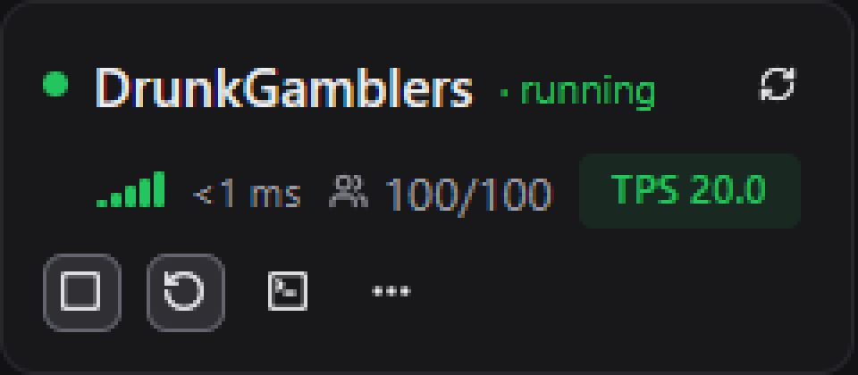

# Instance page: see how many players a paired server has

**Branch:** t3/synced-server-player-count   **Commit:** 3f62c183   **Size:** S-M
**Apps:** desktop only. Hopper Server's web UI already shows players (server list pill `N/M`, Overview "Players online" card and per-server pill, Players tab count, Players card `N / M`), so nothing to add there.

## From -> to
- Before: an instance paired with a server showed state, ping and TPS in the header button and the Server tab card, but the player count was only in the header button's tooltip.
- After: the Server tab card shows `<people icon> 12/200` between ping and TPS (tooltip "Players online"). The header button shows `12/200` after the server name. Both only while the server runs and its panel gives a limit (hidden while starting, stopping, down, or max 0).

## Screenshots
| State | Before | After |
|---|---|---|
| Dark, 1440, 100/100 | before-dark-1440.png (no count) | after-dark-1440-100of100.png |
| Dark, 1440, 12/200 | - | after-dark-1440-12of200.png |
| Dark, 1440, 0/16 | - | after-dark-1440-0of16.png |
| Light, 1440, 100/100 | no before | after-light-1440-100of100.png |
| Light, 1440, 12/200 and 0/16 | no before | after-light-1440-12of200.png, after-light-1440-0of16.png |
| 30-char server name, 1440 | no before | after-long-dark-1440.png, after-long-light-1440.png |
| 1300 wide (count drops, header folds as before) | no before | after-dark-1300-100of100.png, after-light-1300-100of100.png, after-long-dark-1300.png, after-long-light-1300.png |
| 960 wide (header is dot only, as before) | before-dark-960.png | after-dark-960-100of100.png, after-light-960-100of100.png, after-long-dark-960.png, after-long-light-960.png |
| Running, no ping answer yet (count still shown) | no before | after-dark-1440-restarting-noping.png |
| Zoomed crops | - | zoom-card-dark.png, zoom-card-light.png, zoom-header-dark.png, zoom-header-light.png |

## Measurements (all from the running test build's screenshots, PIL pixel scans)
| Claim | State measured | Numbers | Result |
|---|---|---|---|
| Header button content padded evenly | dark + light, 1440, 0/16, 12/200, 100/100 | left pad 9 px, right pad 9-10 px | ok (<= 1 px) |
| Count readable on the selected header button | dark / light, 1440 | text (213,213,216) on (76,76,83) = 5.81:1; (46,46,48) on (170,170,171) = 5.84:1 | ok (>= 4.5) |
| Name gives way before the count | 30-char name, 1440 | name ends x=1064, count x=1075..1121, pads 9/9 (dark), 9/10 (light); name shows "DrunkGamblersMegaServerN..." with ellipsis; nothing wraps or overlaps | ok |
| Count didn't make the header fold sooner | fold-level scan over widths with and without the build | Folder / Settings fold at the same widths or later (long name at 1300: folds later than before); count only drawn at fold level 0 | ok |
| Card count on the same baseline as the ping text | dark + light, 100/100 | ping digits y 345..352, count digits y 345..352, icon y 344..352 | ok (0 px) |
| Card count as quiet/readable as the ping text | dark / light | both `muted_foreground`: 6.35:1 dark, 5.89:1 light (count anti-aliasing low point 5.89 / 5.23) | ok (>= 4.5) |
| Card row fits at the worst number | 100/100 + TPS chip, card inner right border x=553 | ping text ends 398, icon 407-417 (gap 8), count 423-469 (gap 5), TPS chip 486-528 (gap 16), 25 px spare before the border; one line | ok |
| Card height unchanged | before vs after, all widths | card top/bottom rows 299..395 in every shot | ok |

Not measured: a 5-digit count (e.g. 1000/1000), RTL, other zoom levels, other themes than the default dark and light.

## Files
- `crates/hopper-core/src/panel.rs`: `PanelStats::players_shown()` + test asserts.
- `src/gpui/widgets.rs`: `players_figure` / `players_count` (icon, text, tooltip).
- `src/gpui/rigsync.rs`: Server tab card line shows the count.
- `src/gpui/library.rs`: header button count; tooltip uses the same rule.

## How tested
- Tests: `cargo-test-changed.ps1`, 8 test binaries, all passed (hopper-core `panel::tests::reads_stats` covers running / starting / not running / max 0).
- On screen: real scratch Hopper Server (own data + home) with a fake Minecraft process that prints join/leave and spark TPS lines and answers the list ping, paired to a throwaway instance; desktop test exe with `HOPPER_TEST_WINDOW=1`, `HOPPER_LOOPBACK=1`, scratch `HOPPER_DATA_DIR`, MCP on 47832. Shots driven through MCP `navigate` + `screenshot`.
- NOT checked: a fully stopped server (the scratch hopperd restarted the fake process at once, so the "hidden when stopped" state is covered only by the unit test and the same condition the tooltip already used); a "starting" server; an instance with 3+ paired servers; the sync dialog and group view (they show no live ping/TPS to begin with).
- Test data: throwaway instances Scratch Pack and Long Pack, scratch hopperd, no real instance or server touched. No hack left in the code.

## Notes for the maintainer
- Other places checked: Servers page cards already show `N/M` pill + TPS chip; the server hero already says "N/M Players". The multi-server tab strip (`server_strip`) shows dot + name + diff chip only, no ping/TPS, so I left it alone.
- Header: the count is the first thing to go when the header is tight (fold level 0 only), so it never folds Folder/Settings into the menu sooner. At 1300 and narrower the tooltip still has it.
- Count text on the card is `text_sm` + muted, same token as the ping text.

## On the site
     
