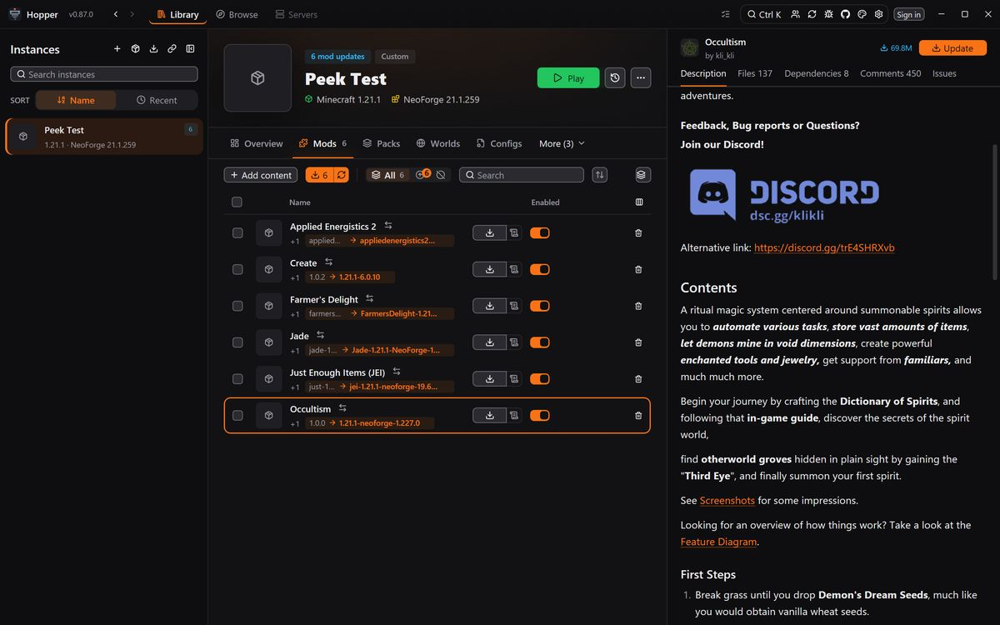
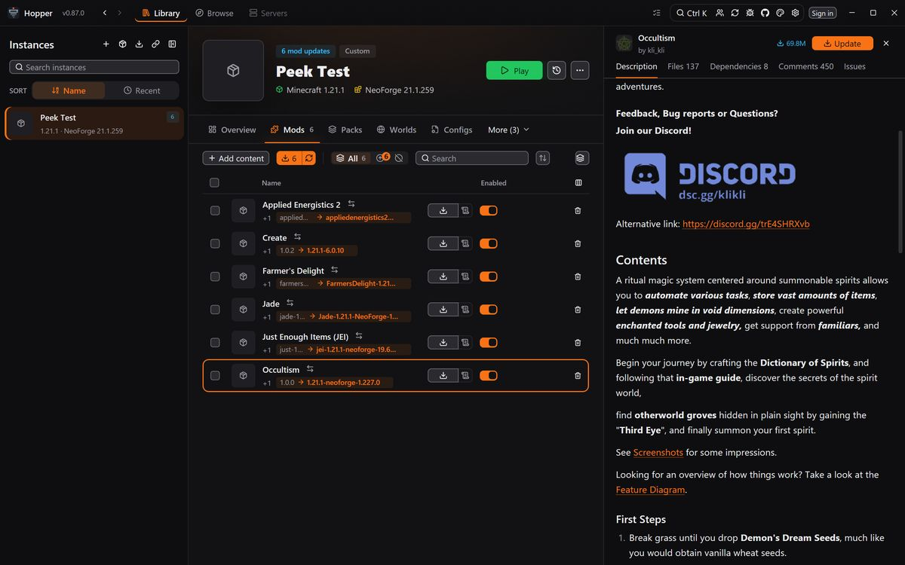
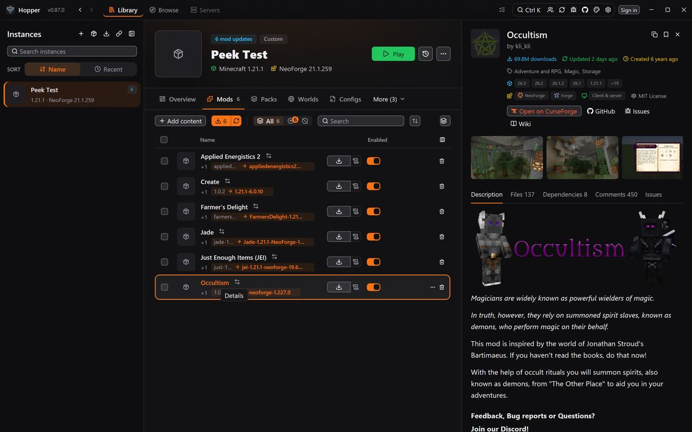
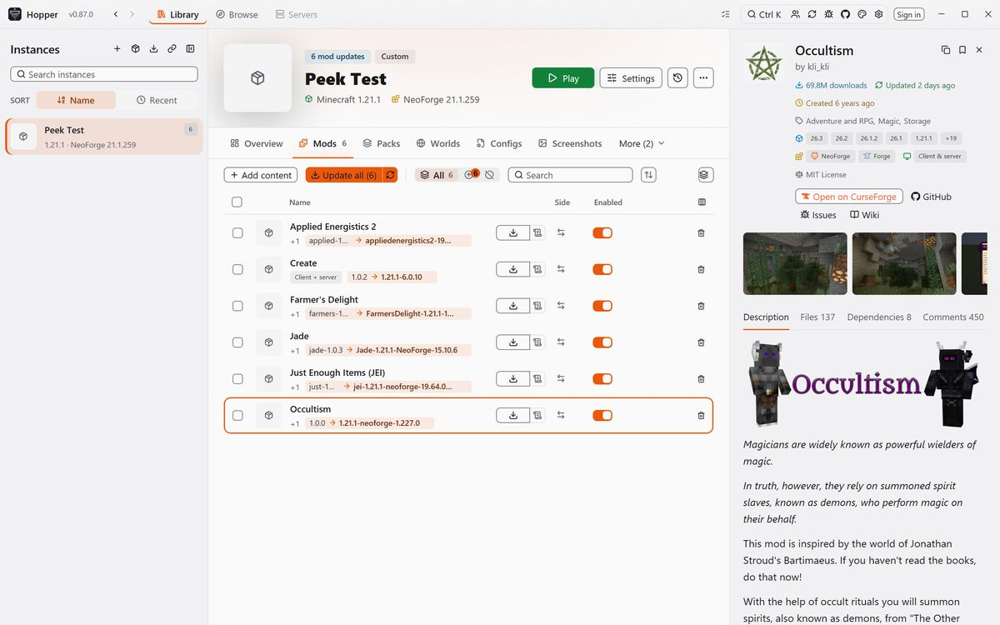
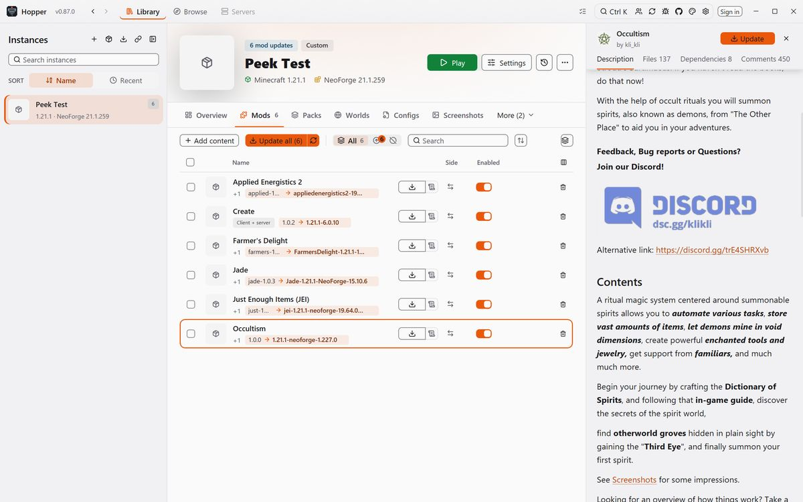
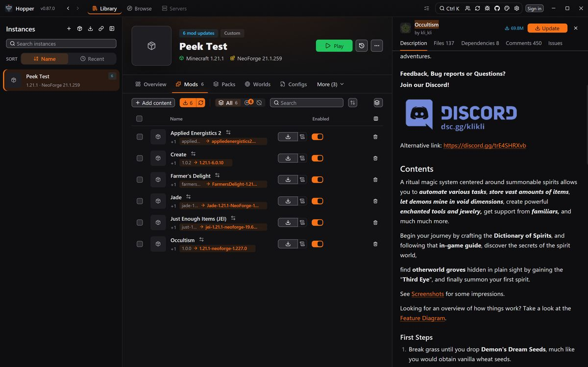
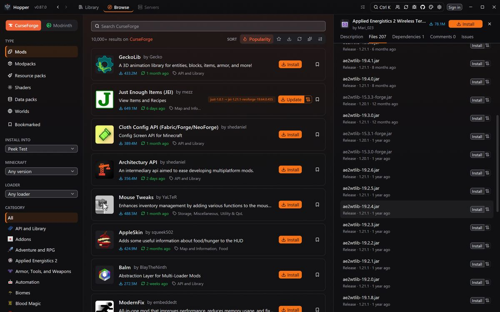
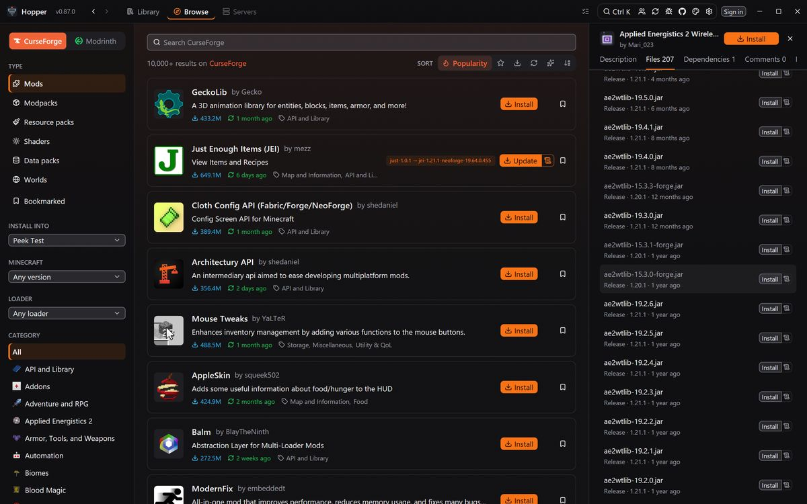

# Mod peek: copy the name, close from the slim bar

**Branch:** t3/peek-copy-name-compact-close   **Commit:** 87dbb43e   **Size:** S
**Apps:** desktop (main change) + Hopper Server (compact bar of the project page when shown as a peek; code only, not seen on screen)

## From -> to
- Before: the mod name in the peek could not be selected. The slim bar that replaces the big header on scroll had no close X, so you had to scroll back up to close the panel.
- After: drag over the name (big header, slim bar, author page title) to select it; Ctrl+C copies it. The slim bar has the same close X as the big header, right of Update/Install.

## Screenshots (every state)
Folder: this one. Rig test build, Hopper Dark and Hopper Light, 1.75x scale.
| State | Before | After |
|---|---|---|
| Big header, dark (Occultism) | before-full-dark.png | after-full-dark.png |
| Slim bar, dark (Occultism) | before-compact-dark.png (no X) | after-compact-dark.png |
| Name selected, big header, dark | - | after-full-select-dark.png |
| Name selected, slim bar, dark | - | after-compact-select-dark.png |
| 40-char name, big header, dark | no before | after-long-full-dark.png |
| 40-char name, slim bar, dark | no before | after-long-compact-dark.png |
| Narrowest panel, big header, dark | no before | after-narrow-full-dark.png |
| Narrowest panel, slim bar, dark | no before | after-narrow-compact-dark.png |
| Big / slim, light (Occultism) | no before | after-full-light.png, after-compact-light.png |
| Name selected, slim bar, light | - | after-compact-select-light.png |
| 40-char name, light | no before | after-long-full-light.png, after-long-compact-light.png |

"Before" was taken from a build of the unchanged commit d7480b49 (dark only). No light "before".

## Measurements (screenshot pixels; 1 pt = 1.75 px)
| Claim | State measured | Numbers | Result |
|---|---|---|---|
| Slim-bar X is the same size and place as the big header's X | dark, narrowest panel (hover fill of the ghost button, diff of hover vs no hover shot) | hover box 39x39 px both; right gap to window edge 33 px both; x range 2448..2486 both | ok |
| Same glyph | dark and light, default and narrowest panel | X glyph 13x13 px, right edge 46 px from window edge, in all 4 dark shots and both light shots | ok |
| Vertical place | dark | slim bar X centred on the bar's row (hover box y 101..139); big header X at the top row (y 106..144): by design, same as Update/icons rows | as intended |
| Name truncates first, nothing squeezed | dark, 40-char name "Applied Energistics 2 Wireless Terminals", narrowest panel (682 px wide) | name ends 2242 (ellipsis), gap 19 px, Install button 2261..2431 (170 px, not squeezed), gap 17 px, X box 2448..2486 | ok |
| Downloads count goes first | same | dropped at narrow, kept at wider panel | as before |
| Selection works, no other click fires | drag over name in slim bar and big header, dark and light | name highlighted (selection colour), panel stayed open, no link opened, panel width unchanged | ok |
| Copy gives the name | slim bar name selected, Ctrl+C via MCP, clipboard read on rig | clipboard = `Occultism` | ok |
| X in slim bar closes the panel | click on the X, dark/light | peek gone, page back to full width | ok |

Not measured: light-theme hover fill of the X (too faint for the diff threshold; glyph position measured instead); contrast (no colour changed).

## Files
- `src/gpui/browse.rs`: shared `close_button`; selectable names; X in `sticky_bar`
- `src/gpui/widgets.rs`: `selectable_text` helper (gpui-base `SelectableText`)
- `crates/hopperd/ui/src/BrowsePack.svelte`: compact bar gets the back/close button in a peek

## Audit: other panels
- All mod / pack / shader / data pack / server / backup peeks are `BrowseView::peek` (addons.rs, backups_view.rs, pack_update.rs, library): one code path, so fixed everywhere. The author page header (`close-author`) now uses the same `close_button`; its title is selectable.
- Friends panel (`friends.rs`, `widgets::dock`): one header with its X, no slim bar, fixed title "Friends": nothing to change.
- Config side panel (`config_view.rs` `panel_head`): one header with its X, no slim bar. Title is `<mod> · config`; left as is (copying "<mod> · config" is not useful).
- Other `widgets::side_panel` users (accounts, configs list, sync, servers list, settings nav) are list/nav columns, no header pair.
- Hopper Server `ModPeek.svelte` and `AuthorPeek.svelte`: one header with X, no slim bar, names are plain text with no `user-select: none` above them (selectable already): no change. `BrowsePack.svelte` (project page): it has a slim bar; as a page it has the Back button in the top row, as a peek (`onBack`) the top "Close/Back to X" button scrolled out of reach. Added the same button (X when it closes the peek, arrow when it goes back one step) to the slim bar. Name is plain text, already selectable.

## How tested
- Tests: `cargo-test-changed.ps1`: 2 test binaries, all passed (hopperd 427 passed, 4 ignored). No logic to unit-test; UI is checked on screen.
- Web UI: `pnpm install --frozen-lockfile` + `pnpm build` (effect check + vite): ok.
- On screen: desktop `--profile fast` build on rig (slot 2/3), `HOPPER_TEST_WINDOW=1`, `HOPPER_LOOPBACK=1`, scratch data on rig, MCP on 47832/47833 through an ssh tunnel. Throwaway instance "Peek Test" with 6 fake jars mapped to real CurseForge ids (read only). Apps stopped, scratch deleted, tunnels killed.
- NOT checked: Hopper Server web UI on screen (no scratch hopperd run; the compact bar change is only built, not seen); keyboard focus ring of the new X (it is the same `Button` as the big header's, which has it; not looked at); other themes than Hopper Dark/Light; Modrinth/GitHub-sourced peeks; author-page title selection (same helper, not dragged); a very narrow window (only the narrowest panel width, 26 rem).

## Notes for the maintainer
- Selection uses gpui-base `SelectableText` (window-level selection layer already in Root). It doesn't work inside clickable parents (press starts a pick): the author link ("by kli_kli") stays a link and is not selectable.
- A drag starting just outside the panel (left of it) closes the peek: existing "click elsewhere closes" behaviour.
- Found on the side: in the narrowest peek the slim bar's tab row clips the last tab ("Issues" shows as a sliver). Same before this change; not touched.
- `selectable_text` can be used for other names later (config panel title).

## On the site
       
